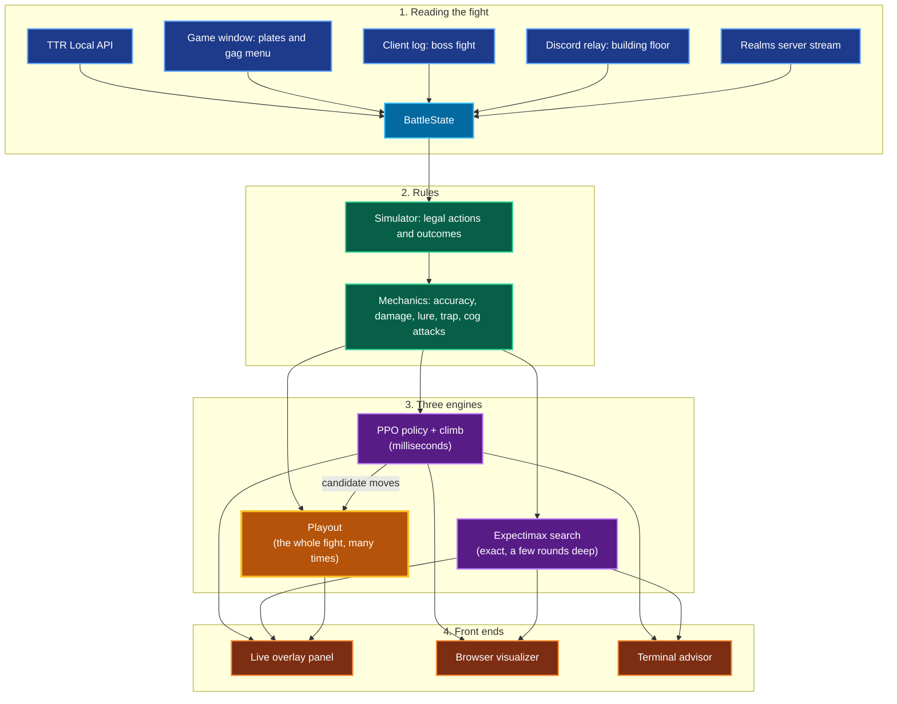
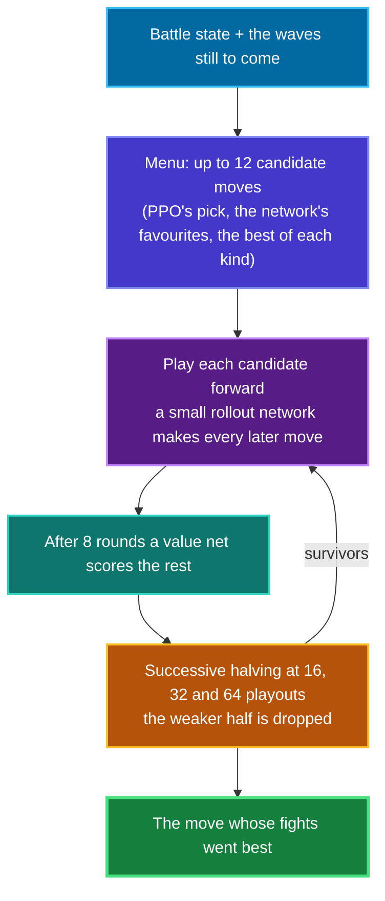
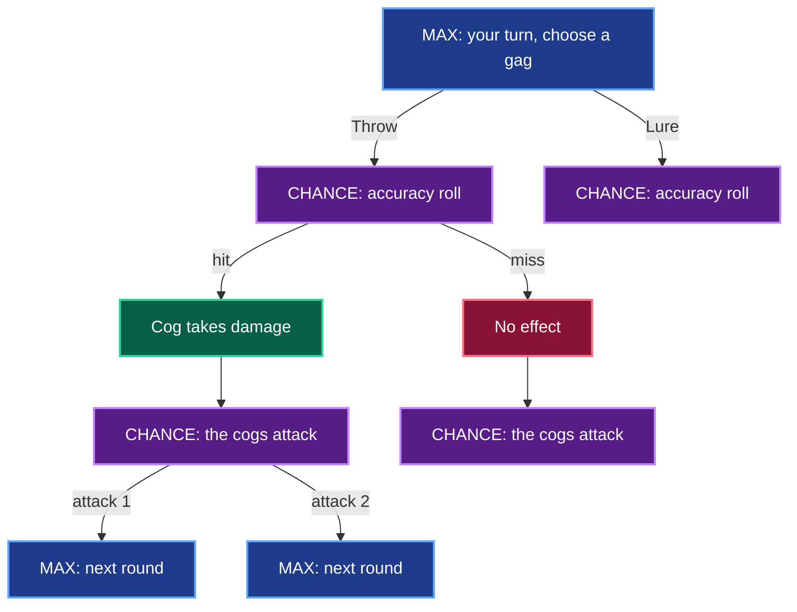
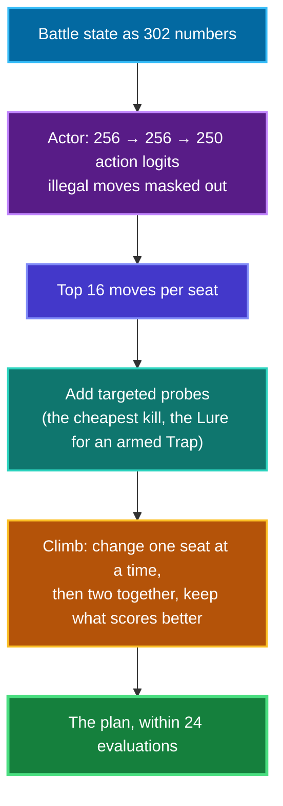

# TTRSolver

A battle advisor for [Toontown Rewritten](https://www.toontownrewritten.com/). It watches your cog fight and tells you which gag to throw at which cog, every round, from a small panel beside the game.

Under the hood it is a rules-exact simulator of TTR combat and three engines that argue over your next move: an expectimax tree search, a PPO policy network, and a Monte Carlo playout engine that plays the whole fight forward hundreds of times. You still make every move yourself.

It also supports Toontown Realms through its own panel.

> Not affiliated with or endorsed by Toontown Rewritten, Toontown Realms or The Walt Disney Company.

---

## Table of Contents

- [What It Reads](#what-it-reads)
- [System Architecture](#system-architecture)
- [Quick Start](#quick-start)
- [The Three Engines](#the-three-engines)
  - [Playout: play the fight to the end](#playout-play-the-fight-to-the-end)
  - [Search: exact expectimax](#search-exact-expectimax)
  - [PPO: a policy network and a climb](#ppo-a-policy-network-and-a-climb)
- [Combat Mechanics](#combat-mechanics)
- [Results](#results)
- [Reading a Live Game](#reading-a-live-game)
- [Status and Limits](#status-and-limits)
- [Repository Layout](#repository-layout)
- [Documentation](#documentation)
- [Licence](#licence)

---

## What It Reads

| Source | What it gives |
|---|---|
| **TTR Local API** (official, opt-in, asks your consent in game) | Laff, gag training, organic tracks, location, pink slips |
| **The game window** (a screenshot, nothing more) | Each cog's level, department and health; your gag counts |
| **The client's log file** | Which boss fight you walked into |
| **Discord Rich Presence** (optional) | Which floor of a cog building you are on |
| **Toontown Realms' local server stream** | The whole battle, exactly |

**It never reads game memory, never hooks or injects into the client, and never sends a key press or a click to the game.** It advises. You play.

---

## System Architecture



---

## Quick Start

The solver and its tests need nothing but Python 3.10+.

```bash
python run.py                        # menu of every front end, and what each needs
python run.py 1                      # the TTR overlay
python run.py 5                      # no game needed: a narrated solo fight
python -m unittest discover tests    # about 1,900 tests
```

Optional extras, only for the parts that use them:

| Install | Unlocks |
|---|---|
| `pip install -r requirements-vision.txt` | Screen reading, and the PPO and Playout engines (numpy) |
| `pip install pywebview` | The overlay window |
| `pip install -r requirements-realms.txt` | The Realms panel |
| `pip install -r requirements-training.txt` | Retraining the networks (torch). The trained weights ship with the repo |

For the TTR overlay, turn on two settings in TTR's `settings.json`: **`want-local-api`** and **`show-cog-levels`**. The game asks for your consent the first time the panel connects.

Full setup and a tour of the panel: **[docs/user-guide.md](docs/user-guide.md)**.

---

## The Three Engines

The panel shows three rows, one move from each engine. **Playout leads**; one click shows either of the others.

| | Playout | Search | PPO |
|---|---|---|---|
| **Method** | Monte Carlo playouts to the end of the fight | Expectimax over exact outcome probabilities | Policy network + coordinate ascent |
| **Sees** | Every wave of the fight | The cogs on the field | One round |
| **Speed** | Seconds, improving as it runs | Up to the think time | Milliseconds |
| **Best at** | Boss fights and long buildings | Small fights, solved exactly | An instant answer |
| **Needs** | numpy | Standard library | numpy |

### Playout: play the fight to the end

One round of lookahead cannot tell you that the Wedding Cake you are about to throw is the one you will need twelve cogs from now. So the Playout engine does not look one round ahead. It takes about ten candidate moves, plays each one out to the end of the fight, over and over, and keeps the move whose fights went best.



Each playout is scored in cogs:

$$\text{value} = \text{cogs defeated} + 0.5 \cdot \frac{\text{laff left}}{\text{max laff}} - \text{charges for gags spent, rounds taken and reach wasted}$$

What makes it work:

- **Common random numbers.** Every candidate faces the same dice, so the comparison is about the move and not the luck.
- **No peeking.** Cogs you have not seen are redrawn in every playout from what the fight is known to hold.
- **A fast rollout network** trained by expert iteration: the Playout engine labels the moves, the network learns them, and the engine gets stronger rollouts back.
- **Anytime.** The panel posts a move after the first playouts and keeps refining.

Details and every measurement: **[docs/playout.md](docs/playout.md)** and **[docs/rollout-network.md](docs/rollout-network.md)**.

### Search: exact expectimax

A solo battle is a finite game. Every gag thrown leaves the pouch, so the fight cannot loop, and the search can weigh every outcome by its true probability:

$$V(s) = \max_{a \in \mathcal{A}(s)} \sum_{o \in \Omega} P(o \mid s, a) \Big( r(s, a, o) + V(s') \Big)$$



- **Star pruning** cuts a chance node as soon as its bounds leave the search window.
- **Cog-phase collapsing** merges outcomes that differ only in damage taken, from 20–70 per action down to a handful.
- **Honest about cost.** On a full endgame pouch against two cogs, depth 1 takes 0.01 s and depth 2 takes 9.3 s, so the panel searches under a time budget.

It is exact, and it only sees the cogs on the field. In a boss fight that is its ceiling.

More: **[docs/search-depth.md](docs/search-depth.md)**, **[docs/scoring.md](docs/scoring.md)**.

### PPO: a policy network and a climb

The fast one. A policy network trained with PPO proposes moves, and a coordinate-ascent step called the climb improves the plan one seat at a time.



It answers in milliseconds, so it is the move you see while the other two think. It judges one round at a time, which is exactly the weakness the playouts exist to fix.

More: **[docs/ml-design.md](docs/ml-design.md)**, **[docs/ppo-math.md](docs/ppo-math.md)**.

---

## Combat Mechanics

The simulator follows the [TTR wiki](https://toontownrewritten.wiki), rule by rule.

$$\text{atkAcc} = \text{propAcc} + \text{trackExp} + \text{tgtDef} + \text{bonus} \qquad \text{clamped to } [5, 95]$$

| Term | Meaning |
|---|---|
| **propAcc** | The gag's base accuracy |
| **trackExp** | (highest level trained in the track − 1) × 10, halved for Toon-Up |
| **tgtDef** | The cog's defence, from −2 at level 1 to −55 at level 12 |
| **bonus** | Stun: +25 for each earlier attack that landed this round, up to +75. Sound and the level 7 Throw and Squirt also gain from cogs already lured |

Rules that override the roll:

- **Trap** always hits.
- **Throw and Squirt on a lured cog** always hit, and deal **+50%** knockback.
- **Drop on a lured cog** always misses.
- **Same track, same cog, same round:** the damage is summed and **+20%** is added.
- **One roll per track per target.** Four Throws at one cog all land or all miss together.

Every value in the code carries a tag saying how it is known: `[CONFIRMED]` from the wiki, `[OWNER]` from the maintainer's play, `[ASSUMED]`, or `[TODO]` for unknown, where the code raises instead of guessing. **[docs/data-confidence.md](docs/data-confidence.md)** lists what is solid and what is not.

More: **[docs/mechanics-notes.md](docs/mechanics-notes.md)**.

---

## Results

All of these are **simulated fights**, each engine shown only what the live panel would show it. A VP is the Sellbot boss: 20 + 20 cogs alone, 10 + 10 a side with company.

| Simulated fight | PPO | Search | Playout |
|---|---|---|---|
| Solo VP, no Unites | about 7% | — | 55–70% |
| Solo VP, the maintainer's pouch and five Unites | — | — | **94 of 100** |
| One toon on a VP side, five Unites | — | — | **55 of 60** |
| One toon on a VP side, a few SOS cards only | 6 of 60 | 6 of 60 | **33 of 60** |
| Two toons on a VP side, planned together | 40 of 40 | — | 40 of 40 |

How the Playout engine got there on the solo VP, one measured step at a time:

| Step | Wins |
|---|---|
| PPO alone | about 7% |
| Top three moves, played out | 21–27% |
| A wider menu of moves | about 40% |
| A fast rollout network, four times the playouts | 55–70% |

**Where the model is off.** The maintainer finds a one-toon VP side easy in the real game; the simulator wins it 33 times in 60 without Unites. That gap points at the simulator's cog damage, not at the engines. Cog attack frequencies also date from Toontown Online, because TTR does not publish its own.

The ideas that lost are written down too: **[docs/experiment-log.md](docs/experiment-log.md)**.

---

## Reading a Live Game

Each source answers for one thing and is never swapped for another: **laff and training from the API, gag counts from the gag menu, cogs from their plates.**

- **Digits** go through small classifiers trained on synthetic digits in the game's own font.
- **A free checksum.** The gag menu prints its own total, read separately, so a misread count is caught and often repaired.
- **Cog identity.** Department and level name a cog outright in only 8 of 48 cases, so the reader matches the head on the plate against a library you build as you play.
- **No guessing.** If the board cannot be read, the panel says why and gives no advice.

More: **[docs/live-reading.md](docs/live-reading.md)**, **[docs/realms.md](docs/realms.md)**.

---

## Status and Limits

- **Simulated results only.** No win rate has been measured in live play.
- **Windows first.** Finding the game window is Windows-only; other platforms are untested.
- **Boss fights.** The VP is detected automatically. The CFO, CJ and CEO are picked by hand, and their fight sizes are partly unknown.
- **Teammates on TTR are a number.** The game shows the client one toon, so the engines do not see what your teammates carry.
- **SOS cards and Unites on TTR** are entered by hand. Pink slips are read.
- **A new install knows no cog heads.** Expect to name cogs often at first and rarely later.

The full list of what is done, open and shelved: **[docs/roadmap.md](docs/roadmap.md)**.

---

## Repository Layout

```
run.py            launcher for every front end
solver/           the rules: state, mechanics, simulator, exact outcomes, parties
  data/           cog and gag tables, sourced from the TTR wiki
  search/         the engines: playout, fastplayer, hybrid (PPO + climb), expectimax
  rl/             the training environment and the shipped weights
  live/           live reading and the panels
overlay_ui/       the overlay's React front end (built files committed, no Node needed)
visualizer/       browser visualizer for positions and search trees
tools/            measurement and training scripts
tests/            the unittest suite
docs/             documentation
```

---

## Documentation

**[docs/README.md](docs/README.md)** is the index. The short version:

| If you want to | Read |
|---|---|
| Run it and read the panel | [user-guide.md](docs/user-guide.md) |
| Know what it reads from your game | [live-reading.md](docs/live-reading.md) |
| See how the pieces fit | [architecture-review.md](docs/architecture-review.md) |
| Understand the strong engine | [playout.md](docs/playout.md) |
| Check the game rules it uses | [mechanics-notes.md](docs/mechanics-notes.md) |
| See what was tried and what failed | [experiment-log.md](docs/experiment-log.md) |

---

## Licence

Code and documentation are released under the [MIT licence](LICENSE).

The licence does not cover the game's artwork. The cog and gag images under `overlay_ui/` and `visualizer/`, and the game screenshots under `docs/img/` and `tests/fixtures/`, come from Toontown Rewritten, Toontown Realms and the Toontown Rewritten wiki, and belong to their owners. They are included so the panels can show which cog or gag is meant.
