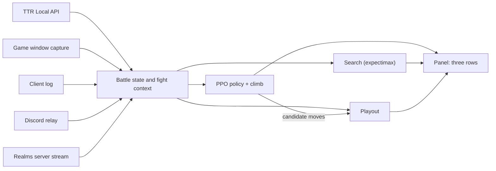

# TTRSolver

TTRSolver advises a player during cog battles in
[Toontown Rewritten](https://www.toontownrewritten.com/) (TTR), a fan-run
online game. Each round it reads the battle and says which gag (an attack
item, carried in limited numbers) to throw at which cog (an enemy). The
advice appears in a small always-on-top panel beside the game. The player
still makes every move.

It is written for two readers: a TTR player who wants a second opinion
mid-fight, and a developer who wants to look at the methods, which are a
battle simulator sourced from the TTR wiki, an exact expectimax search, a
policy network trained with PPO, and Monte Carlo playouts driven by a small
rollout network. Toontown Realms, a different Toontown server, is supported
through its own panel.

TTRSolver is not affiliated with or endorsed by Toontown Rewritten,
Toontown Realms or The Walt Disney Company.

## What it reads, and what it never does

| Source | What it gives |
|---|---|
| TTR's official Local API (opt-in; the game asks for consent in-game) | Laff (health), gag training, organic tracks, location, pink slips |
| A capture of the game's own window | Cog level, department and health from the plate above each cog; gag counts from the gag menu |
| The log file the TTR client writes | Which boss fight the toon has entered |
| What the game publishes to Discord Rich Presence | The floor count of a cog building, through an optional local relay |
| The installed game's asset archives | The interface font and department emblems, used to match what is on screen; cached locally and never shipped in this repository |
| Toontown Realms' local server stream | The whole battle as typed values, read-only |

It never reads the game's memory, never hooks, injects into or modifies the
client, never touches the game's encrypted code, and never sends input to
the game. It advises; the player plays.

## Quick start

The solver and its tests run on the Python standard library alone
(developed on Python 3.13). The live panels need a few optional packages.

```
python run.py            # menu of front ends; marks any whose packages are missing
python run.py --list     # print the menu and exit
python run.py 1          # start entry 1 (the TTR overlay) directly
```

| Install | Needed for |
|---|---|
| `pip install -r requirements-vision.txt` (numpy, pillow, mss) | Screen reading, and the PPO and Playout engines |
| `pip install pywebview` | The overlay window (TTR and Realms). Entry 2 is a plain Tk window that does not need it |
| `pip install -r requirements-realms.txt` (panda3d) | The Realms panel only |
| `pip install -r requirements-training.txt` (torch) | Retraining the networks with `tools/train_*.py`; nothing under `solver/` imports torch |

Trained weights ship in the repository as JSON, so no training is needed to
run anything.

For the TTR overlay, two game settings must be on. Both are keys in TTR's
`settings.json`:

- `want-local-api` turns on the Local API. The game then asks for consent
  the first time the panel connects.
- `show-cog-levels` shows each cog's level on its plate, which is the only
  place the level can be read from.

To try it without a game, `python run.py 5` narrates a solo fight played by
the search, and `python run.py 7` serves the browser visualizer.
[docs/user-guide.md](docs/user-guide.md) covers setup and the panel's
controls in full.

## The three engines

The panel shows three rows, one per engine, each with its own recommended
move. The Playout row leads by default; a button per engine shows any
other engine's move instead.

| Row | What it is | Good at | Limits | Docs |
|---|---|---|---|---|
| **Playout** | Takes about ten candidate moves and plays each one out to the end of the fight many times, with a small network choosing the later moves and a value network scoring a playout cut off after 8 rounds | The strongest in simulation. The only engine that sees the boss waves after the one on the field | Takes seconds; it posts a best move after each batch of playouts and improves as it runs | [playout.md](docs/playout.md), [rollout-network.md](docs/rollout-network.md) |
| **PPO** | A policy network trained with PPO (a reinforcement-learning algorithm) proposes moves, and a coordinate-ascent step, called `climb` in the code, refines them against a one-round scorer | Answers in milliseconds, so it is shown until the playouts post their first result | Judges one round at a time; ignores the panel's play-style preset | [ml-design.md](docs/ml-design.md), [ppo-math.md](docs/ppo-math.md), [scoring.md](docs/scoring.md) |
| **Search** | Expectimax: a tree search over the exact outcome probabilities of each round | Exact for the depth it reaches; small solo fights can be solved to the end | Solo only. Cost grows quickly with depth: on a full endgame pouch against two cogs, depth 1 took 0.01 s and depth 2 took 9.3 s, so the live default is depth 2 | [search-depth.md](docs/search-depth.md), [heuristic-learning.md](docs/heuristic-learning.md) |



## How well it does, in simulation

Every figure below comes from simulated fights (`tools/sweep.py`), not from
live play. Each engine is shown only what the live panel would show it.
The absolute win rates depend on the simulator's cog tables, which are
known to be imperfect (see the note under the table), so the comparisons
between engines on the same fights are more trustworthy than the
percentages themselves.

A VP is the Sellbot boss fight. Its cog rounds are 20 + 20 cogs for a toon
alone and 10 + 10 per side when toons split across the two sides. A Unite
is a consumable phrase that heals or restocks the party.

| Simulated fight | Result |
|---|---|
| Solo VP, Unites not usable by the engines | PPO alone won about 7%. Playouts won 21–27% with three candidates, about 40% with the wider menu, and 55–70% with the rollout network and four times the rollouts |
| Solo VP, the maintainer's own pouch and five Unites | Playout won 94 of 100 |
| One toon on a VP side (10 + 10 cogs), same pouch and five Unites | Playout won 55 of 60 |
| The same side with a few SOS cards and no Unites or pink slips | PPO 6 of 60, Search 6 of 60, Playout 33 of 60 |
| Two toons on a VP side, planned together | 40 of 40 with PPO and with Playout |
| Solo cog building, toon and street drawn at random | Playout won between 104 and 128 of 1,000 across sweeps |
| Building with two to four toons, teammates played by `SensiblePrior` | Playout won 120 of 300 |

Where the model is known to be off:

- The maintainer, an experienced player, describes the one-toon VP side as
  trivial in the real game, yet without Unites the model wins only 33 of
  60. Every traced loss died to the skelecogs (the VP's second round) with
  most of the pouch unthrown, which points at the simulator's cog damage or
  attack rate rather than at the search.
- Cog attack frequency and accuracy are Toontown Online-era values. TTR has
  rebalanced both and publishes neither. A sensitivity sweep found the
  recommended move unchanged across ±20 accuracy points, but forecast win
  rates should be read with that gap in mind
  ([docs/data-confidence.md](docs/data-confidence.md)).
- `SensiblePrior` is a guess at how strangers play, not a model fitted to
  real players. Every result with modelled teammates rests on it.

Ideas that were measured and lost are kept in
[docs/experiment-log.md](docs/experiment-log.md).

## How the game is read

On TTR, each source is used for one thing and never substituted for
another: laff and gag training come from the Local API, gag counts from the
gag menu on screen, and cogs from their plates. The capture is scoped to
the game's window. Digits go through small classifiers trained on synthetic
digits in the game's font, and the gag menu's "Total gags" label is read
separately as a checksum on the counts. When the readings disagree or
something cannot be read, the panel says why instead of advising from a
guessed state. Department and level do not always name a cog, so the
reader also matches the head on the plate against a library that each
player builds by labelling cogs as they first appear. Building floors come
from a relay on Discord's local pipe that passes Discord's own traffic
through unchanged; taking that pipe can require restarting Discord, which
the panel does only when the player presses the button for it. Each source
and its limits are in [docs/live-reading.md](docs/live-reading.md), and
Realms is covered in [docs/realms.md](docs/realms.md).

## Repository layout

```
run.py            launcher: lists the front ends and what each needs
solver/           battle rules: state.py, mechanics.py, simulator.py, outcomes.py, party.py
  data/           cog and gag tables, sourced from the TTR wiki
  search/         the engines: playout.py, fastplayer.py, hybrid.py, expectimax.py, party_search.py
  rl/             the training environment and the shipped network weights
  live/           live reading and the panels: ttr_local.py, vision.py, digits.py,
                  ttr_log.py, discord_relay.py, session.py, panel.py, realms_panel.py
overlay_ui/       the overlay's React front end (built files are committed; no Node needed to run)
visualizer/       browser visualizer for exploring positions and search trees
tools/            measurement and training scripts: sweep.py, round_parity.py, train_*.py
tests/            the unittest suite
docs/             documentation
```

## Status and limits

- **Simulated results only.** No win rate has been measured in live play.
- **Developed on Windows.** Finding the game's window is Windows-only
  (elsewhere the whole screen is captured), the client log's location is
  known only for a Windows install (set `TTR_LOG_DIR` otherwise), and the
  Discord relay's Unix transport has not been run on a Mac.
- **Boss fights.** The VP's structure is entered from the maintainer's play
  (`[OWNER]`), as is the CEO's first round, with less certainty. The CFO,
  the CJ and the CEO's second round are `[TODO]`. On TTR only the VP is
  detected automatically; the others are picked by hand in the panel.
- **Teammates on TTR.** The game shows the client one toon, so the engines
  know teammates only as a count. Modelling them in the Playout row was
  started and shelved after measuring no gain
  ([docs/roadmap.md](docs/roadmap.md)). Party values from the evaluator are
  defined but not validated.
- **SOS cards and Unites on TTR.** The Local API's `/sos.json` and
  `/unites.json` are not parsed, so the player enters what they hold in the
  panel. Pink slips are read.
- **Screen reading.** The library of cog heads is not shipped and starts
  empty, so a new player labels cogs as they first appear. A cog that
  cannot be read is reported as unreadable, not guessed.
- **Realms.** The board is read exactly but priced with TTR's rules, so
  damage numbers will not match what Realms rolls.
- **Buildings.** The next floor is unknown to the player, so the engines do
  not plan for it.

Game values in the code carry a provenance tag: `[CONFIRMED]` (from the TTR
wiki), `[OWNER]` (the maintainer's judgement as a player, not a sourced
fact), `[OPEN TOONTOWN SOURCE]` (from the open-source Toontown Online
reimplementation; a lead, not confirmation), `[ASSUMED]` (a labelled
assumption) and `[TODO]` (unknown; the code raises instead of substituting
a value). [docs/data-confidence.md](docs/data-confidence.md) lists what is
confirmed and what is not.

## Running the tests

```
python -m unittest discover tests
```

About 1,900 tests, standard-library `unittest` only. Tests that need numpy
or panda3d skip themselves when the package is absent.

## Documentation

[docs/README.md](docs/README.md) is the index: guides for using the panels,
how each engine works, the game mechanics and data, and the project's
record of experiments.
