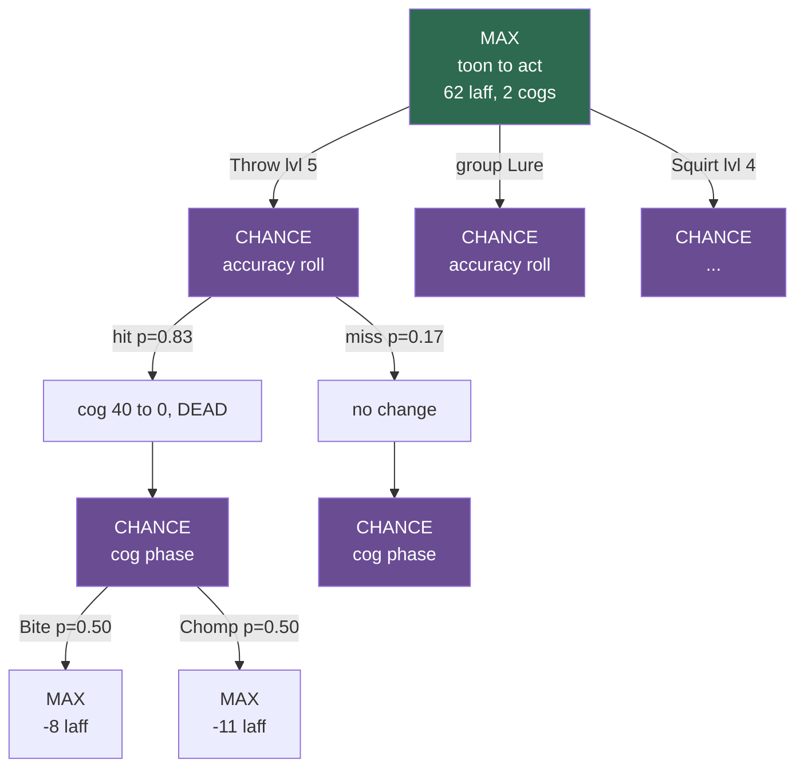
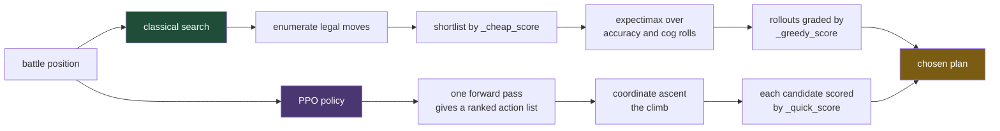
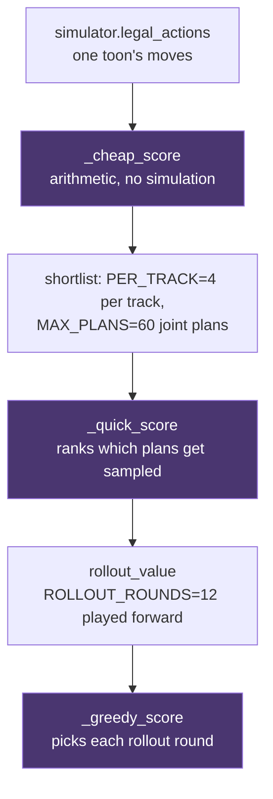
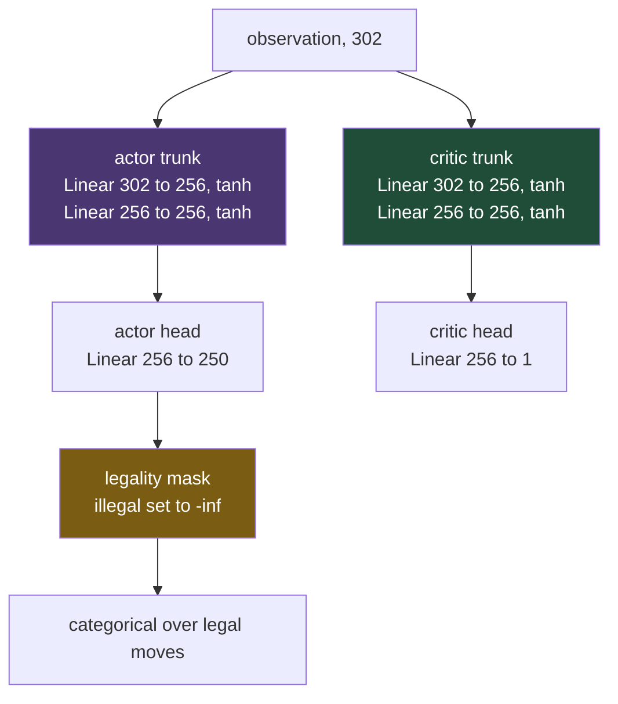
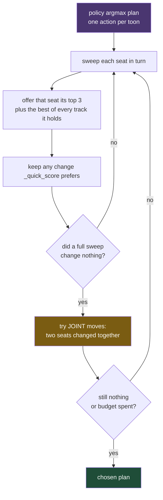

# TTRSolver

A battle solver for [Toontown Rewritten](https://www.toontownrewritten.com/):
a simulator of the cog-battle rules, an expectimax search that plays them,
and a set of readers that can watch a live game and advise on the fight in
front of you.

It solves solo battles **exactly** — every action spends a gag, so the game
tree is finite and `expectimax.solve` plays a position to the end with no
heuristic at all. Party battles are searched approximately, because their
outcome space cannot be enumerated.

> **The [TTR wiki](https://toontownrewritten.wiki) is the source of truth.**
> The strategy guide this project started from describes *Toontown Online*
> and predates TTR's rebalancing passes; it has been caught wrong on Lure
> durations, Lure accuracy, which Lure levels are group gags, and the
> luredRatio rule. Everything in `solver/data/` has been audited against the
> wiki.

## The rule that shapes everything here

**A number that isn't confirmed is `None`, and the code raises rather than
substituting.** No plausible-looking fills, and when sources conflict the
cell stays open with a note on what looked wrong rather than being averaged
or guessed.

That sounds pedantic until you see what it catches. Toon-Up was modelled
healing the *thrower* — the rule exactly backwards, since
[the wiki says](https://toontownrewritten.wiki/Toon-Up) toons cannot heal
themselves. Group cog attacks weren't modelled at all, so parties took
strictly less damage than the game deals. Both were found because a search
produced advice a human looked at and said "nobody plays that."

Two things are deliberate exceptions, both tagged `[ASSUMED]` so they can
never read as data: the multi-Lure accuracy bonus, where the patch notes
give the magnitudes `(20/15/10)%` but never say which level gap selects
which; and the accuracy and frequency of twelve cog attacks that the wiki
confirms exist and publishes damage for, but never gives those two
columns. Nine of the twelve are group attacks, so leaving them unfired
understated cog threat — the exception is there because silence was the
worse error.

## Quick start

Standard library only — no install step.

```bash
python -m unittest discover tests      # ~700 tests
python -m solver.search.demo           # narrated solo fight
python -m solver.live.advise           # advise on a running game
```

Optional extras, each isolated so the core never depends on them:

```bash
pip install -r requirements-vision.txt     # numpy, for screen reading
pip install -r requirements-training.txt   # torch, for training only
```

## Layout

```
solver/
  state.py          BattleState / ToonState / CogState / Action
  mechanics.py      accuracy, damage, cog attacks, lure wake-up
  simulator.py      legal_actions() and step() -- samples
  outcomes.py       action_outcomes() -- enumerates, exactly
  party.py          party rules: pickup vs coordinated modes
  data/             game tables, one module per table, wiki-audited
  search/
    expectimax.py   exact solo search, star1/star2 pruning
    party_search.py sampled party search
    fitted.py       learned leaf evaluator (plain floats, stdlib)
    policy.py       trained policy head (needs numpy, optional)
    objective.py    what a round is worth -- the tunable weights
  live/             reading a running game (see below)
tools/              offline: label generation, fitting, training
docs/               findings, and what is not yet trustworthy
visualizer/         browser front end
```

## How the solver works: expectimax

### Why not minimax

Minimax assumes your opponent picks the move that hurts you most. Cogs do
not. A cog picks its attack from a **published frequency table** and rolls
to hit — it is indifferent to you, not hostile. Modelling cogs as an
adversary would produce advice braced against a worst case that only
happens 15% of the time, and would systematically over-value defence.

So the tree alternates two kinds of node:

- **MAX** — the toon chooses. Take the best branch.
- **CHANCE** — the dice choose. Take the *probability-weighted average* of
  the branches.

That is expectimax. It answers "what maximises my expected outcome",
which is the right question against an indifferent opponent.

### One round of the tree

A single round expands into three layers. The toon picks a gag, the gag
hits or misses, then every living cog attacks:



Green is a choice, purple is a roll. The value of a CHANCE node is the
weighted mean of its children; the value of a MAX node is the best child.
Recursion bottoms out when the battle ends.

### Why this terminates — and why it is exact

Here is the property that makes this project unusual: **solo battles are
solved exactly, with no heuristic at all.**

Every gag a toon throws is **spent**. The pouch only shrinks, so no line of
play can be longer than the number of gags carried, and no position can
repeat with the same pouch. The state graph is a **DAG**, not a cycle, and
the tree is finite:

```
round 1        pouch = 34 gags
round 2        pouch = 33 gags        strictly decreasing
round 3        pouch = 32 gags        ...so this must end
```

`expectimax.solve()` therefore plays to the end of the battle and returns
the *true* expected value of a position. Not an estimate. That is why the
learned evaluator in `fitted.py` can be trained on ground truth rather than
on its own predictions — a luxury most game AI does not have.

The one thing that could break the argument is the **pass** action, which
spends no gag. Passing is an ordinary choice — conserve a scarce gag, or
in a party decline to attack, since `pick_cog_target` makes a cog prefer
whoever damaged it most, so swinging pulls its next hit onto you. Given a
lone Wedding Cake and an 8hp cog, the exact solver passes rather than
spend it.

To keep the measure well-founded, an unlured pass draws on a small
budget (`state.free_passes`). Without one, the branch where every cog
*misses* leaves the state unchanged and the search recurses forever. So
the measure is `(gags, lure rounds, free passes)` lexicographically, and
still descends. A lured pass is free of the budget — the lure timer is
already the quantity going down.

### Three ways a battle ends

The third one is easy to forget and cost this project a real bug:

1. Laff hits zero.
2. Every cog is dead.
3. **The toon has no remaining way to damage a cog.** Nothing restocks a
   pouch mid-fight, so 80 Lures and no attacks is a *loss*, and so is
   Toon-Up plus Trap with no Lure.

Before (3) existed, hopeless positions fell through to the heuristic and
scored **+47.6** — and since training labels came from `solve()`, the
evaluator was partly fitted to its own optimism.

### Making it fast: star1 and star2 pruning

Alpha-beta does not apply directly, because a CHANCE node has no "best"
child to cut on. **star1** bounds it instead. If a chance node's children
must lie within `[L, U]`, then after seeing some of them you can bound the
whole node:

```
       seen so far          still unknown
     ┌───────────────┐   ┌─────────────────┐
     p1·v1 + p2·v2  +     p3·L ... p3·U        <- lower and upper bound
     └───────────────┘   └─────────────────┘

  if upper bound  <  alpha   ->  cut, this branch cannot win
  if lower bound  >  beta    ->  cut, opponent avoids it
```

This is why `fitted.value` is **clamped** into the range the bounds
promise, and why that clamp is a correctness requirement rather than
tidiness. Unclamped, the fitted model put **32% of positions outside the
envelope** — as high as 175 against a ceiling of 100 — and the search
quietly began cutting branches it had no warrant to cut.

**star2** adds a probe pass: try one child of each unseen branch first, and
if the probe already breaks the bound, skip the rest.

A transposition table catches the rest, since many action orders reach the
same position — `outcomes.state_key` keys on every toon **in order**,
deliberately, because a frozenset there would let the memo answer about one
party using another's value.

### Where it stops being exact

Parties. A party round's outcome space is the accuracy rolls (one per track
per target) times each cog's choice of attack, times its choice of *whom*
to hit, times the teammates' actions. That cannot be enumerated, so
`party_search` **samples** it — and its values are estimates that are not
comparable with `solve()`'s.

The invariant that catches most bugs there: **coordinated can never score
below pickup**, since coordinated may choose everything pickup may and
more. That inequality is what exposed a truncation quietly deleting the
best plan.


## Reading a live game

Two sources, both verified against a running client rather than from
documentation:

- **Local API** (`solver/live/ttr_local.py`) — official, opt-in via
  `"want-local-api"` in TTR's `settings.json`. Gives laff, gag tracks,
  organic, location, invasion. It does **not** expose the battle.
- **Screen reading** (`solver/live/vision.py`) — needs `"show-cog-levels"`
  on. Cog level, department and health come off the plate above each cog.
  This is the only route to the cogs.

`session.py` joins them into a `BattleState` and `advise.py` runs the solver
on it. `build_state` returns a state **or** the reasons there isn't one —
never a guess, because advice computed from an invented state is worse than
no advice.

## What the solver has found

Some of it was surprising, which is the point of building one:

- Against three level 10s and a level 11, four maxed toons, the best opening
  is **2 Foghorn + 2 Aoogah** — cheap mixed-level Sound, 159 damage against
  the 156 the toughest cog has. Sound emerged unprompted; nothing in the
  code knows what a Sound combo is.
- **Coordinated can never score below pickup**, since it may choose
  everything pickup may and more. That inequality has caught more party bugs
  than any test.
- A **wider damage margin** is not protection against the dice — gag damage
  is deterministic — it is protection against the model being wrong about
  training. A 10% shortfall breaks a 3-damage margin and not a 15-damage one.

`docs/party-strategy.md` has the numbers, and more usefully what they cannot
yet tell you.

## The two agents

There are two ways to pick a move here, and they fail differently. Both
share the same rules engine (`solver/simulator.py`) and the same
objective; they disagree about how to search.



The shipped agent is **PPO + climb**. The classical search is kept
because it is exact for solo battles and because a second opinion has
caught bugs neither would find alone.

### Agent 1: the classical search

**Solo battles are solved exactly.** No heuristic, no evaluation
function. Every gag is spent and the pouch only shrinks, so the game
tree is finite and `expectimax.solve` returns a true value with a
transposition memo and star1/star2 pruning over the chance nodes.

**Party battles are not.** The joint action space is every toon's move
crossed with every other's, and the chance layer is the accuracy rolls
times each cog's attack times its choice of target. `party_search`
therefore *samples* rather than enumerates, which makes its numbers
estimates and **not comparable with `solve()`'s**.

Move generation, in order:



The three scorers are deliberately different functions with different
weights, because they answer different questions:

| scorer | job | weights |
| --- | --- | --- |
| `_cheap_score` | shortlist one action, no simulation | `HEAL_VALUE`, `TRAP_DISCOUNT` |
| `_quick_score` | rank whole joint plans | `QUICK_W` |
| `_greedy_score` | choose each round of a rollout | `GREEDY_W` |

`_greedy_score` is **not** a scorer in the usual sense. `rollout_value`
*is* `greedy_plan` played forward, so it decides what the future looks
like, and making it more careful makes the search's model of the future
passive rather than the search itself careful. That is why it keeps its
own weights and is not fitted alongside `_quick_score`.

### Agent 2: PPO plus the climb

**Observation, 302 floats.** Per cog (x4): alive, level, hp fraction,
max hp, lured, trapped, lure rounds, dead, **suited** (Version 2.0),
**remaining work across both health bars**, armed trap damage as a
fraction of hp. Per toon (x4): alive, laff fraction, max laff, **pink
slips**, and 49 gag counts. Then six globals, the acting seat, and a
36-float block of what the other toons have already committed to this
round.

That `pending` block is what makes coordination possible: without it,
four toons sharing one policy see identical observations and throw four
identical Lures.

**Action table, 250 entries.** Every (track, level, target) the game
allows, plus a pass, plus four fire actions. Illegal actions get
`-inf` logits so they carry no probability at all — masking lives
*inside* the distribution, never as a penalty, because a penalty lets
the agent learn to want an illegal move and be taxed for it.

**Architecture: two separate towers.**



Sharing one trunk was the first version and it trained **backwards** —
eval return fell from +47.9 to +22.5 while the win rate dropped 88% to
78%. Returns run to about plus or minus 100, so the value loss is of
order 10,000 against a policy loss of order 0.1: the shared trunk
followed the critic and the policy was noise riding on top. Separate
towers plus reward scaling keep the two gradients comparable.

**Training.** PPO with GAE, on 32 parallel environments.

| | |
| --- | --- |
| steps | 6,000,000 |
| envs / rollout / epochs | 32 / 128 / 4 |
| minibatch | 1024 |
| learning rate | 3e-4 |
| gamma / lambda | 0.99 / 0.95 |
| clip / entropy / value coef | 0.2 / 0.01 / 0.5 |
| reward scaling | running standard deviation |
| throughput | about 3,500 steps a second on a 3070 Ti |

The training distribution is mixed deliberately: half multi-floor
facilities, a quarter boss sides (VP and CEO), pink slips in a quarter
of positions, and mid-fight "strange" boards with armed traps and
picked-over pouches. **Truncation is not termination** — an episode cut
off at the round cap still has value ahead of it and is bootstrapped;
treating it as a terminal zero teaches the agent that surviving to the
cap is worthless.

**The climb.** The policy alone is not the agent. `hybrid.climb` starts
from the policy's argmax joint plan and does coordinate ascent, judged
by `_quick_score`:



The joint step exists because coordinate ascent cannot cross a valley.
Both toons luring scores 366; either one switching to Sound scores 178,
because Sound resolves after Lure and wakes what Lure put to sleep; both
switching scores 672. Every single-seat edit is downhill and the joint
edit nearly doubles the score.

### How a move is evaluated

`_quick_score` takes the **expectation over every way the dice can
fall**, enumerated rather than sampled. A party is at most four toons
and each rolls at most one die, so there are at most sixteen branches.

Branching is over **roll groups**, not toons, because accuracy is rolled
per track per target: two toons throwing the same track at the same cog
land or miss *together*. Treating those as independent lets a plan hedge
in a way the game does not allow.

The probabilities are read from the simulator's own record rather than
recomputed, because accuracy is conditional and the conditions are
large: a landed Throw lifts a following Drop from 54% to 79%, a second
Lure lifts the pair from 79% to 95%, a trapped target lifts a Lure from
79% to 95%.

The score itself:

```
  damage landed (counting BOTH layers of a Version 2.0)
+ 2   x laff restored, capped at real headroom
+ 1   x damage an armed trap will deal when a lure springs it
+ 120 x cogs killed
+ 9   x damage prevented by luring or killing
- 1   x gag price, scaled by how many cogs are still to come
```

`prevent` at 9 rather than 2 is the single largest correction this
project has made — see below.

### Performance

Held-out seeds, 200 sides a cell, `PPO + climb` at budget 24. A boss
side is two toons; the full fight needs both sides to clear.

| fight | one side | full fight |
| --- | --- | --- |
| cog buildings | **73.5%** | n/a |
| Sellbot VP | **99.5%** | 99.0% |
| CEO, banquet cleared | **88.5%** | 78.3% |
| CEO, 2 leftovers | 73.5% | 54.0% |
| CEO, 4 leftovers | 45.0% | 20.2% |
| CEO, 5 leftovers | 32.5% | 10.6% |
| CEO, 10 leftovers | 3.0% | 0.1% |

Cost: **5.8 ms a decision**. The classical search is 794–1245 ms on the
same boards and does not do better — on buildings the two are within
noise, and on a 20-cog CEO waiter battle the search scores 10% against
the climb's 90%.

## Things worth knowing before trusting a number

- **Party values are estimates.** Exact `solve()` cannot reach a party
  position, so there are no labels to check against.
- **The objective's weights are chosen, not derived.** `laff_weight`,
  `scarcity_cost`, `turn_cost` and friends are swept and sane; nothing
  calibrates them against real play.
- **The horizon buys conservation with win rate.** `state.cogs_remaining`
  (0-30) is how many cogs come *after* this fight -- the rest of a
  building, a factory, a boss run -- and it raises the price of every gag,
  so a Railroad spent on floor one costs more than the same Railroad spent
  on the last cog of the day. This is the quantity `scarcity_cost` had been
  standing in for with a constant. At a full building ahead it saves about
  7% of the pouch for about 3 points of win rate in the current fight, and
  the mean gag level drops 3.36 to 3.05. Whether that trade pays depends on
  how badly the later floors need the pouch, which one battle's search
  cannot see. `cogs_remaining = 0` reproduces the old behaviour exactly,
  and every street battle is undisturbed.
- **Pickup mode rests on a model of strangers.** `SensiblePrior` is a guess
  about how people play, labelled as one.
- **Six times a *reduction* has silently deleted the right answer** — a
  candidate cap, a lexicographic prefix, a global top-N, twice from the
  learned ranker. Each produced confident, plausible, wrong output. The
  habit that catches them is an invariant a truncation cannot satisfy by
  accident.

## Documentation

| | |
| --- | --- |
| [docs/data-confidence.md](docs/data-confidence.md) | every data gap, and why it is open |
| [docs/party-strategy.md](docs/party-strategy.md) | party findings, and their limits |
| [docs/ml-design.md](docs/ml-design.md) | the learning plan and its results |
| [docs/search-depth.md](docs/search-depth.md) | what depth is worth |
| [docs/roadmap.md](docs/roadmap.md) | what is next |

Not affiliated with Toontown Rewritten or the Walt Disney Company.
