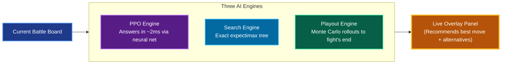
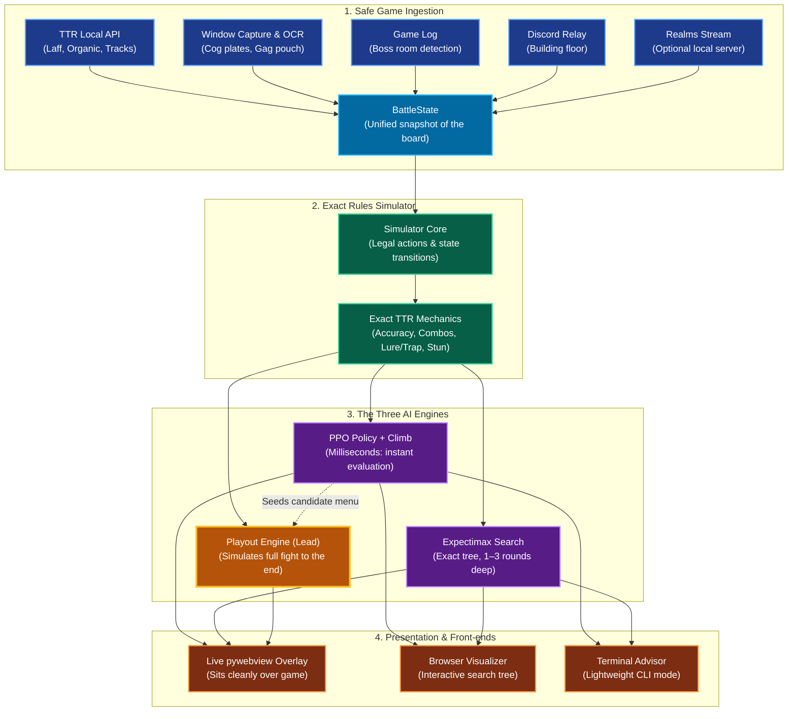
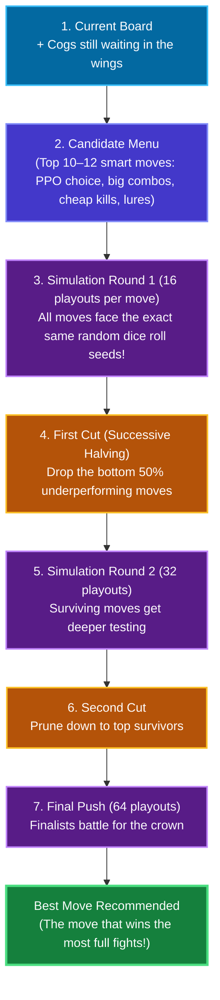
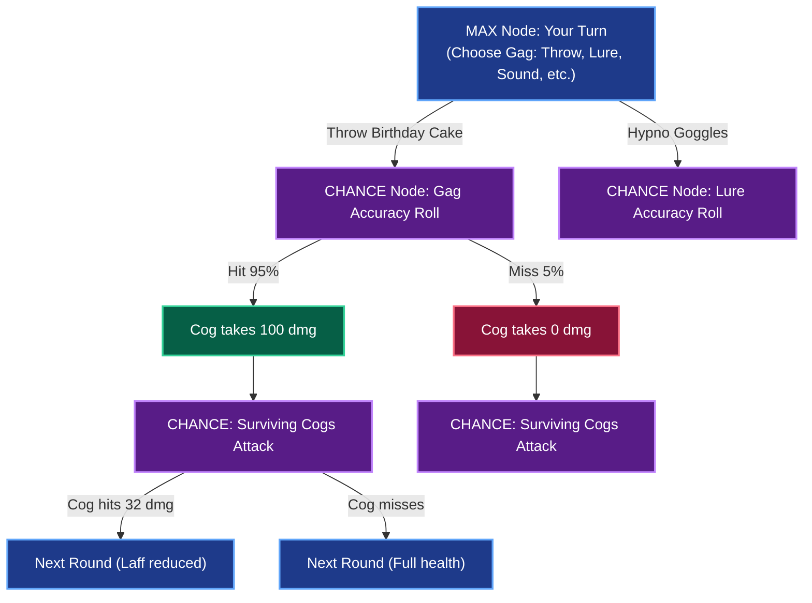
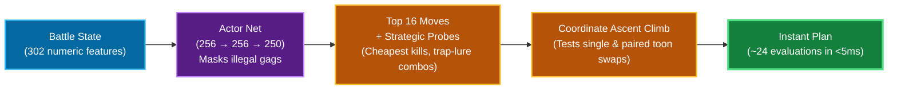

# TTRSolver

A real-time battle advisor for **[Toontown Rewritten](https://www.toontownrewritten.com/)** (and **Toontown Realms**). 

TTRSolver sits quietly beside your game window on a lightweight overlay panel. Every round, it reads the battle state, evaluates hundreds of possible outcomes, and suggests the smartest gag to throw at which cog—so you never accidentally waste a Level 7 gag or drop an unsafe move in a critical boss fight.

> [!NOTE]
> **You are always in control:** TTRSolver never plays the game for you, never injects into game memory, never clicks, and never sends keystrokes. It reads the game safely from the outside and advises. You make every move yourself.
> 
> *Not affiliated with or endorsed by Toontown Rewritten, Toontown Realms, or The Walt Disney Company.*

---

## Table of Contents

- [Quick Overview](#quick-overview)
- [How It Reads the Game](#how-it-reads-the-game)
- [System Architecture](#system-architecture)
- [Quick Start](#quick-start)
- [The Three Engines](#the-three-engines)
  - [1. Playout](#1-playout)
  - [2. Search](#2-search)
  - [3. PPO](#3-ppo)
- [Combat Mechanics & Game Rules](#combat-mechanics--game-rules)
- [Benchmark Results](#benchmark-results)
- [Reading a Live Game Safely](#reading-a-live-game-safely)
- [Current Limitations](#current-limitations)
- [Repository Layout](#repository-layout)
- [Documentation Index](#documentation-index)
- [License](#license)

---

## Quick Overview

In Toontown, battles look deceptively simple until you are deep in a 5-story cog building or a solo VP boss fight. One missed Lure, an unintended wake-up, or burning a high-level gag too early can send your toon straight back to the playground.

TTRSolver solves this with a **rules-exact game simulator** paired with **three AI engines** that approach the problem from different angles:



- **Playout:** Plays out the whole rest of the fight hundreds of times in the simulator to ensure your gag pouch survives the entire wave.
- **Search:** Computes an exact mathematical tree (expectimax) a couple of rounds ahead.
- **PPO:** Delivers an instant heuristic suggestion in milliseconds while the heavier engines deliberate.

---

## How It Reads the Game

TTRSolver is designed from the ground up to follow fair-play principles. It reads only what a human player can see or what the game explicitly publishes:

| Source | What it reads | How it works |
|---|---|---|
| **TTR Local API** | Laff, unlocked tracks, organic tracks, location, pink slips | Official, opt-in HTTP API running on `localhost:1547`. The game asks your explicit consent on-screen before sharing data. |
| **Game Window Screenshot** | Cog levels, departments, current health, gag menu counts | Standard OS desktop screen grab. Nothing is hooked or injected. |
| **Client Log File** | Boss fight detection (VP, CFO, CJ, CEO) | Standard text log written by the game client. |
| **Discord Rich Presence** (Optional) | Building floor progression | Standard Discord RPC pipe published by the game. |
| **Toontown Realms Stream** | Exact combat state | Realms' built-in local developer network stream. |

> [!IMPORTANT]
> **Zero Game Tampering:** TTRSolver does **not** inject DLLs, does **not** read client RAM, does **not** manipulate network packets, and does **not** automate inputs. It acts strictly as an external HUD assistant.

---

## System Architecture

Here is the full pipeline from a frame on your screen to a recommended gag on your overlay:



---

## Quick Start

The core simulation, exact search, and test suite run on standard Python with **zero external dependencies**.

### 1. Requirements
- Python 3.10 or higher.
- Windows (for game window capture / live overlay).

### 2. Run immediately
```bash
# Launch interactive menu of all front-ends and check missing packages
python run.py

# Launch the live TTR overlay
python run.py 1

# Try a simulated solo fight right in your terminal (no game needed!)
python run.py 5

# Run the full test suite (~1,900 unit tests)
python -m unittest discover tests
```

### 3. Optional Packages

Install only what you plan to use:

| Feature | Command | Why you need it |
|---|---|---|
| **Screen Reading & AI** | `pip install -r requirements-vision.txt` | Installs `numpy`, `pillow`, `mss` for OCR, plus the PPO and Playout engines. |
| **Live GUI Overlay** | `pip install pywebview` | Renders the sleek overlay window beside your game. |
| **Toontown Realms** | `pip install -r requirements-realms.txt` | Panda3D networking client for Realms local streams. |
| **Model Retraining** | `pip install -r requirements-training.txt` | PyTorch (weights already come pre-trained in the repository!). |

### 4. Enable TTR Settings
To allow the live panel to see your game, toggle two options inside TTR's `settings.json` (or via game options):
- `"want-local-api": true` (allows reading your laff and pouch)
- `"show-cog-levels": true` (shows the overhead plate with cog level, department, and health)

> [!TIP]
> Check out the complete step-by-step setup guide with screenshots in **[docs/user-guide.md](docs/user-guide.md)**.

---

## The Three Engines

When the overlay opens, it displays three rows—one from each engine. **Playout leads by default**, but you can click any row to inspect its rationale.

| Engine | Method | Visibility | Speed | Ideal Scenario | Dependencies |
|---|---|---|---|---|---|
| **Playout** | Monte Carlo playouts to fight's end | Every wave & holdout cogs | Progressive (~1–3s) | Boss fights (VP/CFO/CEO) & tall buildings | `numpy` |
| **Search** | Expectimax over exact outcome trees | Only current cogs on field | Set by time budget | Small, lethal boards solved to 100% precision | Standard Library |
| **PPO** | Neural policy net + coordinate climb | One single round | Instant (~2ms) | Immediate recommendation while others compute | `numpy` |

---

### 1. Playout

#### The Lookahead Horizon
If an AI only looks 1 or 2 rounds ahead, it might see that throwing a Level 7 **Wedding Cake** or **TNT** right now kills a level 12 cog with 100% certainty. It looks great in the short term, but in a solo VP fight with 40 cogs in reserve, burning that Wedding Cake now means you'll have nothing left when two Level 12s walk out together 10 rounds later.

#### How Playout Works
Instead of stopping after a round or two, Playout takes a diverse menu of ~10 candidate moves and **simulates the entire rest of the battle forward hundreds of times** using a fast neural rollout policy.



#### How Each Playout is Scored
Playout scores each full simulation based on survival efficiency:

$$\text{Value} = \text{Cogs Defeated} + 0.5 \cdot \left(\frac{\text{Remaining Laff}}{\text{Max Laff}}\right) - \text{Resource Costs}$$

Where resource costs penalize burning rare level 7 gags, wasting turns, or using group gags when only one cog is un-lured.

#### Key Mechanisms
- **Common Random Numbers (CRN):** In rollout $k$, every candidate move faces the exact same dice rolls and incoming cogs. This removes "luck" from the equation—you compare pure move quality.
- **Successive Halving:** Bad moves are eliminated early (after 16 runs), so precious compute time is spent fine-tuning the top contenders.
- **Rollout Network:** A lightweight neural net trained via expert iteration plays subsequent turns at lightning speed.

*Deep dive:* **[docs/playout.md](docs/playout.md)** and **[docs/rollout-network.md](docs/rollout-network.md)**.

---

### 2. Search

When you face a small, dangerous board (e.g., two heavy cogs that could kill you next turn), you don't want estimates—you want exact mathematical certainty.

Expectimax searches every possible branch, weighting every branch by its true in-game probability:

$$V(s) = \max_{a \in \mathcal{A}(s)} \sum_{o \in \Omega} P(o \mid s, a) \Big( r(s, a, o) + V(s') \Big)$$

*(In plain English: The value of a state $V(s)$ is the best action you can choose, multiplied across all possible outcomes $o$ and their exact chances $P(o)$ of hitting or missing, plus the resulting position $V(s')$.)*



#### Search Optimizations
- **Star Pruning:** Similar to Alpha-Beta pruning, but for chance trees. If the best-case upper bound of a branch can't beat our current best move, it is cut immediately.
- **Cog-Phase Collapsing:** Merges identical damage outcomes together, turning 20–70 individual cog attack combinations into a handful of consolidated states.

*Deep dive:* **[docs/search-depth.md](docs/search-depth.md)** and **[docs/scoring.md](docs/scoring.md)**.

---

### 3. PPO

A neural policy network evaluates 302 battle state features and outputs action logits in under 2 milliseconds.



Because PPO acts immediately, it populates the live overlay instantly while the Playout engine runs in the background.

*Deep dive:* **[docs/ml-design.md](docs/ml-design.md)** and **[docs/ppo-math.md](docs/ppo-math.md)**.

---

## Combat Mechanics & Game Rules

TTRSolver simulates Toontown combat with 100% adherence to the official Toontown Rewritten mechanics:

### 1. The Attack Order
Gags resolve strictly by track, regardless of which toon chose first:

```
Toon-Up Trap Lure Sound Throw Squirt Drop [Cogs Attack]
```

### 2. Accuracy Formula
Every gag attack calculates its hit probability using:

$$\text{Accuracy} = \text{Base Gag Acc} + \text{Track Experience} + \text{Target Cog Def} + \text{Bonuses} \quad [\text{clamped to } 5\% - 95\%]$$

- **Track Experience:** $+10\%$ per unlocked gag level in that track (halved for Toon-Up).
- **Target Cog Defense:** Ranges from $-2\%$ (Level 1 cog) to $-55\%$ (Level 12 cog).
- **Stun Bonus:** $+25\%$ accuracy for each earlier attack that hit the cog this round (up to $+75\%$).
- **Lured Bonus:** Sound, Level 7 Throw, and Level 7 Squirt get extra accuracy against lured cogs.

### 3. Key Combat Rules
- **Trap always hits (100%):** Traps cannot miss.
- **Lured Knockback (+50%):** Throw and Squirt attacks on lured cogs always hit and deal $+50\%$ damage.
- **Drop on Lured Cogs always misses:** Drop attacks wake/cancel on lured targets and roll 0% hit rate.
- **Same-Track Combo Bonus (+20%):** Two or more toons using the same track on the same cog combine damage with an extra $+20\%$ boost.
- **Single Roll per Track:** If multiple toons throw Pies at the same cog, they either all hit or all miss together.

*Complete reference:* **[docs/mechanics-notes.md](docs/mechanics-notes.md)**.

---

## Benchmark Results

To evaluate performance, the engines were tested on simulated **Solo VP** battles (the Sellbot boss: 40 cogs back-to-back, fought completely alone on a single gag pouch):

| Setup | PPO Solo | Search | Playout Engine |
|---|---|---|---|
| **Solo VP (Standard Pouch, No Unites)** | ~7% win rate | — | **55% – 70%** win rate |
| **Solo VP (Maintainer Pouch + 5 Unites)** | — | — | **94 of 100 wins** |
| **1 Toon on VP Side (5 Unites)** | — | — | **55 of 60 wins** |
| **1 Toon on VP Side (A few SOS cards only)** | 6 of 60 | 6 of 60 | **33 of 60 wins** |
| **2 Toons on VP Side (Planned together)** | 40 of 40 | — | **40 of 40 (100%)** |

### Playout Progression
```
PPO Solo:                     7%  [■░░░░░░░░░]
Top-3 Moves Playout:         27%  [■■■░░░░░░░]
Wide 12-Move Diverse Menu:   40%  [■■■■░░░░░░]
Rollout Neural Network:      70%  [■■■■■■■░░░]
Pouch + Unites:              94%  [■■■■■■■■■░]
```

*Read the lab notebook of ideas that worked and ideas that failed:* **[docs/experiment-log.md](docs/experiment-log.md)**.

---

## Reading a Live Game Safely

TTRSolver reads the game strictly from the outside through multiple sanity checks:

```
[Screen Grab] ──> [Crop Plate] ──> [Emblem Matcher] ──> Department: Lawbot
                               ──> [Digit Classifier] ──> Level: 11
                               ──> [Health Bar Pixel] ──> HP: 104 / 156
[Gag Menu]   ──> [Count Per Gag] ──> [Pouch Sum Checksum] ──> Match! (100% Confidence)
```

- **Digit OCR:** Custom miniature classifier trained specifically on Toontown's native font.
- **Pouch Checksum:** The in-game menu prints its own total gag count. TTRSolver reads individual counts and compares the sum against the printed total. If a number is misread, it catches and fixes it automatically.
- **Head Matching Library:** Cogs share levels across departments. TTRSolver builds a local library of learned cog portraits as you play.
- **Fail-Safe Integrity:** If a plate is obscured or unreadable, the panel displays an informative notice and refuses to guess.

*Deep dive:* **[docs/live-reading.md](docs/live-reading.md)**.

---

## Current Limitations

- **Simulated Benchmarks:** Win rates are measured in high-fidelity simulated battles; live-game statistical win rates are not yet tracked.
- **Platform:** Automated window detection currently targets Windows.
- **Teammate Pouches:** On TTR, the game client does not publish teammates' remaining gag pouches. The solver assumes sensible teammate play.
- **Boss Fights:** The VP is detected automatically from logs; CFO, CJ, and CEO room sizes are selected manually.
- **First-Time Cog Heads:** A fresh install starts with an empty cog head library; you may need to confirm a cog's identity occasionally early on.

*See what's completed and what's next:* **[docs/roadmap.md](docs/roadmap.md)**.

---

## Repository Layout

```
run.py                     Main launcher for all UI modes and tools
solver/                    Core simulation rules & engine implementations
  data/                    Cog stats, gag tables, and accuracy charts (wiki-sourced)
  search/                  AI engines: playout.py, expectimax.py, hybrid.py (PPO)
  rl/                      Reinforcement learning environment & pre-trained weights
  live/                    Screen OCR, Local API client, and overlay controllers
overlay_ui/                React front-end for pywebview overlay (pre-compiled)
visualizer/                Interactive browser tool for tree exploration
tools/                     Automated simulation sweeps and benchmark scripts
tests/                     Comprehensive unittest suite (~1,900 unit tests)
docs/                      Complete technical & user documentation
```

---

## Documentation Index

Looking for more details? Check out the specific guides below:

| What you want to do | Where to look |
|---|---|
| **Install & use the overlay panel** | **[docs/user-guide.md](docs/user-guide.md)** |
| **Understand how all components fit together** | **[docs/architecture-review.md](docs/architecture-review.md)** |
| **Learn how the Playout engine simulates fights** | **[docs/playout.md](docs/playout.md)** |
| **Look up exact combat formulas & combo rules** | **[docs/mechanics-notes.md](docs/mechanics-notes.md)** |
| **Learn how the game screen is read & verified** | **[docs/live-reading.md](docs/live-reading.md)** |
| **Explore move trees in the browser visualizer** | **[visualizer/README.md](visualizer/README.md)** |
| **Read the experimental log of what was tried** | **[docs/experiment-log.md](docs/experiment-log.md)** |

---

## License

Code and documentation are released under the [MIT License](LICENSE).

*Game artwork, cog/gag icons, and UI assets belong to Toontown Rewritten, Toontown Realms, and The Walt Disney Company. They are included strictly for fair-use reference in player overlay displays.*
