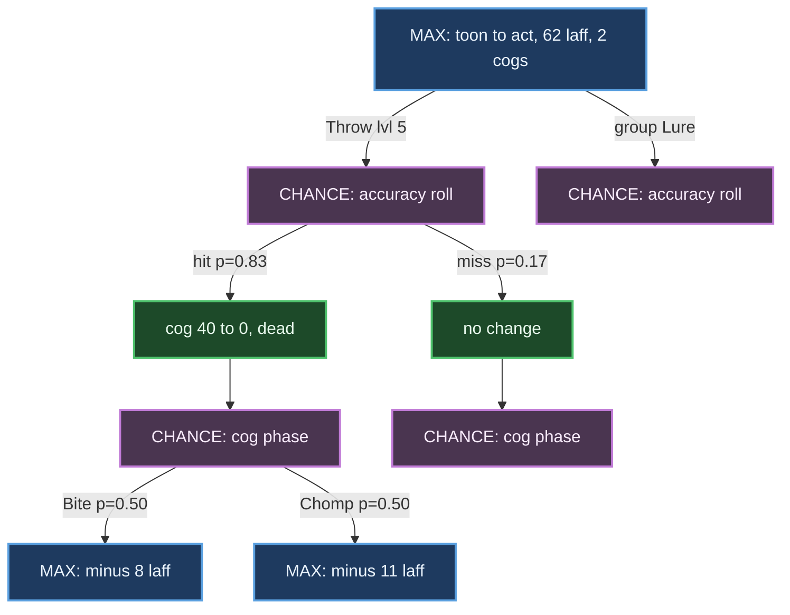
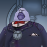
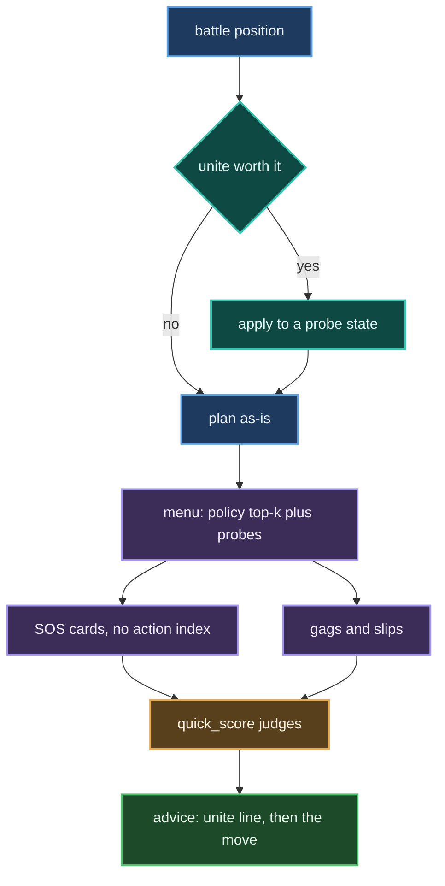
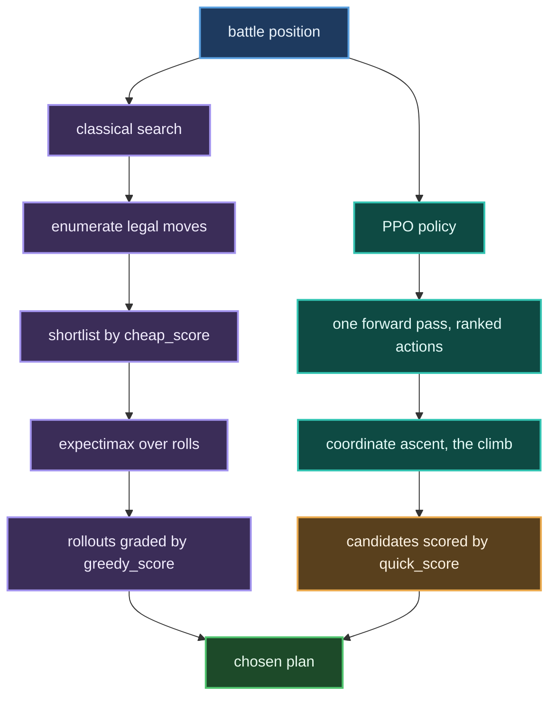
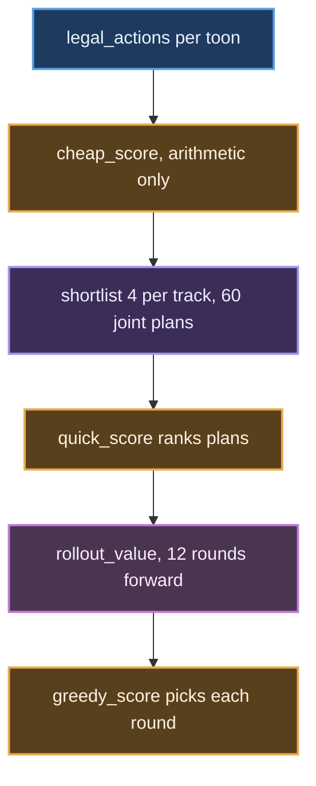
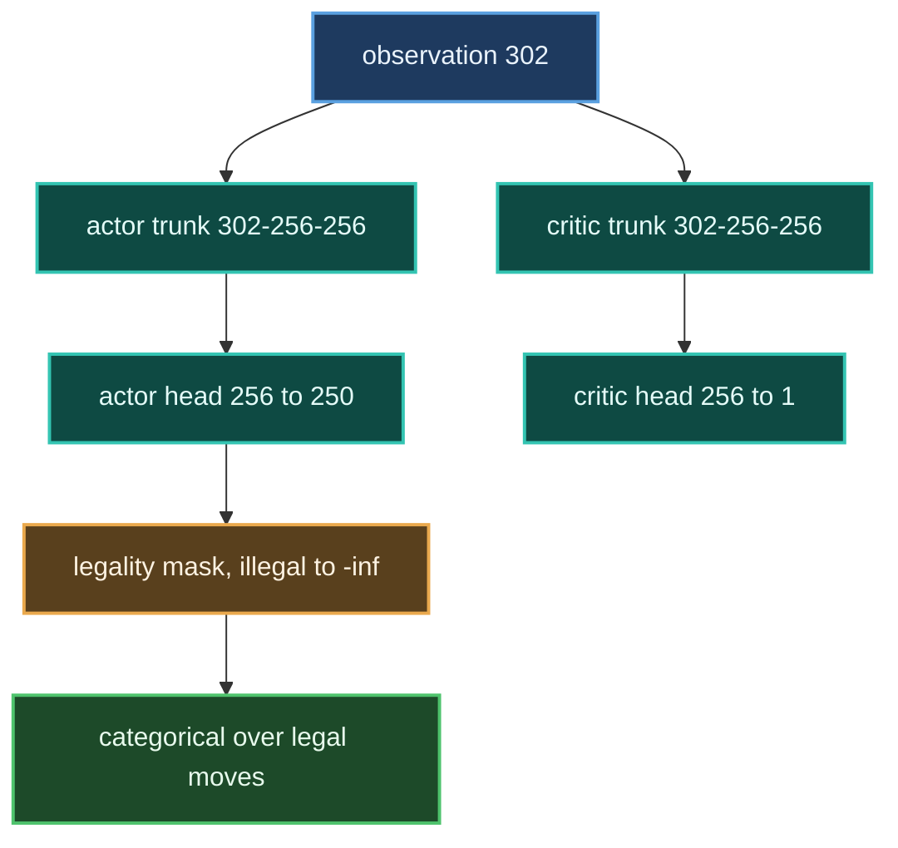
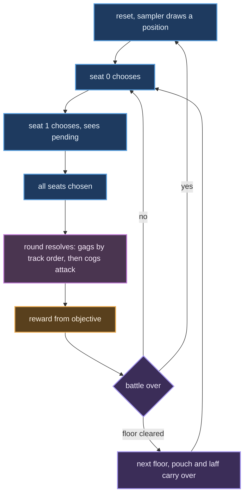
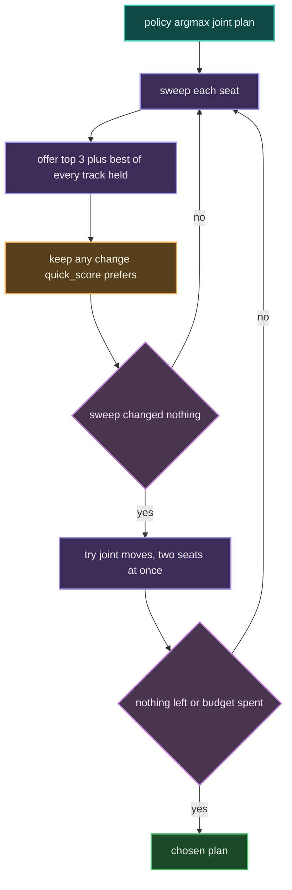

# TTRSolver

A battle solver for [Toontown Rewritten](https://www.toontownrewritten.com/):
a simulator of the cog-battle rules, an expectimax search that plays them,
and a set of readers that can watch a live game and advise on the fight in
front of you.

It solves solo battles **exactly** — every action spends a gag, so the game
tree is finite and `expectimax.solve` plays a position to the end with no
heuristic at all. Party battles are searched approximately, because their
outcome space cannot be enumerated.

> **The [TTR wiki](https://toontownrewritten.wiki) is the source of truth.**
> The strategy guide this project started from describes *Toontown Online*
> and predates TTR's rebalancing passes; it has been caught wrong on Lure
> durations, Lure accuracy, which Lure levels are group gags, and the
> luredRatio rule. Everything in `solver/data/` has been audited against the
> wiki.

## Quick start

Standard library only — no install step.

```bash
python -m unittest discover tests      # 1343 tests
python -m solver.search.demo           # narrated solo fight
python -m solver.live.advise           # advise on a running game
```

Optional extras, each isolated so the core never depends on them:

```bash
pip install -r requirements-vision.txt     # numpy, for screen reading
pip install -r requirements-training.txt   # torch, for training only
```

## Layout

```
solver/
  state.py          BattleState / ToonState / CogState / Action
  mechanics.py      accuracy, damage, cog attacks, lure wake-up
  simulator.py      legal_actions() and step() -- samples
  outcomes.py       action_outcomes() -- enumerates, exactly
  party.py          party rules: pickup vs coordinated modes
  data/             game tables, one module per table, wiki-audited
  unites.py         Toon-Up and Gag-Up unites: free, but priced
  sos.py            the 29 renewable SOS cards, as eight effect shapes
  search/
    expectimax.py   exact solo search, star1/star2 pruning
    party_search.py sampled party search, and the three scorers
    weights.py      EVERY tuned number, with its measurement
    hybrid.py       the climb: policy proposes, quick_score disposes
    fitted.py       learned leaf evaluator (plain floats, stdlib)
    policy.py       trained policy head (needs numpy, optional)
    objective.py    what a round is worth -- the tunable weights
  rl/
    env.py          BattleEnv, the observation, the action table
    harness.py      running a chosen action through the env, safely
  live/             reading a running game (see below)
tools/              offline: label generation, fitting, training
docs/               findings, and what is not yet trustworthy
overlay_ui/         the advice overlay (React; dist/ is committed)
visualizer/         browser front end
```

## How the solver works: expectimax

### Why not minimax

Minimax assumes your opponent picks the move that hurts you most. Cogs do
not. A cog picks its attack from a **published frequency table** and rolls
to hit — it is indifferent to you, not hostile. Modelling cogs as an
adversary would produce advice braced against a worst case that only
happens 15% of the time, and would systematically over-value defence.

So the tree alternates two kinds of node:

- **MAX** — the toon chooses. Take the best branch.
- **CHANCE** — the dice choose. Take the *probability-weighted average* of
  the branches.

That is expectimax. It answers "what maximises my expected outcome",
which is the right question against an indifferent opponent.

### One round of the tree

A single round expands into three layers. The toon picks a gag, the gag
hits or misses, then every living cog attacks:



Green is a choice, purple is a roll. The value of a CHANCE node is the
weighted mean of its children; the value of a MAX node is the best child.
Recursion bottoms out when the battle ends.

### Why this terminates — and why it is exact

Here is the property that makes this project unusual: **solo battles are
solved exactly, with no heuristic at all.**

Every gag a toon throws is **spent**. The pouch only shrinks, so no line of
play can be longer than the number of gags carried, and no position can
repeat with the same pouch. The state graph is a **DAG**, not a cycle, and
the tree is finite:

```
round 1        pouch = 34 gags
round 2        pouch = 33 gags        strictly decreasing
round 3        pouch = 32 gags        ...so this must end
```

`expectimax.solve()` therefore plays to the end of the battle and returns
the *true* expected value of a position. Not an estimate. That is why the
learned evaluator in `fitted.py` can be trained on ground truth rather than
on its own predictions — a luxury most game AI does not have.

The one thing that could break the argument is the **pass** action, which
spends no gag. Passing is an ordinary choice — conserve a scarce gag, or
in a party decline to attack, since `pick_cog_target` makes a cog prefer
whoever damaged it most, so swinging pulls its next hit onto you. Given a
lone Wedding Cake and an 8hp cog, the exact solver passes rather than
spend it.

To keep the measure well-founded, an unlured pass draws on a small
budget (`state.free_passes`). Without one, the branch where every cog
*misses* leaves the state unchanged and the search recurses forever. So
the measure is `(gags, lure rounds, free passes)` lexicographically, and
still descends. A lured pass is free of the budget — the lure timer is
already the quantity going down.

### Three ways a battle ends

The third one is easy to forget and cost this project a real bug:

1. Laff hits zero.
2. Every cog is dead.
3. **The toon has no remaining way to damage a cog.** Nothing restocks a
   pouch mid-fight, so 80 Lures and no attacks is a *loss*, and so is
   Toon-Up plus Trap with no Lure.

Before (3) existed, hopeless positions fell through to the heuristic and
scored **+47.6** — and since training labels came from `solve()`, the
evaluator was partly fitted to its own optimism.

### Making it fast: star1 and star2 pruning

Alpha-beta does not apply directly, because a CHANCE node has no "best"
child to cut on. **star1** bounds it instead. If a chance node's children
must lie within `[L, U]`, then after seeing some of them you can bound the
whole node:

```
       seen so far          still unknown
     ┌───────────────┐   ┌─────────────────┐
     p1·v1 + p2·v2  +     p3·L ... p3·U        <- lower and upper bound
     └───────────────┘   └─────────────────┘

  if upper bound  <  alpha   ->  cut, this branch cannot win
  if lower bound  >  beta    ->  cut, opponent avoids it
```

This is why `fitted.value` is **clamped** into the range the bounds
promise, and why that clamp is a correctness requirement rather than
tidiness. Unclamped, the fitted model put **32% of positions outside the
envelope** — as high as 175 against a ceiling of 100 — and the search
quietly began cutting branches it had no warrant to cut.

**star2** adds a probe pass: try one child of each unseen branch first, and
if the probe already breaks the bound, skip the rest.

A transposition table catches the rest, since many action orders reach the
same position — `outcomes.state_key` keys on every toon **in order**,
deliberately, because a frozenset there would let the memo answer about one
party using another's value.

### Where it stops being exact

Parties. A party round's outcome space is the accuracy rolls (one per track
per target) times each cog's choice of attack, times its choice of *whom*
to hit, times the teammates' actions. That cannot be enumerated, so
`party_search` **samples** it — and its values are estimates that are not
comparable with `solve()`'s.

The invariant that catches most bugs there: **coordinated can never score
below pickup**, since coordinated may choose everything pickup may and
more. That inequality is what exposed a truncation quietly deleting the
best plan.


## Reading a live game

Two sources, both verified against a running client rather than from
documentation:

- **Local API** (`solver/live/ttr_local.py`) — official, opt-in via
  `"want-local-api"` in TTR's `settings.json`. Gives laff, gag tracks,
  organic, location, invasion. It does **not** expose the battle.
- **Screen reading** (`solver/live/vision.py`) — needs `"show-cog-levels"`
  on. Cog level, department and health come off the plate above each cog.
  This is the only route to the cogs.

A third reader exists for a different client. **Toontown Realms**
(`solver/live/realms.py`) is read off its Astron cluster rather than the
screen, which gives the battle directly — and, unlike TTR, gives what the
player is *carrying*: `setPinkSlips`, `setResistanceMessages` (unites) and
`setNPCFriendsDict` (SOS cards). It is kept strictly separate, because
Realms is Toontown Online lineage and nothing read from it may become
solver truth. See `docs/realms.md`.

`session.py` joins them into a `BattleState` and `advise.py` runs the solver
on it. `build_state` returns a state **or** the reasons there isn't one —
never a guess, because advice computed from an invented state is worse than
no advice.

### Naming the cog is harder than reading the plate

The plate gives a department and a level. That is not enough to say
*which* cog it is: of the 48 (department, level) pairs, **only 8 name
exactly one cog**, and the worst allow five. Every one of these is a
Lawbot level 5:

<p align="left">
  
  
  
  
  
</p>

It matters because attack sets differ: which cog it is decides how hard
the round hits back. The remaining evidence is the head rendered in the
plate, matched against a collected library
(`solver/live/catalogue.py`).

**The art above is not what it matches against**, and that was measured
rather than assumed. Ranking a plate against this artwork put the right
cog first for 3 of 4 known plates, which sounds fine until you read the
margins — 0.001 to 0.004, against the collected library's 0.028 correct
versus 0.132 wrong. Every candidate scores 0.12–0.15, so the art carries
essentially no signal and the hits are coin flips; one of the four
ranked its true cog *last*. Different pose, light and background from
the fixed-camera plate render. It stays useful for showing a human the
candidates, which is exactly its job here.

**The library never has to be finished.** `HeadCatalogue.eliminate`
deduces a cog it has never seen: when every known candidate in the pool
is ruled out and exactly one is left, that is the cog — by deduction
rather than resemblance. So the last cog in each group needs no label,
and one unknown at level 5 is often deducible at level 6. It
deliberately does not record what it deduces: a signature is written
once and consulted forever, so a wrong entry poisons every later match,
while a wrong deduction costs one battle.

## Consumables: slips, unites and SOS cards

Three resources sit outside the gag pouch, and each is modelled
differently because each behaves differently.

| | | costs a turn | how it is priced | who can see it |
| :-: | --- | --- | --- | --- |
|  | **Pink slip** | yes | `FIRE_PRICE` per cog still to come, plus `FIRE_FLOOR` | Realms (`setPinkSlips`) |
|  | **Unite** | **no** — SpeedChat, alongside a gag | `UNITE_PRICE`, flat | Realms (`setResistanceMessages`) |
|  | **SOS card** | yes | `SOS_PRICE`, flat | Realms (`setNPCFriendsDict`) |

The icons are the overlay's own: a slip, the Toon Resistance fist, and
the SOS card. The advice line uses them to say *what kind* of move it is
before you have read a word of it — and a unite gets its own line above
the gag, because it is not an alternative to one.

A unite costing no turn is the fact the whole model turns on: it makes a
round *two* decisions, so `unites.best_with_unite` transforms the state
and re-plans on it rather than adding an entry to the action table.
Both engines share that helper — the exact search had no unites at all
until it did.

An SOS is the opposite: it *is* the move. That turn cost is already paid
in the mechanics, since the plan then holds no gag for that toon, which
is why `SOS_PRICE` only carries the residual scarcity and not the turn.




**Nothing is offered without evidence.** `unites_held` defaults to 0 and
`sos_cards` to empty, so a reader that cannot see a pouch offers
nothing — and the TTR readers cannot. The overlay's three cap boxes are
a *permission*, not a count: the wire says what is held, the cap says
what you are willing to spend, and neither alone grants anything.

Measured across the difficulty range, the prices do the job on their
own: at difficulty 3 the solver spends **0.00 unites and 0.00 cards**
per battle, at difficulty 9 it spends 4.88 and 1.16. Standard play does
not need them, which is the intent, and it falls out of the pricing
rather than a rule about buildings.

## What the solver has found

Some of it was surprising, which is the point of building one:

- Against three level 10s and a level 11, four maxed toons, the best opening
  is **2 Foghorn + 2 Aoogah** — cheap mixed-level Sound, 159 damage against
  the 156 the toughest cog has. Sound emerged unprompted; nothing in the
  code knows what a Sound combo is.
- **Coordinated can never score below pickup**, since it may choose
  everything pickup may and more. That inequality has caught more party bugs
  than any test.
- A **wider damage margin** is not protection against the dice — gag damage
  is deterministic — it is protection against the model being wrong about
  training. A 10% shortfall breaks a 3-damage margin and not a 15-damage one.

`docs/party-strategy.md` has the numbers, and more usefully what they cannot
yet tell you.

## The two agents

Both share `solver/simulator.py` and `solver/search/objective.py`. They
differ in how they search.



Shipped agent: **PPO + climb**. The search is kept because it is exact
for solo and because a second opinion catches bugs.

The climb's evaluation budget is **24**, not `climb`'s own default of
16 and emphatically not the 8 the panel used to pass. Eight starved
the targeted probes — they are appended after the track sweep, so at
8 they were never reached and `PROBE_CHEAPEST_KILL` was dead in live
play. Raising it was worth **fourteen points of win rate** across two
seed blocks (88.8%→98.4% and 85.2%→99.2%, p<0.001), *and* it spends
fewer pink slips, because the cheap-kill probe finally gets to offer
the gag that does the job instead of a level 7 group gag. It costs
five milliseconds.

### Classical search

Solo is exact: every gag is spent, the pouch only shrinks, so the tree
is finite. `expectimax.solve` returns a true value with a transposition
memo and star1/star2 pruning over chance nodes.

Party is not. The joint action space is every toon's move crossed with
every other's; the chance layer is accuracy rolls times each cog's
attack times its target choice. `party_search` samples. Its values are
estimates and **not comparable with `solve()`'s**.



Three scorers, three weight sets, three jobs:

| scorer | job | weights |
| --- | --- | --- |
| `_cheap_score` | shortlist one action, no simulation | `LAFF_POINT_VALUE`, `TRAP_DISCOUNT` |
| `_quick_score` | rank joint plans | `QUICK_W` |
| `_greedy_score` | choose each rollout round | `GREEDY_W` |

`_greedy_score` is not a plan scorer. `rollout_value` *is* `greedy_plan`
played forward, so it defines the simulated future. Making it careful
makes the future passive rather than the search careful — hence its own
weights, not fitted with `_quick_score`.

### PPO

**Observation, 302 floats.**

| block | size | contents |
| --- | --- | --- |
| cogs | 4 x 11 | alive, level, hp fraction, max hp, lured, trapped, lure rounds, dead, **suited**, **work left across both bars**, armed trap damage / hp |
| toons | 4 x 53 | alive, laff fraction, max laff, **pink slips**, 49 gag counts |
| globals | 6 | round, cogs alive, toons alive, cogs remaining, is-facility, holdout size |
| actor | 4 | one-hot of the deciding seat |
| pending | 36 | what each toon has already committed this round |

`pending` is what makes coordination possible. Without it four toons
sharing one policy see identical observations and throw four identical
Lures.

**Actions, 250.** Every legal (track, level, target), a pass, and four
fires. Illegal actions get `-inf` logits: masking lives inside the
distribution, never as a penalty, or the agent learns to want an illegal
move and be taxed for it.

**Architecture.** Two separate towers, 256 wide, tanh.



A shared trunk trained backwards: eval return fell +47.9 to +22.5 while
win rate dropped 88% to 78%. Returns run to about +/-100, so value loss
is order 10,000 against policy loss order 0.1 — the trunk followed the
critic. Separate towers plus reward scaling keep the gradients
comparable.

### Training

**Toon generation** (`env.random_toon`) — deliberately not maxed:

- Throw and Squirt always, plus 0-4 of the other five. Never all seven:
  a toon picks six at most, and a one-track toon is an impossible puzzle
  rather than a hard one.
- Each owned track gets training 1-7, which feeds `calc_track_exp`, so
  an unmaxed track is genuinely less accurate rather than merely
  smaller.
- Gag counts drawn per level under that track's carry limit.
- 10% chance the damage tracks are emptied, leaving Lure/Trap/Toon-Up
  only. A spent pouch, not an untrained track — real play reaches it
  constantly and it forces Lure, Trap or a pass.
- Pouch capacity sampled per toon from the confirmed table, then the
  pouch trimmed to fit. Without this, 62% of generated toons would not
  have fitted a starting 20-gag bag.
- Laff from a fixed ladder (15 to 137), current laff 15-100% of it.
- 40% chance one track is organic.

**Situation generation** — five samplers, blended by CLI fraction:

| sampler | what it produces |
| --- | --- |
| `default_position` | a fresh street battle |
| `hard_position` | solo against level 10-12 cogs, where Lure stops being optional |
| `strange_position` | mid-fight: cogs already lured with 1-4 rounds left, armed traps with a real `trap_level`, cogs at 10-60% hp, toons at 5-25% laff, pouches with the cheap gags spent, `round_num` 0-5 |
| `combo_position` | trap armed and a Lure in hand, payoff one move away |
| `facility_position` | multi-floor, one pouch and one laff bar across floors |
| boss sides | VP and CEO, the only source of Version 2.0 cogs, pink slips and cogs above level 12 |

`strange_position` matters because training only on round-one boards
teaches round-one habits, and advice is asked for mid-fight. Every
modifier it applies is reachable — a `trapped` flag without a
`trap_level` would build a state the simulator cannot resolve.

Cog pools are restricted to `SAFE_COGS` and `SAFE_GAGS`, entries whose
data tables are complete, so a `[TODO]` cell cannot raise mid-episode
and bias the sample toward whatever happens to be filled in.

**Trajectories.** 32 environments stepped in lockstep, 128 steps each
per update.



One step is **one seat's decision**, not one round. Intermediate seats
resolve nothing and score no reward; the round's reward lands on the
last seat. GAE runs over the seat sequence, so credit for a joint plan
is spread across the toons that formed it.

**Truncation is not termination.** An episode cut at the round cap still
has value ahead and is bootstrapped from the critic. Treating it as
terminal zero teaches that surviving to the cap is worthless.
`info["truncated"]` distinguishes them, and the cap is per floor, since
a five-floor building legitimately runs past 20 rounds.

| hyperparameter | value |
| --- | --- |
| steps | 6,000,000 |
| envs / rollout / epochs / minibatch | 32 / 128 / 4 / 1024 |
| lr | 3e-4 |
| gamma / lambda | 0.99 / 0.95 |
| clip / entropy / value coef | 0.2 / 0.01 / 0.5 |
| reward scaling | running standard deviation |
| throughput | ~3500 steps/s, RTX 3070 Ti |

Entropy is over actions, which is not entropy over tracks: sweeping the
flat coefficient 0.01 / 0.04 / 0.10 moved gag entropy not at all, 3.79 at
every setting, because the policy satisfies it by spreading mass over
levels and targets within one track. `--track-entropy` puts the bonus on
the track marginal instead.

### The climb

The policy alone is not the agent.



The joint step exists because coordinate ascent cannot cross a valley.
Both toons luring scores 366; either one switching to Sound scores 178,
since Sound resolves after Lure and wakes what Lure put to sleep; both
switching scores 672.

Track probes exist because three tracks were unreachable: Trap sat at
median rank 25 in the policy's ranking and entered the 3-wide window 0
times in 521 seats, Toon-Up at rank 10 and 1%. No weight fixes that — an
earlier heal sweep read flat at twenty times the weight because the
search never consulted it.

### Move evaluation

`_quick_score` takes the expectation over every way the dice fall,
enumerated, not sampled. At most four toons, one die each, so at most 16
branches.

Branching is over **roll groups**, not toons: accuracy is rolled per
track per target, so two toons throwing one track at one cog land or
miss together. Treating them as independent lets a plan hedge in a way
the game forbids.

Probabilities come from the simulator's own record, not a recomputation,
because accuracy is conditional: a landed Throw lifts a following Drop
54% to 79%, a second Lure lifts the pair 79% to 95%, a trapped target
lifts a Lure 79% to 95%.

```
  damage landed, counting BOTH layers of a Version 2.0
+ 2   x laff restored, capped at real headroom
+ 1   x damage an armed trap will deal when a Lure springs it
+ 120 x cogs killed
+ 9   x damage prevented by luring or killing
- 1   x gag price, scaled by cogs still to come
```

### Performance

Held-out seeds, 200 sides a cell, PPO + climb at budget 24. A boss side
is two toons; the full fight needs both sides.

| fight | one side | full fight |
| --- | --- | --- |
| cog buildings | 73.5% | n/a |
| Sellbot VP | 99.5% | 99.0% |
| CEO, banquet cleared | 88.5% | 78.3% |
| CEO, 2 leftovers | 73.5% | 54.0% |
| CEO, 4 leftovers | 45.0% | 20.2% |
| CEO, 5 leftovers | 32.5% | 10.6% |
| CEO, 10 leftovers | 3.0% | 0.1% |

5.8 ms a decision. The classical search costs 794-1245 ms on the same
boards and does not do better: within noise on buildings, 10% against
the climb's 90% on a CEO waiter battle.

## Things worth knowing before trusting a number

- **Party values are estimates.** Exact `solve()` cannot reach a party
  position, so there are no labels to check against.
- **The objective's weights are chosen, not derived.** `laff_weight`,
  `scarcity_cost`, `turn_cost` and friends are swept and sane; nothing
  calibrates them against real play.
- **The horizon buys conservation with win rate.** `state.cogs_remaining`
  (0-30) is how many cogs come *after* this fight -- the rest of a
  building, a factory, a boss run -- and it raises the price of every gag,
  so a Railroad spent on floor one costs more than the same Railroad spent
  on the last cog of the day. This is the quantity `scarcity_cost` had been
  standing in for with a constant. At a full building ahead it saves about
  7% of the pouch for about 3 points of win rate in the current fight, and
  the mean gag level drops 3.36 to 3.05. Whether that trade pays depends on
  how badly the later floors need the pouch, which one battle's search
  cannot see. `cogs_remaining = 0` reproduces the old behaviour exactly,
  and every street battle is undisturbed.
- **Pickup mode rests on a model of strangers.** `SensiblePrior` is a guess
  about how people play, labelled as one.
- **Six times a *reduction* has silently deleted the right answer** — a
  candidate cap, a lexicographic prefix, a global top-N, twice from the
  learned ranker. Each produced confident, plausible, wrong output. The
  habit that catches them is an invariant a truncation cannot satisfy by
  accident.
- **A measurement harness will lie to you before the solver does.** Four
  results in one sitting were harness bugs: an action the table could
  not express silently became a *pass*, a solo toon was given Toon-Up it
  can never use, and a Monte Carlo loop re-seeded the environment
  identically every rollout — so sixteen samples were one sample
  sixteen times, and reported that `_quick_score` was barely better than
  chance. It isn't; corrected, it captures 96–100% of the gap between
  chance and best. `solver/rl/harness.py` exists because of this and
  **raises** rather than falling back.
- **Almost every weight was swept on a maxed toon**, which is 13% of
  what the sampler actually builds and the one regime where the 95%
  accuracy cap flattens gag choice. `FIRE_FLOOR`, `SOS_PRICE` and
  `survive` have since been re-run on realistic toons and all three
  held; the bias was real as a limitation of method and changed none of
  the values.
- **The shipped policy is a selected outlier**, 3.8 standard deviations
  above ten fresh runs. Comparing anything against it makes an honest
  result look like a regression. Compare like against like, on paired
  seeds.

## Documentation

| | |
| --- | --- |
| [docs/data-confidence.md](docs/data-confidence.md) | every data gap, and why it is open |
| [docs/party-strategy.md](docs/party-strategy.md) | party findings, and their limits |
| [docs/ml-design.md](docs/ml-design.md) | the learning plan and its results |
| [docs/search-depth.md](docs/search-depth.md) | what depth is worth |
| [docs/roadmap.md](docs/roadmap.md) | what is next |

Not affiliated with Toontown Rewritten or the Walt Disney Company.
