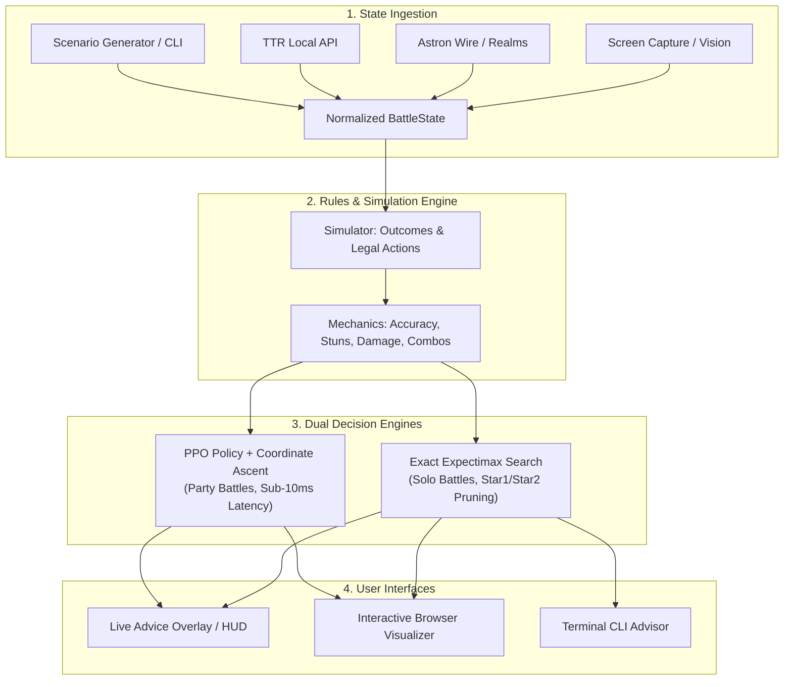
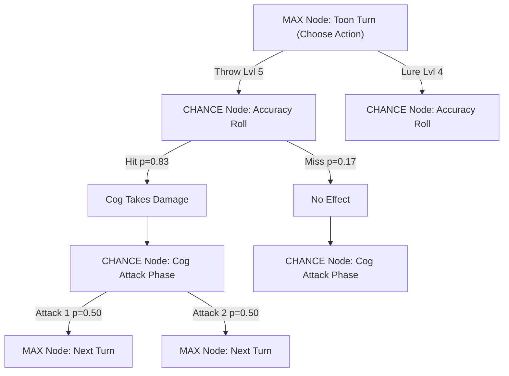
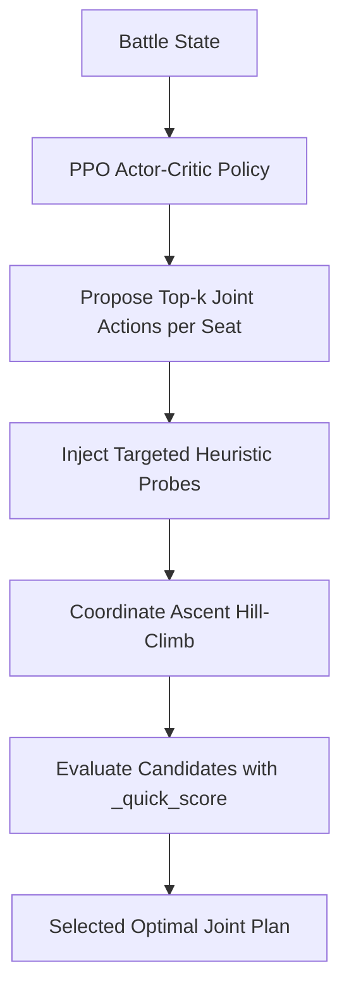

# TTRSolver

TTRSolver is an automated battle assistant and decision engine for [Toontown Rewritten](https://www.toontownrewritten.com/). It combines a faithful simulation of Toontown's combat mechanics, an exact expectimax tree search for solo battles, a trained reinforcement learning policy (PPO) with coordinate ascent for party battles, and live screen-reading tools to deliver real-time tactical advice.

---

## Table of Contents
- [System Architecture](#system-architecture)
- [How to Run & Interfaces](#how-to-run--interfaces)
- [Combat Mechanics & Calculations](#combat-mechanics--calculations)
- [Dual-Engine Solver Architecture](#dual-engine-solver-architecture)
  - [Why Two Engines? Expectimax vs. PPO](#why-two-engines-expectimax-vs-ppo)
  - [Engine 1: Exact Expectimax Search (Solo)](#engine-1-exact-expectimax-search-solo)
  - [Engine 2: Neural Policy & Coordinate Ascent (Party)](#engine-2-neural-policy--coordinate-ascent-party)
- [Scoring Objective & Optimization](#scoring-objective--optimization)
- [Consumable Economics](#consumable-economics)
- [Live Game State Ingestion](#live-game-state-ingestion)
- [Benchmark Performance](#benchmark-performance)
- [Repository Structure](#repository-structure)
- [Documentation Index](#documentation-index)

---

## System Architecture

The following diagram illustrates how game state flows from live clients or simulated scenarios through the rules engine and solver to user interfaces:



---

## How to Run & Interfaces

TTRSolver is designed to run out of the box using only the Python standard library. Optional dependencies are isolated to specific features (such as computer vision or model training).

### Quick Start
```bash
python run.py                          # Open interactive launcher menu
python -m unittest discover tests      # Run test suite (1600+ tests)
```

### Supported Interfaces

1. **Live Game Overlay (`python run.py 1`)**:
   - Transparent, always-on-top HUD rendered directly over Toontown Rewritten.
   - Detects active battle state, displays cog health and status, and highlights recommended gags in real time.
   - Inventory controls allow setting spending caps for pink slips, unites, and SOS cards.

2. **Interactive Browser Visualizer (`python run.py 7` or `python -m visualizer.serve`)**:
   - Web application for exploring solver decisions and inspecting game trees.
   - Features:
     - **Dual-Engine Inspection**: Compare moves selected by Classical Search vs. PPO Policy.
     - **Tree Graph Visualization**: Explore full probability and outcome branches.
     - **Custom Scenario Builder**: Generate or configure complex battle positions (e.g., multi-cog street battles, boss rounds, or damaged toons).

3. **Terminal Real-Time Advisor (`python run.py 3`)**:
   - Headless CLI tool that monitors live gameplay and prints turn-by-turn advice directly to the console.

4. **Python Scripting API**:
   ```python
   from solver.state import BattleState, ToonState, CogState, Track
   from solver.search import expectimax

   toon = ToonState(laff=65, max_laff=100, track_exp={Track.THROW: 6},
                    gag_counts={(Track.THROW, 5): 3, (Track.LURE, 4): 2})
   cog = CogState.create(department="Bossbot", level=9)
   state = BattleState(toons=[toon], cogs=[cog])

   best_action, expected_value = expectimax.solve(state)
   print(f"Recommended action: {best_action} (EV: {expected_value:.2f})")
   ```

### Optional Dependencies
```bash
pip install -r requirements-vision.txt     # OpenCV/NumPy for live screen reading
pip install -r requirements-training.txt   # PyTorch for offline model training
```

---

## Combat Mechanics & Calculations

The simulation engine implements exact Toontown Rewritten battle mechanics audited against the [TTR Wiki](https://toontownrewritten.wiki).

### 1. Accuracy Calculation
Toon gag accuracy is calculated as:

$$\text{Accuracy} = \text{propAcc} + \text{trackExp} - \text{tgtDef} + \text{bonus}$$

- **Base Accuracy ($\text{propAcc}$)**: The intrinsic accuracy of the gag tier (e.g., 70 for level 5 Throw, 95 for organic Lure).
- **Track Experience ($\text{trackExp}$)**: $(\text{training\_level} - 1) \times 10$ points (halved for Toon-Up), reflecting mastery level.
- **Target Defense ($\text{tgtDef}$)**: Defense rating determined by the highest-level cog targeted, scaled by cog tier rank.
- **Accuracy Bonuses ($\text{bonus}$)**:
  - **Stun Bonus**: $+20\%$ if a prior attack landed successfully earlier in the same round.
  - **Trap Bonus**: $+20\%$ for Lure if the target cog is already trapped.
  - **Multi-Lure Bonus**: $+20\%$ if multiple toons use Lure in the same round.

Final accuracy is clamped to $[5\%, 95\%]$, except for rule-mandated forced outcomes:
- **Trap**: Always hits ($100\%$).
- **Throw & Squirt against Lured Cogs**: Always hit ($100\%$).
- **Drop against Lured Cogs**: Always misses ($0\%$).

*Roll Groups*: Gags of the same track targeting the same cog share a single random variable roll rather than rolling independently.

### 2. Damage & Combo Multipliers
- **Combo Bonus**: When two or more toons successfully hit the same cog with the same gag track in a single round, a $+20\%$ damage multiplier is applied.
- **Lure Knockback Bonus**: Throw or Squirt attacks that wake a lured cog receive an additional $+50\%$ damage multiplier.
- **Organic Bonus**: Trees planted in a toon's estate grant a $+10\%$ damage increase to that track.

### 3. Cog Attack Selection
Cogs do not play adversarially; they select attacks randomly from published frequency distributions based on their specific cog type and level. Counter-attacks occur after the toon phase concludes.

---

## Dual-Engine Solver Architecture

TTRSolver employs two complementary engines:

| Feature | Engine 1: Exact Expectimax | Engine 2: Neural Policy + Climb |
|---|---|---|
| **Best For** | Solo battles (1 Toon) | Party battles (2–4 Toons), Bosses |
| **Optimality** | **Exact mathematical expectation** | Approximate heuristic optimization |
| **Search Method** | Depth-limited tree search with $\alpha$-$\beta$ pruning | Coordinate ascent hill-climbing over PPO logits |
| **Branching Control** | Star1/Star2 bounds & cog node collapsing | Top-$k$ action menus & targeted heuristic probes |
| **Latency** | 50 ms – 4.0 s (depending on depth) | **~5.8 ms** (deterministic budget) |
| **Runtime Requirements** | Python Standard Library | NumPy |

### Why Two Engines? Expectimax vs. PPO

The split between the two engines is determined by state-space geometry and turn-time constraints:

1. **Solo Combat $\to$ Exact Expectimax Search**:
   Because every attack permanently consumes a gag, solo battles form a finite Directed Acyclic Graph (DAG) whose depth is bounded by initial pouch capacity. This enables `expectimax.solve()` to evaluate lines to battle completion without heuristic approximations, yielding an exact mathematical oracle. Reinforcement learning is unnecessary and sub-optimal here compared to direct exact computation.
2. **Party Combat $\to$ Neural Policy (PPO) + Coordinate Ascent**:
   In party encounters (2–4 toons against up to 4 cogs), joint action and outcome spaces explode ($>8,600$ branches per ply). Full search depth scales exponentially: Depth 1 takes ~0.38s, Depth 2 takes ~17.9s, and Depth 3 takes ~199s—far exceeding the 15-second turn timer. The trained PPO policy evaluates in $<1$ ms, generating high-probability candidate plans that coordinate ascent (`hybrid.climb`) refines in 5.8 ms.

For detailed empirical analysis of this division, see [docs/ml-design.md](docs/ml-design.md).

---

### Engine 1: Exact Expectimax Search (Solo)

Solo combat forms a **Directed Acyclic Graph (DAG)**:
1. Every attack consumes a gag from the pouch.
2. Pouch inventory strictly decreases across turns, bounding the maximum game depth by the initial gag count.
3. Unlured passes consume a finite allowance (`state.free_passes`), while lured passes reduce remaining lure duration.

Because the game cannot loop infinitely, `expectimax.solve()` evaluates lines to battle completion without heuristic value approximations:

$$V(s) = \max_{a \in \mathcal{A}(s)} \sum_{o \in \Omega} P(o \mid s, a) \Big( r(s, a, o) + V(s') \Big)$$



#### Search Optimizations
- **Star1 Pruning**: Bounds unexpanded chance node probability mass using child intervals $[L, U]$. If upper bound $< \alpha$ or lower bound $> \beta$, the branch is pruned.
- **Star2 Probing**: Samples a single probe child per unseen branch to tighten bounds before evaluating complete subtrees.
- **Cog Phase Collapsing**: Because cog counter-attacks involve random distributions rather than tactical choices, replacing the counter-attack distribution with its mean beyond root plies collapses chance outcomes from 20–70 down to 2 (toon hit vs. toon miss), unlocking $+1$ to $+2$ plies of search depth.

---

### Engine 2: Neural Policy & Coordinate Ascent (Party)

Party battles cannot be solved by full enumeration due to the combinatorial explosion of simultaneous toon actions, target assignments, and accuracy combinations ($>8,600$ branches per ply). TTRSolver solves party battles using a two-stage hybrid pipeline:



#### 1. Neural Policy (PPO)
- **Observation Space (302 floats)**: Encodes cog levels, health fractions, Version 2.0 suits, lured/trapped statuses; toon health, inventory counts, pink slips; global battle counters; and pending teammate selections for the current round.
- **Action Space (250 discrete actions)**: All legal (track, level, target) triples, passes, and fires. Invalid actions are masked with $-\infty$ logits.
- **Architecture**: Separate 256-unit actor and critic towers with tanh activations to prevent high value gradients from destabilizing policy representations.

#### 2. Coordinate Ascent ("The Climb")
The neural policy serves as a candidate generator. `hybrid.climb` then refines the joint plan using coordinate ascent:
- Iterates across toon seats, swapping individual moves with top policy candidates and targeted heuristic probes (such as the cheapest single-target kill or lure activations for armed traps).
- Evaluates candidate plans using `_quick_score`.
- Evaluates pairwise joint swaps to escape local minima (e.g. transitioning from dual Lure to dual Sound).
- Operates under a fixed budget of 24 evaluations, executing in ~5.8 ms.

---

## Scoring Objective & Optimization

Candidate plans in the climb and party search are evaluated by `_quick_score`:

$$\text{Score} = \Delta_{\text{damage}} + 2 \cdot \Delta_{\text{heal}} + \text{trap\_stored} + 120 \cdot \text{kills} + 9 \cdot \text{prevented} - \text{price}_{\text{gag}} - \text{price}_{\text{spend}} + \text{survival\_bonus}$$

### Breakdown of Objective Terms
- **$\Delta_{\text{damage}}$**: Expected damage inflicted across cogs (including Version 2.0 outer suits).
- **$\Delta_{\text{heal}}$**: Laff restored to the party, weighted at $2\times$ up to maximum health headroom.
- **$\text{trap\_stored}$**: Expected value of placing an armed trap that will trigger on subsequent lure.
- **$\text{kills}$ ($+120$)**: High-priority bonus for eliminating a cog, removing its damage contribution permanently.
- **$\text{prevented}$ ($+9\times$)**: Expected incoming cog damage averted this round through stun or lure.
- **$\text{price}_{\text{gag}}$**: Gag conservation penalty scaling with remaining facility length ($\text{cogs\_remaining}$).
- **$\text{survival\_bonus}$**: Buffers toons against lethal thresholds based on pre-plan expected incoming damage.

---

## Consumable Economics

Consumables sit outside regular gag pouches and are governed by individual resource constraints:

| Consumable | Turn Cost | Pricing Structure | Solver Decision Rule |
|---|---|---|---|
| **Pink Slip** | 1 Turn | `FIRE_PRICE` $\times$ cogs remaining + `FIRE_FLOOR` (120) | Fired when threat exceeds floor; scales with remaining cogs. |
| **Unite** | 0 Turns (SpeedChat) | Flat cost (`UNITE_PRICE = 200`) | Evaluated counterfactually; used only if plan gain exceeds cost. |
| **SOS Card** | 1 Turn | Flat cost (`SOS_PRICE = 250`) | Evaluated against standard gags; reflects card rarity. |

At low difficulty levels, the solver spends 0.00 unites or cards. In end-game encounters (such as the CEO), usage scales up automatically based on objective risk.

---

## Live Game State Ingestion

TTRSolver ingests live game state through three modular channels (`solver/live/`):

1. **Screen Capture & Vision (`solver/live/vision.py`)**:
   - Captures cog level, department, and current HP from floating overhead nameplates.
   - Disambiguates identical (department, level) pairs by template-matching head icons against `solver/live/catalogue.py`.
   - Uses deduction (`HeadCatalogue.eliminate`) to identify unindexed cogs when all other candidates are eliminated.

2. **TTR Local API (`solver/live/ttr_local.py`)**:
   - Official JSON endpoint exposing toon laff, gag tracks, organic status, and district location.

3. **Astron Wire Protocol (`solver/live/realms.py`)**:
   - For Toontown Realms environments; parses cluster network packets directly to extract exact inventory counts for pink slips, unites, and SOS cards.

`solver/live/session.py` fuses available inputs into a verified `BattleState`. If data is incomplete or corrupted, the solver reports explicit error diagnostics rather than guessing state values.

---

## Benchmark Performance

Evaluated across held-out test seeds (200 sides per cell, PPO + Climb, budget 24):

| Encounter Type | Single Side Win Rate | Full Battle Win Rate | Average Latency |
|---|---|---|---|
| Standard Cog Buildings | 73.5% | — | ~5.8 ms |
| Sellbot VP Boss | 99.5% | 99.0% | ~5.8 ms |
| Bossbot CEO (Banquet Cleared) | 88.5% | 78.3% | ~5.8 ms |
| Bossbot CEO (2 Leftover Cogs) | 73.5% | 54.0% | ~5.8 ms |
| Bossbot CEO (4 Leftover Cogs) | 45.0% | 20.2% | ~5.8 ms |
| Bossbot CEO (5 Leftover Cogs) | 32.5% | 10.6% | ~5.8 ms |

Classical search on equivalent party positions achieves comparable win rates but requires 794–1,245 ms per decision, compared to 5.8 ms for PPO + Climb.

---

## Repository Structure

```
solver/
  state.py              BattleState, ToonState, CogState, Action dataclasses
  mechanics.py          Damage, accuracy, stun bonuses, and knockback formulas
  simulator.py          Game simulation and step transition rules
  outcomes.py           Exact probability distribution enumerator
  party.py              Multi-toon party battle logic
  data/                 Wiki-audited tables for cogs, gags, and tracks
  unites.py             Unite evaluation and cooldown trackers
  sos.py                SOS card definitions and effect logic
  search/
    expectimax.py       Exact solo solver with Star1/Star2 pruning
    party_search.py     Sampled rollout search for party battles
    hybrid.py           PPO + coordinate ascent climb engine
    fitted.py           Fitted leaf evaluation model
    objective.py        Reward functions and scoring weights
  rl/
    env.py              Gym-compatible BattleEnv observation and action mapping
    harness.py          Safe execution harness for RL policies
  live/
    vision.py           Screen reader for cog nameplates and health bars
    catalogue.py        Template library for cog head identification
    session.py          State aggregation pipeline
    panel.py            PyWebview overlay interface
visualizer/             Browser-based interactive tree visualizer
overlay_ui/             React HUD interface for the live overlay
tools/                  Offline training, fitting, and data generation utilities
docs/                   Detailed mathematical proofs and technical audit notes
```

---

## Documentation Index

### Core Mathematics & Algorithms
- [docs/ppo-math.md](docs/ppo-math.md): Mathematical formulation of PPO loss, GAE, and track marginal entropy.
- [docs/search-depth.md](docs/search-depth.md): Branching factor analysis, expectimax scaling, and chance node collapsing.
- [docs/scoring.md](docs/scoring.md): Empirical tuning of scoring weights, survival terms, and consumable pricing.
- [docs/scorer-audit.md](docs/scorer-audit.md): Party evaluation audit, conditional accuracy resolution, and bug postmortems.
- [docs/heuristic-learning.md](docs/heuristic-learning.md): Ground-truth label generation and linear leaf evaluator training.
- [docs/reward-experiments.md](docs/reward-experiments.md): Reward shaping ablations and conservation experiments.

### System Design & Strategy
- [docs/ml-design.md](docs/ml-design.md): Machine learning architecture, policy design, and Expectimax vs. PPO analysis.
- [docs/party-strategy.md](docs/party-strategy.md): Multi-toon tactics, sound combinations, and coordination dynamics.
- [docs/mechanics-notes.md](docs/mechanics-notes.md): Combat formulas, stun bonuses, and wiki audit findings.
- [docs/data-confidence.md](docs/data-confidence.md): Data validation against game tables and wiki specifications.
- [docs/architecture-review.md](docs/architecture-review.md): System modularity, data contracts, and solver invariants.

### Interfaces & Protocols
- [docs/panel-contract.md](docs/panel-contract.md): Bridge protocol and JSON contracts for overlay interfaces.
- [docs/visualizer-spec.md](docs/visualizer-spec.md): Web visualizer architecture and Pyodide/CPython bridge design.
- [docs/realms.md](docs/realms.md): Astron cluster network protocols for Toontown Realms integration.
- [docs/sos-notes.md](docs/sos-notes.md): Mechanics and inventory tracking for the 29 renewable SOS cards.
- [docs/live-notes.md](docs/live-notes.md): Real-time screen capture, OCR, and memory reading observations.
- [docs/roadmap.md](docs/roadmap.md): Planned solver improvements and future milestones.

---

*Disclaimer: TTRSolver is an independent open-source project and is not affiliated with Toontown Rewritten or the Walt Disney Company.*
