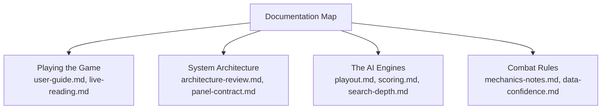

# TTRSolver Documentation Index

Welcome to the complete technical and gameplay documentation for **TTRSolver**.

If you're looking for a high-level overview of what TTRSolver is and how to install it, start at the main **[Project README](../README.md)**. The guides below delve into the mechanics, AI engines, live game reading, and engineering logs.

---

## Quick Navigation

---

## 1. Using TTRSolver

| Document | Description | Kind |
|---|---|---|
| **[user-guide.md](user-guide.md)** | Step-by-step setup guide, overlay panel tour, and troubleshooting. | *Reference* |
| **[live-reading.md](live-reading.md)** | How screen OCR, digit recognition, and the Local API work safely. | *Reference* |
| **[realms.md](realms.md)** | Dedicated guide for Toontown Realms support via network streams. | *Reference* |
| **[panel-contract.md](panel-contract.md)** | JSON data contract between Python worker and the React HUD. | *Reference* |
| **[visualizer-spec.md](visualizer-spec.md)** | Architecture and API behind the browser tree visualizer. | *Reference* |

---

## 2. How the AI Engines Work

| Document | Description | Kind |
|---|---|---|
| **[architecture-review.md](architecture-review.md)** | High-level system design, threading/process model, and data flow. | *Reference* |
| **[playout.md](playout.md)** | The flagship Playout engine: Monte Carlo rollouts to the end of the fight. | *Reference* |
| **[rollout-network.md](rollout-network.md)** | The fast neural rollout and value policies guiding Playout simulations. | *Reference* |
| **[search-depth.md](search-depth.md)** | Expectimax exact tree search, star-pruning, and branching math. | *Reference* |
| **[scoring.md](scoring.md)** | Objective functions and one-round evaluation weights. | *Reference* |
| **[ml-design.md](ml-design.md)** | Neural network architecture for the PPO actor policy. | *Reference* |
| **[ppo-math.md](ppo-math.md)** | Formal reinforcement learning math and training loss formulations. | *Reference* |
| **[heuristic-learning.md](heuristic-learning.md)** | Learned leaf evaluation for heuristic search. | *Reference* |

---

## 3. Game Combat Mechanics & Provenance

| Document | Description | Kind |
|---|---|---|
| **[mechanics-notes.md](mechanics-notes.md)** | Complete Toontown combat physics: accuracy, stun, knockback, combos. | *Reference* |
| **[data-confidence.md](data-confidence.md)** | Source audit of confirmed vs. assumed game values. | *Reference* |
| **[sos-notes.md](sos-notes.md)** | Mechanics of SOS toons, unites, and pink slips. | *Reference* |
| **[party-strategy.md](party-strategy.md)** | Experimental findings on multi-toon party coordination. | *Record* |

---

## 4. Engineering Records & Experiment Logs

| Document | Description | Kind |
|---|---|---|
| **[roadmap.md](roadmap.md)** | Project status: completed milestones, open tasks, and shelved ideas. | *Record* |
| **[experiment-log.md](experiment-log.md)** | The master lab notebook: all experiments, win-rate sweeps, and dead ends. | *Record* |
| **[live-notes.md](live-notes.md)** | Development and debugging log behind the computer vision screen reader. | *Record* |
| **[reward-experiments.md](reward-experiments.md)** | Reward function ablations for policy training. | *Record* |
| **[scorer-audit.md](scorer-audit.md)** | Detailed audit of the party scoring function. | *Record* |

---

## Reading the Numbers & Provenance Tags

- **Simulation Benchmarks:** Unless explicitly stated otherwise, win rates throughout these documents were measured in simulated battles using the rules simulator.
- **Source Integrity:** Every value in the codebase carries an explicit tag:
  - `[CONFIRMED]` (Verified via the Toontown Rewritten Wiki)
  - `[OWNER]` (Veteran player gameplay judgement)
  - `[OPEN TOONTOWN SOURCE]` (Open Toontown codebase reference)
  - `[ASSUMED]` (Explicitly labeled assumption)
  - `[TODO]` (Unknown; code raises an error rather than substituting a guess)
