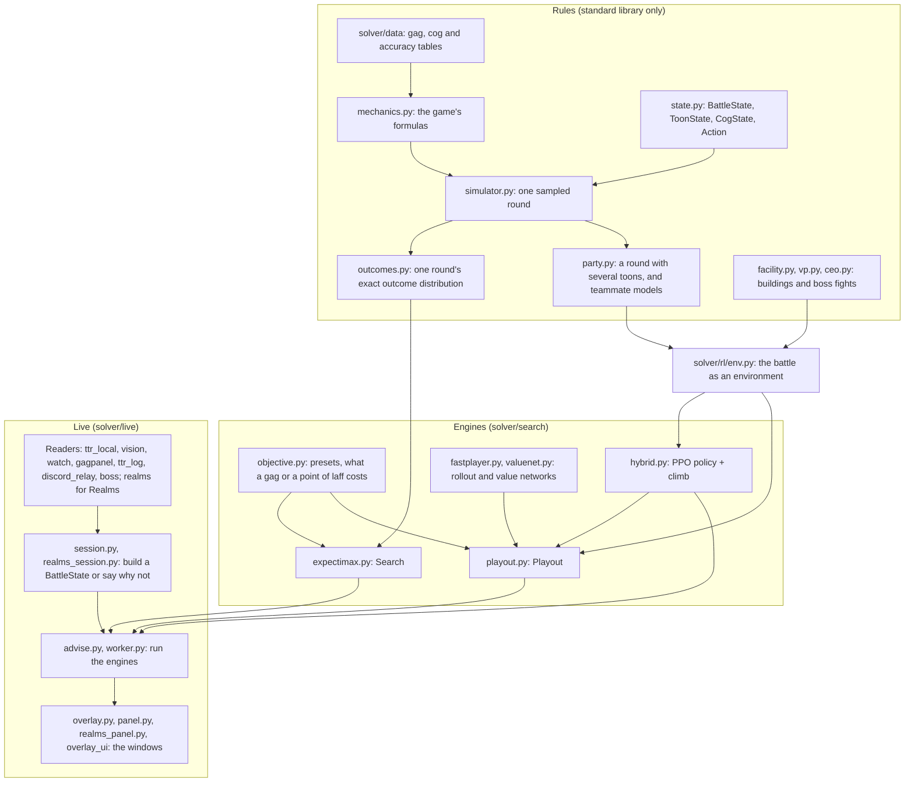
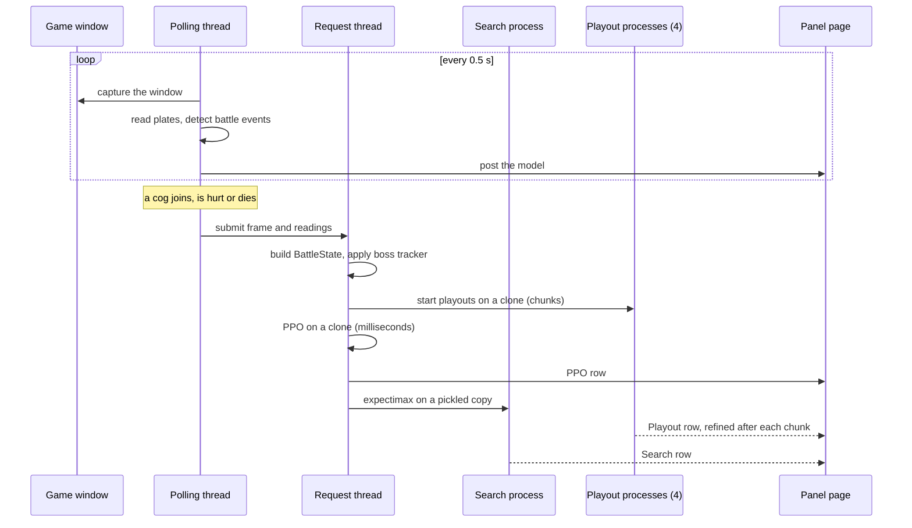

# How TTRSolver fits together

TTRSolver advises a player during cog battles in Toontown Rewritten (TTR).
Each round it says which gag to throw at which cog. This document describes
the system as it stands on 2026-10-11: the layers, the path one decision takes
from a screen frame to a line of advice, the three engines that produce
advice, how groups of players are handled, and the constraints that shaped the
design.

The filename is historical. An earlier version of this file was a review of
two engines that predates the third; what is worth keeping from it is
compressed in [the last section](#history-the-two-engine-review).

Wherever this document quotes a win rate or a time, the figure comes from
simulated fights or from timing the code, as recorded in the source comments
and commit messages. Nothing here is a measurement of the real game.

## Terms

A non-player needs about a dozen words.

| Term | Meaning |
|---|---|
| Toon, cog | The player's character and the enemy. Up to four toons fight up to four cogs at a time. |
| Gag | One attack or support item. Gags come in seven tracks (Toon-Up, Trap, Lure, Sound, Throw, Squirt, Drop), each with levels 1 to 7. |
| Laff | A toon's hit points. At zero the toon is "sad" and leaves the battle. |
| Pouch | The gags a toon carries. It is not restocked during a fight. |
| Lure, trap | A lured cog skips its attacks for some rounds. A trap goes off when its cog is lured. |
| Organic | A bonus on a track's gags that comes from the toon's gag trees. It raises damage, or accuracy for Lure. |
| Building, floor | A cog building is several battles ("floors") in a row on one pouch and one laff bar. |
| VP, CFO, CJ, CEO | The four boss fights. The VP (Vice President) has a round of cogs and then a round of skelecogs. |
| SOS card, unite, pink slip | Consumables: an SOS card calls a helper (a heal, a restock, a lure, damage); a unite heals or restocks alongside a gag without costing the round; a pink slip removes one cog. |
| Holdout | Cogs that belong to the current round of a boss fight but have not walked onto the field yet. |
| Plate | The name plate above a cog on screen. With the game's "show cog levels" option on, it shows the cog's level, department and health. |

The tags `[CONFIRMED]`, `[OWNER]`, `[ASSUMED]`, `[TODO]` and
`[OPEN TOONTOWN SOURCE]` that appear in the code are explained in
[data-confidence.md](data-confidence.md). `[OWNER]` marks the maintainer's
judgement as an experienced player, not a sourced fact.

## The layers



### Data and mechanics

`solver/data/` holds the tables: gag damage, accuracy and carry limits, the
cogs of the four departments with their attacks, and which attacks hit the
whole party. The TTR wiki is the source of truth. A value that is not
confirmed is left `None` and tagged `[TODO]`, and the code raises instead of
substituting something plausible. [data-confidence.md](data-confidence.md)
lists what is solid and what is not; the largest gap is that current cog
attack frequencies and accuracies are not published.

`solver/mechanics.py` holds the formulas that turn those tables into numbers:
gag accuracy, damage and its bonuses, lure duration and wake-up, and which
toon a cog attacks. `solver/state.py` defines the position:
`BattleState` (a list of toons, the cogs on the field, the holdout, and how
many cogs later rounds hold), `ToonState`, `CogState` and `Action`.

### One round, three ways

The rules of a round exist in three forms, because three consumers need
different things from them.

| Module | Gives | Used by |
|---|---|---|
| `simulator.step` | One sampled next state for a lone toon | Solo rollouts, tests |
| `outcomes.action_outcomes` | Every next state with its exact probability | The Search engine |
| `simulator.apply_party_round`, wrapped by `party.step` | One sampled round for any number of toons | `rl/env.py`, and through it the PPO policy's training, the Playout engine and the sweeps |

The toon's half of a round is written once (`simulator.apply_toon_action`) and
shared. The cogs' half is genuinely implemented more than once, so
`tools/round_parity.py` plays random positions through all three and reports
any expected outcome that differs beyond sampling error. A fixed-seed version
runs in the test suite.

One rule is easy to get wrong and matters for every engine: **accuracy is
rolled once per track per target, not per gag.** Gags of the same track aimed
at the same cog all land or all miss together. Rolling each gag separately
would let a party hedge by stacking a track on one cog, which is not the game.

`solver/facility.py`, `solver/vp.py` and `solver/ceo.py` describe fights longer
than one battle: a building's floors, and the rounds of a VP or CEO.
`solver/rl/env.py` wraps all of it as an environment with `reset` and `step`.
It is not training-only. The live advisor calls its observation encoding to
run the policy network, and the playouts step fights through it.

### The engines

Three engines answer the same question and are described
[side by side below](#the-three-engines). They share
`solver/search/objective.py`, which defines the five presets a player can pick
(Balanced, Speedrun, Conserve, Survive, Glass Cannon). A preset is a choice
about what "playing well" means, such as how a point of laff trades against a
scarce gag. None of it is game data, and it is kept out of `solver/data/` for
that reason.

### The live readers

TTR is read from four sources, each authoritative for one thing.

| Source | Module | Gives |
|---|---|---|
| The official Local API (opt-in, HTTP on localhost) | `ttr_local.py` | Laff, which gag tracks are trained, organic, location, pink slips. It does not expose the battle. |
| The game's own window | `window.py`, `watch.py`, `vision.py`, `gagpanel.py`, `digits.py`, `catalogue.py` | The cogs (level, department and health from each plate, identity from the head render) and the count of each gag from the gag menu |
| The client's log file | `ttr_log.py` | Entering a boss room |
| What the game publishes to Discord Rich Presence | `discord_relay.py` | A building's floor count, for display |

Toontown Realms, a different server, is read by `realms.py` from the server
stream that Realms runs on the player's own machine. The reader subscribes and
queries; it never sends an update or a command. Realms' balance differs from
TTR's, so nothing read there may reach `solver/data/` (see
[realms.md](realms.md)).

Nothing in the project reads game memory, hooks or injects into a client, or
sends input to a game.

`session.build_state` (TTR) and `realms_session.build_state` (Realms) join
the sources into a `BattleState`. Each returns a state or the list of reasons
there is not one, never a guess. `boss.py` holds the published structure of the
boss fights and counts cogs defeated against it, which is what gives the
engines a view of rounds that have not started.
[live-notes.md](live-notes.md) covers the readers in detail.

### The worker and the panels

`solver/live/worker.py` defines `AdviceWorker`, the part of a panel that does
not care where the state came from: which engine's answer is on screen, what a
"no, not that" rejects, how a setting reaches the engines, and the playout
scheduler. Two subclasses supply the state: `overlay.Worker` reads the TTR
screen, and `realms_panel.RealmsWorker` reads Realms.

The windows are views over a plain `Model` object. `solver/live/panel.py` shows
it in a pywebview window drawn by the React app in `overlay_ui/`;
`solver/live/overlay.py` also contains a Tk window over the same worker; and
`solver/live/advise.py` can print advice to a terminal. `python run.py` lists
every front end and says which optional dependencies each needs.
[panel-contract.md](panel-contract.md) documents the fields the page receives.

### What depends on what

The layering is mostly one-directional, with three exceptions worth knowing
before moving code:

- `simulator.py` and `outcomes.py` import `search/objective.py`, because a
  round's reward is defined by the objective.
- `party.py` imports `search/expectimax.py` for one of its teammate models.
- `rl/env.py` imports `search/party_search.py` for the reward, and
  `search/hybrid.py` imports `rl/env.py` for the observation encoding.

`worker.py` imports neither backend, by rule: it is shared by the TTR panel and
the Realms panel, and Realms data must not leak into anything TTR-specific.

## The path of one decision

This is the TTR panel. Realms differs only in the first half, as noted after
the steps.



1. **Capture.** Every 0.5 s the polling loop (`overlay.Worker.run`) asks the
   window manager where the window titled "Toontown Rewritten" is and grabs
   only that rectangle (`window.game_rect`, `watch.Capture`). The lookup is
   Windows-only; elsewhere the whole screen is grabbed.
2. **Read the cogs.** `BattleWatcher.poll` finds the plates, reads each
   plate's level, department and health, and names the cog from its head
   render against a collected library (`catalogue.py`). A battle is entered
   only when plates and the gag menu are both visible, because plate-coloured
   scenery alone once produced phantom battles. The watcher emits events: a
   battle started, a cog joined or was defeated, damage landed, a reading was
   corrected.
3. **Decide whether to think.** Engines run only when an event changes the
   position, when the player asks, or when a failed read is being retried.
   Between those the previous answer stands.
4. **Build the state.** On a new request thread (`advise.Thinker`), the Local
   API snapshot supplies laff and training, the gag menu supplies counts, and
   the plates supply the cogs. The menu's "Total gags" label is read
   separately and used as a checksum on the counts; a mismatch refuses the
   state. If anything is missing the panel shows the reasons and no advice.
5. **Add what the player knows about the fight.** A frozen copy of the boss
   tracker marks the state as a VP or CEO and sets how many cogs later rounds
   hold. The player's own counts of unites and pink slips are added, since the
   screen cannot show them.
6. **Run three engines.** The playouts are started first on a clone of the
   state, in their own process pool. PPO then runs on another clone in the
   request thread and posts its move within milliseconds. Finally the state is
   sent to the search process, and the request thread waits for it.
7. **Word the answer.** Each engine's move is turned into a line such as
   "Safe on cog 1 (Flunky, 42/42 hp)" by `advise._render`, with reasons
   (accuracy, expected incoming damage) from `explain.py`, which reads them off
   the same functions the scorer uses.
8. **Show it.** The worker posts a copy of the model to a queue; the page
   receives it as JSON. The Playout row's move is the one displayed unless the
   player has picked an engine. PPO's move is shown until the playouts post
   their first.

A request for the same position as the one being searched does not restart
anything. A request for a new position supersedes the old one: its playouts
stop at the next chunk boundary and the old search process is terminated.

In the Realms panel, steps 1 to 4 are replaced by `RealmsWorker.tick`, which
builds the state from typed fields every 0.4 s and re-runs the engines when the
position's key changes.

## The three engines

All three are computed every round and shown as three rows. A player can
switch the displayed row at no cost, because the other answers already exist.

| | PPO | Search | Playout |
|---|---|---|---|
| Module | `search/hybrid.py` (`climb`) | `search/expectimax.py` | `search/playout.py` |
| What it computes | A trained policy network proposes a plan; coordinate ascent tries alternatives and keeps what a one-round scorer prefers | The expected value of each move over the exact outcome tree, to a depth limit | The mean result of playing each of about ten candidate moves to the end of the fight |
| Looks ahead | One round | Several rounds of the battle on the field | The whole fight, including rounds not yet on the field in a VP or CEO |
| Chance | Expectation over accuracy rolls for one round | Exact probabilities | Sampled, with the same random numbers for every candidate |
| Cost per decision | Milliseconds | A time budget: 15 s by default on TTR, 4 s on Realms | Anytime: a first answer after two rollouts per candidate, refined until the think time runs out |
| Where it runs | The request thread | One child process | Four child processes |
| Follows the preset | No | Yes | Yes, relative to Balanced |
| Groups | Plans every seat | Solo; teammates are a count | Joint plans or modelled teammates (see below) |
| Needs numpy | Yes | No | Yes |

### PPO (`hybrid.climb`)

A policy network trained with PPO (proximal policy optimisation) and exported
as plain numbers (`solver/rl/ppo_facility.json`) ranks the legal moves for each
seat. `climb` starts from the network's first choice and sweeps the seats,
offering each the network's top alternatives plus targeted probes (the pass,
the cheapest kill, the cheapest lure, SOS cards, a unite), and keeps any change
that `party_search._quick_score` prefers. That scorer takes the expectation of
one round over its accuracy rolls with hand-set weights; see
[scoring.md](scoring.md). [ppo-math.md](ppo-math.md) covers the training.

Its strength is cost. Timings recorded in the code range from about 2 ms to
26 ms per decision depending on the board and settings, and one comparison
over 80 single battles with a wounded toon found it agreeing with Search on 79
while running about 2,000 times faster (98.8% of battles won against 100%).

Its weakness is the one-round view. On 500 simulated solo VP sides it won 36
(7.2%), spending its power gags on the easy cog round and meeting the skelecog
round without them.

Besides being the instant answer, `climb` proposes the Playout engine's menu
and plays out group fights inside playouts.

### Search (`expectimax`)

A depth-limited expectimax: the toon's move is a MAX node, and the gag's hit
roll with the cogs' counter-attack is a CHANCE node with exact probabilities
from `outcomes.action_outcomes`. It uses *-minimax pruning (the analogue of
alpha-beta for chance nodes), a memo across depths, and iterative deepening
under a time budget, so it returns the deepest pass that finished. At the depth
cutoff it scores the board with a linear evaluator fitted against exact
solutions of small fights (`search/fitted.py`, checked in as plain floats).
[search-depth.md](search-depth.md) has the branching analysis.

Fully exact search is expensive. On a real endgame loadout (20 distinct gags,
30 root actions, two cogs) depth 1 took 0.01 s, depth 2 took 9.3 s and depth 3
many minutes. The panel therefore collapses the cogs' attacks into their mean
where the preset allows it and drops 3% of probability mass per chance node,
which reaches depth 4 against two cogs and depth 3 against three or four
within the 15 s budget.

Its strength is exactness inside its horizon. In single battles its move stops
changing by depth 4, and it is the only engine whose values are not estimates.

Its weakness is the horizon itself. It searches the battle on the field. The
count of cogs still to come can make gags dearer in its objective, but those
cogs are never simulated. On 60 simulated one-toon sides of a two-player VP it
won 6 where the Playout engine won 33. In buildings the two were level (146
against 149 of 200). Three attempts to give it a learned leaf evaluator
(`search/valuenet.py`) had lower error than the fitted leaf and played no
better; that network is off by default.

It is also a solo search. `expectimax.solve` cannot reach a party position, and
teammates enter only as a count that thins the cogs' single-target attacks.

### Playout (`playout`)

The Playout engine builds a menu of up to twelve candidate moves, plays each
to the end of the fight with a small network choosing the later rounds, and
keeps the move whose fights ended best, using successive halving and common
random numbers to spend rollouts where candidates are close. In a boss fight
it draws the unseen cogs afresh in each rollout from what a player knows is
coming. [playout.md](playout.md) is its full reference, and
[rollout-network.md](rollout-network.md) describes the network that plays the
rollouts.

It is the strongest engine wherever the fight extends past the cogs on the
field. With a realistic VP pouch and five unites, simulated playouts won 94 of
100 solo VPs and 55 of 60 one-toon sides of a two-player VP. Its results are
estimates, and they are not comparable with Search's values.

Its costs are time and dependencies. A sweep recorded about 1.9 s per decision
on solo VPs, and it needs numpy and the shipped weights.

### Which engine is shown

The Playout row is displayed by default in every fight. It first led only in
boss fights, on the 6-against-33 measurement above. Extending that to all
fights on 2026-10-11 was the maintainer's preference after watching it play a
building (`[OWNER]`), where the measured result is a tie with Search. Once the
player clicks another engine's button, the panel stops applying the default
and shows the engine they chose.

## Parties

`BattleState.toons` is a list, and `toons[0]` is the toon being advised.
**Only part of the system is party-aware**, and the line is worth knowing
before extending either side.

### What is party-aware

- **The rules.** A sad toon leaves the battle and does not end it; the fight is
  over when every toon is sad or every cog is dead. `can_still_damage` pools
  the party's gags, so Trap on one toon and Lure on another is a winning pair
  although neither pouch is on its own. Group cog attacks damage every
  standing toon; which attacks are group attacks is `[CONFIRMED]` from the
  wiki's two attack categories.
- **The memo keys.** `outcomes.state_key` and `merge_key` key on every toon in
  order, because toons are not interchangeable.
- **The evaluator's features** (`search/features.py`) pool laff, gags and
  damage over the toons still standing. Solo feature vectors are bit-identical
  to what they were before, which is what keeps the fitted weights valid. The
  party values are defined but not validated: exact search cannot reach a
  party position, so there are no labels to check them against.
- **PPO and Playout.** `climb` plans one action per seat. The Playout engine
  handles a board with teammates on it in one of two modes.

### Two modes, and why there are two

Whether a teammate is someone you choose for or someone you predict is a
question about the players, not about the search.

- **Coordinated**: every toon's action is chosen together. This is the only way
  to find the plays that make coordinating worth anything, such as stacking a
  track on one cog or holding a Trap for someone else's Lure.
- **Pickup**: you control one toon, and the others are a chance node, sampled
  from a `TeammateModel`.

Using the wrong one gives bad advice in both directions. Searching strangers
as choices you do not have produces "throw a level 1, my teammate will throw a
level 7 into the same cog". Modelling a coordinated team as a distribution
throws away the reason they coordinated.

The default teammate model, `party.SensiblePrior`, is **a guess about how
people play**. Nothing in the wiki or the source can confirm what a stranger
throws, and any pickup-mode number rests on it. `party.NetTeammate` is a second
guess of the same standing.

`solver/search/party_search.py` is a sampled search over party positions with
both modes. It is used offline, and its one-round scorer is the judge inside
`climb`. Its values are estimates and are not comparable with exact search.
One invariant catches most bugs in it: coordinated can never score below
pickup, since it may choose everything pickup may and more.
[party-strategy.md](party-strategy.md) records what its first strategic trials
found, and two cautions from it carry over: the party evaluator is saturated on
a maxed team, and no result about Lure is trustworthy from a one-ply search.

### What is still solo

- **The Search row.** Teammates are a count.
- **`simulator.legal_actions`** enumerates one toon's moves; the party code
  builds joint plans on top of it.
- **The rollout network.** It knows one seat, so group playouts are played out
  by `climb` and are not shortened.
- **TTR's readers.** The Local API reports the player's own toon, and nothing
  reads a teammate's laff or gags off the screen. On TTR every engine sees the
  teammates as the count the player sets. The Realms stream does carry
  teammates; there PPO and Playout plan the party jointly and show the
  player's part, while Search still sees a count.

An attempt to give the TTR playouts guessed teammates was measured and
shelved: guessing gained nothing over the count, and knowing the real
teammates was worth about 11 wins in 300 simulated buildings.
[playout.md](playout.md#guessing-ttrs-teammates-gains-nothing) has the table.

## Engines get a clone, never the live board

`hybrid.climb` applies the unite it chooses to the board it is given. That is
right inside a simulation, where the board is about to be played, and wrong for
a board that anything else will read afterwards.

Both panels once passed their live board to PPO. The Search row, the
explanations and the decision log then read that same object. A Toon-Up unite
that PPO had merely considered turned 12 laff into 92 for everything
downstream, and a Gag-Up invented gags that two rows then planned with.

The rule is now explicit at every call site:

- `advise.first_answer` and `RealmsWorker._first_answer` call
  `hybrid.climb(state.clone(), ...)`.
- `Thinker` hands the playouts `state.clone()`; inside `playout.py` the menu is
  built on a clone and every rollout starts from a clone.
- The Search and Playout engines run in child processes, which receive pickled
  copies.
- The boss tracker is handed to the request thread as a frozen copy, so the
  count cannot move while it is being read.

A related rule: the model the page reads is a fresh copy on every post, so the
page never sees a model the worker is halfway through updating.

## Processes and threads

The TTR panel is one main process with several threads and five child
processes.

| Where | What runs there |
|---|---|
| Main thread | The window's event loop (pywebview, or Tk in `overlay.py`) |
| Drain thread | Takes posted models off a queue and pushes them to the page as JSON. The page also pulls every 400 ms, so a dropped push is a late frame and not a stuck panel. |
| Polling thread (`overlay.Worker`) | Captures the window and reads the plates every 0.5 s, votes on gag-menu counts while the menu is open, tracks the boss fight and the round count, and decides when to ask for advice. It never runs an engine. |
| Local API refresher | One request every 5 s on a single kept session. Discovery is never run in a loop, because the game shows its consent prompt once per new client. |
| Request thread (one per request, newest wins) | Builds the state, starts the playouts, runs PPO, and waits on the search |
| Playout coordinator thread | Walks the chunk schedule, applies halving, and posts the best move after each chunk |
| Search process (pool of 1) | `expectimax` under its time budget. A superseded search is terminated instead of being left to run out its budget. |
| Playout processes (pool of `PLAYOUT_WORKERS` = 4) | Rollouts. Each chunk's candidates are split across them and merged by key. |
| Discord relay threads | Hold the Discord pipe to read the building's floor |

The reasons for this shape are all measured. Polling has to keep its cadence
because it is what notices a cog dying, and a search takes seconds, so the two
cannot share a thread. Search and playouts are pure Python and would hold the
interpreter lock the polling thread needs, so they run in processes. Rollouts
of different candidates are independent, so four processes run a chunk about
four times as fast: when the split was introduced, the first move on a VP
opening arrived in 1.5 s instead of 3.0 s. Four are used, not every core,
because the game and the screen reader run on the same machine.

Two consequences are easy to trip over. Pool processes are reused, so any
setting that lives in a module global (the preset, the group mode, whether
level 7 gags are allowed) is set again on every call. And a value set in a
child process never reaches the parent, which is why the Search process returns
its chosen unite in its result.

The Realms panel has the same shape with a different first half: a listener
thread keeps an object store from the server stream, and the worker thread
polls that store every 0.4 s.

## Constraints that shape the design

**The core runs on the standard library alone.** The rules, the tables, the
exact search, the Local API client, the Discord relay and `run.py` import
nothing third-party. The fitted evaluator is a block of float literals and its
inference is a dot product in plain Python.

**numpy is optional and confined.** It is needed by the screen readers
(`vision.py`, `watch.py`, `gagpanel.py`, `digits.py`, `catalogue.py`,
`read_battle.py`) and by the modules that evaluate a network (`hybrid.py`,
`fastplayer.py`, `valuenet.py`, `policy.py`). Each network module reports
itself unavailable instead of raising, and callers fall back: without numpy
the PPO and Playout rows are unavailable and Search still works. The screen
extras are in `requirements-vision.txt`. `solver/live/__init__` must not
import `vision`, and the vision tests skip themselves when numpy is absent.

**No torch in `solver/`.** Training uses torch (`requirements-training.txt`)
and lives in `tools/`. Every trained network is exported to JSON as plain
numbers and evaluated with numpy.

**panda3d only in the Realms reader**, which needs the game's own parser for
its message definitions (`requirements-realms.txt`).

**No guessed state.** A reader returns a value with a confidence, a builder
returns a state or the reasons it cannot, and advice is not computed from an
invented position. The one deliberately assumed game value is tagged
`[ASSUMED]` and described in [data-confidence.md](data-confidence.md).

**Information realism.** An engine may use only what a player can see. The
published structure of a boss fight counts; the next floor of a building does
not.

**Three things end a battle.** Laff reaches zero, every cog is dead, or the
toons have no remaining way to damage a cog (`BattleState.can_still_damage`).
The third is as final as the first, since nothing restocks a pouch mid-fight.
Before it existed, a hopeless position fell through to the evaluator and
scored +47.6, and because training labels came from exact solves, the
evaluator was partly fitted to its own output.

**Tests are standard-library `unittest`**, about 1,900 of them:

```
python -m unittest discover tests
```

Measurement tools live in `tools/`. `tools/sweep.py` plays the same simulated
fights with different engines and is the harness behind the Playout figures.

## Where to read next

| Topic | Document |
|---|---|
| The Playout engine in full | [playout.md](playout.md) |
| The rollout network | [rollout-network.md](rollout-network.md) |
| What the game data is based on | [data-confidence.md](data-confidence.md), [mechanics-notes.md](mechanics-notes.md) |
| The one-round scorer and its weights | [scoring.md](scoring.md) |
| Exact search depth | [search-depth.md](search-depth.md) |
| The policy network | [ppo-math.md](ppo-math.md), [ml-design.md](ml-design.md) |
| The screen and API readers | [live-notes.md](live-notes.md) |
| Realms | [realms.md](realms.md) |
| Every experiment, including the failed ones | [experiment-log.md](experiment-log.md) |

## History: the two-engine review

This file used to be a request for outside review of two engines, written in
August 2026 before the Playout engine existed. Its full text is in the file's
git history. The engines it compared were PPO with `climb`, and the sampled
party search in `party_search.py` (not today's Search row), on one task: the
percentage of simulated cog buildings fully cleared by a party.

**The result was a tie.** Over three disjoint sets of 180 held-out buildings:

| Engine | Buildings cleared (per set) | Time per decision |
|---|---|---|
| PPO + `climb` | 65.9% (69.4 / 63.3 / 65.0) | 0.6 ms |
| Sampled party search | 65.0% (65.6 / 65.0 / 64.4) | 124 ms |
| PPO alone | 57.6% (57.2 / 53.9 / 61.7) | 0.28 ms |

The lessons that outlived the comparison:

- **Measure the noise floor first.** Three training runs that differed only in
  the seed scored 65.0%, 66.1% and 65.9%, and they reordered on a fourth set.
  The party search's own sampling seed was worth a standard deviation of 1.44
  points. A 2.8-point gap that the review had been written to explain came
  from one measurement on one set and did not survive three. Results have
  since been believed only when paired and repeated.
- **A judge must be independent of the proposer.** Four times an evaluator
  that shared the proposer's assumptions produced a result that vanished: the
  policy's own critic ranking its samples, a greedy two-round lookahead (2.8
  points worse), the policy playing a few rounds on as its own judge (3.3 to
  3.8 points worse), and a fork experiment that favoured the search only while
  the search's own rollout policy played the continuation.
- **The better move depends on who plays after it.** In that fork experiment
  (500 forks over 47 buildings, on identical dice) the search's moves led by
  2.29 points under its own continuation and by nothing distinguishable from
  zero under the policy's. This is the same reason formulas fitted to playout
  labels later failed in play.
- **Copying behaviour did not copy results.** Changes that moved the policy's
  usage statistics onto the search's bought at most 1.1 points. Holding a gag
  back, which five interventions had tried to teach, measured as worth
  nothing.
- **The scorer's terms matter and its weights do not.** Four random weight
  vectors cleared 63.3% to 65.0% of buildings; zeroing every term but damage
  cleared 57.5%.
- **A building is decided by the first toon lost.** Over 50 buildings played by
  both engines, every run that lost no toon cleared the building, and no run
  was lost to an empty pouch.
- **A self-referential teacher has no fixed point.** Distilling `climb` into
  the policy failed, because `climb` is defined as a perturbation of the
  policy's own output and the target moves with the student. Cloning the party
  search collapsed to 7.5% of buildings.

Two of those threads lead directly to the current design. The review's
unanswered request was for a horizon that the one-round scorer lacks and a
judge the proposer does not control. The Playout engine supplies both: it
plays to the end of the fight instead of a few rounds, scores cogs defeated,
and averages many rollouts on common random numbers. And once that engine
existed as a fixed, stronger teacher, expert iteration worked where it had
failed before: the rollout network trained on the Playout engine's moves
raised simulated solo-VP wins from 44 to 65 of 100, though only as a rollout
player and not as an engine in its own right.
