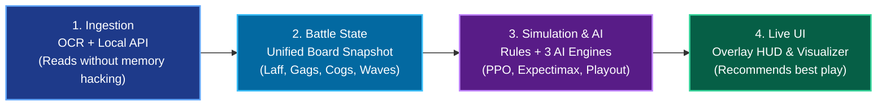
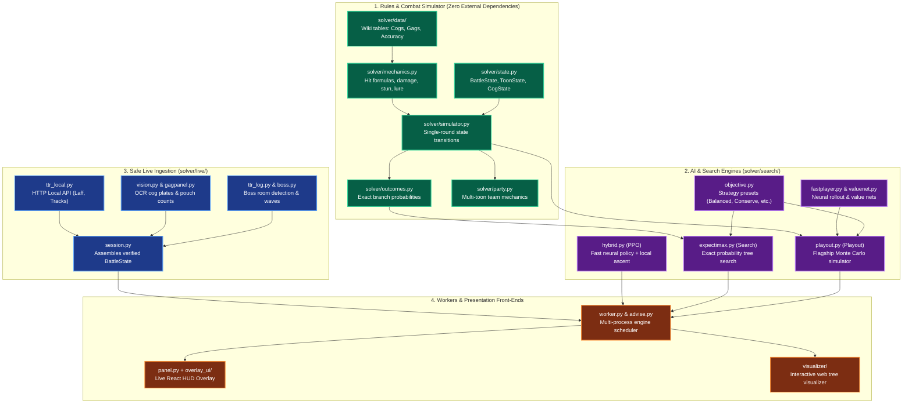
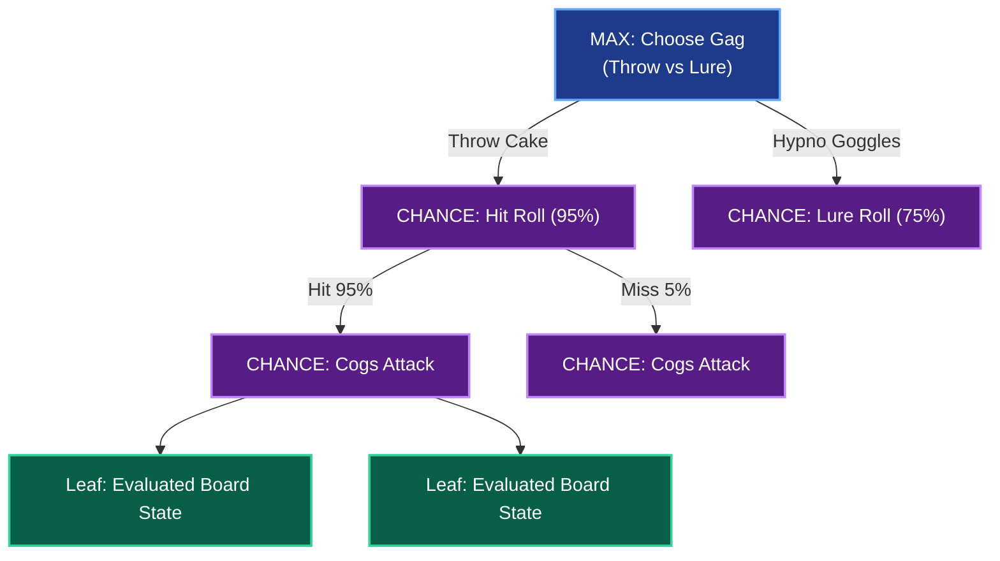
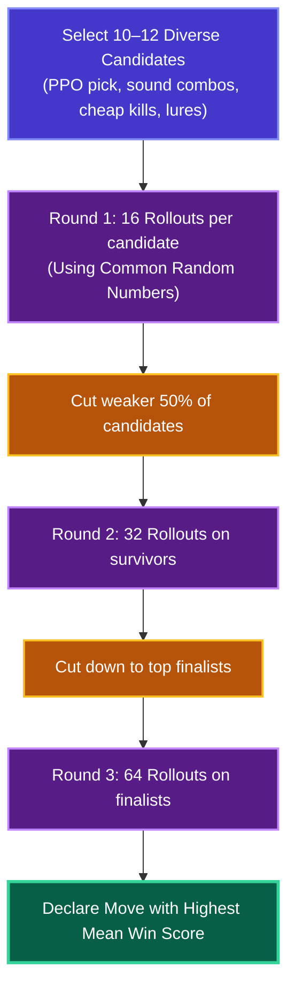
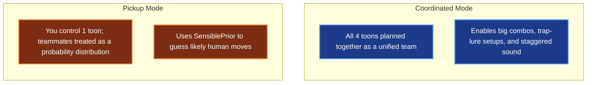
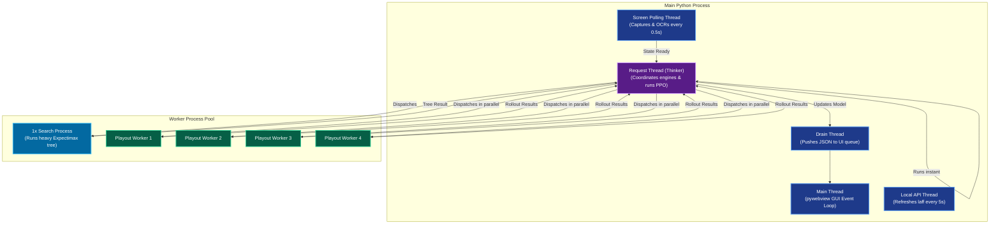

# TTRSolver System Architecture

A complete walkthrough of how **TTRSolver** works under the hood: how game data flows from your screen into Python, how combat rules are simulated with 100% precision, how three AI engines debate your best move, and why the system is built with a multi-process, multi-threaded design.

> [!NOTE]
> All win rates, performance benchmarks, and timings cited here come from simulated fights and measured profiling scripts. Game data formulas adhere strictly to the Toontown Rewritten wiki and confirmed mechanics.

---

## Table of Contents

- [Overview](#overview)
- [Key Concepts & Vocabulary](#key-concepts--vocabulary)
- [System Layers](#system-layers)
  - [1. Rules & Game Physics](#1-rules--game-physics)
  - [2. The Three AI Engines](#2-the-three-ai-engines)
  - [3. Safe Live Ingestion](#3-safe-live-ingestion)
  - [4. The Worker & Front-End Panels](#4-the-worker--front-end-panels)
- [The Lifecycle of a Decision (Frame to Advice)](#the-lifecycle-of-a-decision-frame-to-advice)
- [Engine Comparison (PPO, Search, Playout)](#engine-comparison-ppo-search-playout)
  - [PPO (`hybrid.climb`)](#ppo-hybridclimb)
  - [Search (`expectimax`)](#search-expectimax)
  - [Playout (`playout`)](#playout-playout)
- [Party Strategy (Coordinated vs. Pickup)](#party-strategy-coordinated-vs-pickup)
- [Process & Threading Architecture](#process--threading-architecture)
- [Core Design Invariants](#core-design-invariants)
- [Historical Review & Evolution](#historical-review--evolution)

---

## Overview

At any given moment during a Toontown cog fight, a player needs to know: **"What is the best gag to throw right now that keeps my team alive and doesn't waste our highest-tier gags?"**

TTRSolver answers this in real-time through four cooperating stages:



1. **Ingest safely:** Grabs the screen and queries the official Local API to build an immutable snapshot of the battle.
2. **Simulate exactly:** Runs the board against exact Toontown combat rules (accuracy, combos, stun, knockback).
3. **Solve concurrently:** Spawns three distinct AI algorithms to evaluate moves (from instant 2ms neural evaluations up to full-game Monte Carlo rollouts).
4. **Display clearly:** Renders the leading recommendation on a sleek, always-on-top HUD window beside your game.

---

## Key Concepts & Vocabulary

| Term | What it means in TTRSolver |
|---|---|
| **Toon & Cog** | Your character (up to 4 per side) and the corporate enemies (up to 4 on the field). |
| **Gag & Track** | Attacks in 7 families (*Toon-Up, Trap, Lure, Sound, Throw, Squirt, Drop*), tiered Levels 1–7. |
| **Laff** | Health points. Reaching 0 laff means your toon goes "sad" and leaves the fight. |
| **Pouch** | The gags currently in your backpack. Cannot be restocked mid-fight except via rare Unites or SOS cards. |
| **Lure & Knockback** | Lured cogs fall asleep and skip attacks. Throw and Squirt against lured cogs get $+50\%$ damage knockback. |
| **Plate** | The floating nameplate above a cog showing its department, level, and health bar. |
| **Holdout** | Cogs that belong to the current wave or boss fight but are still waiting to walk onto the field. |
| **Common Random Numbers (CRN)** | A statistical technique where all candidate moves are simulated with identical random seeds to eliminate dice luck. |

---

## System Layers

TTRSolver is organized into clean, decoupled layers where game logic, AI math, and live screen capture remain strictly separated:



---

### 1. Rules & Game Physics

- **`solver/data/`**: Ground-truth tables sourced directly from the official Toontown Rewritten wiki. Covers cog HP, cog attack tables, gag damage numbers, and carrying limits.
- **`solver/mechanics.py`**: Pure mathematical formulas for accuracy, track experience, group stun bonuses ($+25\%$ per earlier hit), and cog target selection.
- **`solver/state.py`**: Immutable dataclasses representing the entire battle state: `BattleState`, `ToonState`, `CogState`, and `Action`.

#### One Round, Three Different Implementations
Because different components need different outputs, combat rounds are evaluated in three distinct ways:

| Implementation | What it outputs | Who uses it |
|---|---|---|
| `simulator.step` | 1 sampled next state for a lone toon | Fast solo rollouts, unit tests |
| `outcomes.action_outcomes` | Every possible next state with exact mathematical probabilities | Exact Expectimax Search engine |
| `party.step` | 1 sampled next state for a team of 1–4 toons | RL training environment, Playout engine, multi-toon sweeps |

> [!IMPORTANT]
> **One Roll Per Track Rule:** In Toontown, accuracy is rolled **once per gag track per target cog**, not per gag! If three toons throw Birthday Cakes at the same cog, they all hit or all miss together. Simulating individual rolls would falsely favor stacking gags. TTRSolver strictly models the true single-roll rule.

---

### 2. The Three AI Engines

TTRSolver ships with three complementary AI engines:
1. **PPO (`hybrid.py`)**: An ultra-fast neural policy network paired with a coordinate-ascent hill climber. Runs in $\sim 2\text{ms}$.
2. **Search (`expectimax.py`)**: An exact depth-limited expectimax tree search. Calculates exact probabilities for current cogs on the field.
3. **Playout (`playout.py`)**: The flagship Monte Carlo engine. Plays out the whole rest of the fight hundreds of times using a neural rollout policy to protect future waves.

---

### 3. Safe Live Ingestion

The live readers gather information exclusively from outside the game client:
- **`ttr_local.py`**: Connects via HTTP to `localhost:1547` (TTR's official local API) for laff, unlocked tracks, organic bonuses, and location.
- **`vision.py` & `digits.py`**: Takes an OS screenshot of the game window and crops the cog nameplates. Runs a custom digit classifier trained on Toontown's native font.
- **`gagpanel.py`**: Scans the gag menu numbers and verifies them against the in-game "Total Gags" label checksum.
- **`session.py`**: Merges all sensory inputs into a complete `BattleState`. If anything is obscured or inconsistent, it refuses to guess and signals the UI to display a clear explanation.

---

### 4. The Worker & Front-End Panels

- **`worker.py` (`AdviceWorker`)**: An engine coordinator completely decoupled from GUI frameworks. Dispatches work across background processes, manages calculation budgets, and aggregates advice.
- **`overlay_ui/`**: A lightweight React web app styled with Tailwind and daisyUI. Rendered inside an Edge WebView2 window via `pywebview`.
- **`visualizer/`**: A browser-based tree exploration application (`localhost:8000`) for debugging positions and evaluating alternative branches.

---

## The Lifecycle of a Decision (Frame to Advice)

Here is what happens during a single battle round from the moment the gag selection menu appears on your screen:

```mermaid
sequenceDiagram
    autonumber
    participant G as TTR Game Window
    participant P as Polling Thread (0.5s)
    participant T as Request Thread (Thinker)
    participant S as Search Process (Expectimax)
    participant O as Playout Processes (4 Workers)
    participant U as Overlay UI (React)

    loop Every 0.5s
        P->>G: Capture game window rect
        P->>P: Detect plates, verify gag menu
    end

    Note over P: Battle detected! New round starts.
    P->>T: Submit frame, plate OCR, and Local API snapshot
    T->>T: Construct immutable BattleState (add wave holdout)

    par PPO Policy
        T->>T: Run PPO policy net on cloned state (~2ms)
        T->>U: Post instant PPO advice (card populated immediately!)
    and Exact Search Tree
        T->>S: Dispatch pickled state to Search process (depth 1–3)
    and Playout Rollouts
        T->>O: Distribute candidate moves across 4 Playout workers
    end

    loop Progressive Refinement
        O-->>U: Post updated best move after 16, 32, and 64 playouts!
    end

    S-->>U: Post finished Expectimax search branch
    Note over U: Playout move leads; user can click Search or PPO anytime.
```

---

## Engine Comparison (PPO, Search, Playout)

| Attribute | PPO (`hybrid.climb`) | Search (`expectimax`) | Playout (`playout`) |
|---|---|---|---|
| **Underlying Math** | Neural policy net + coordinate hill-climb | Depth-limited Expectimax tree | Monte Carlo tree rollout + Successive Halving |
| **Lookahead Horizon** | 1 single round | 1–3 rounds on current board | Entire fight to the end (including all reserve waves) |
| **Probability Handling** | Hand-weighted expectation | Exact mathematical probabilities | Sampled with Common Random Numbers (CRN) |
| **Speed / Latency** | **2ms – 25ms** (instant) | 5s – 15s (set by budget) | Progressive (first result at ~1s, refines to ~3s) |
| **Execution Environment** | Request thread | 1 dedicated child process | 4 dedicated worker processes |
| **Strategy Presets** | Ignores presets | Follows preset weights | Follows preset adjustments |
| **Key Strength** | Zero latency; never leaves UI blank | 100% exact math on lethal turns | Long-range gag conservation for boss fights |

---

### PPO (`hybrid.climb`)

PPO takes the 302-number battle state vector, feeds it through an actor neural network ($256 \to 256 \to 250$ action logits), and masks out illegal gags.

Next, a coordinate-ascent hill climber (`climb`) tests small adjustments:
1. Swaps one toon's move at a time with the network's top alternatives or strategic probes (e.g., cheapest lure, trap combo, SOS card).
2. Tests paired 2-toon swaps.
3. Locks in the best candidate within 24 quick evaluations.

**Why it's great:** Blazing fast. In benchmark tests against 80 single battles, it agreed with exact Search 79 times while running **2,000× faster** (98.8% win rate vs. 100%).  
**Where it struggles:** It only sees 1 round ahead. In a solo VP with 40 cogs, it might blow its Level 7 Wedding Cake on a standard cog wave, leaving nothing for the Skelecogs later.

---

### Search (`expectimax`)

Expectimax maps out a complete tree of choices:
- **MAX Nodes:** Your choice of gags.
- **CHANCE Nodes:** Every combination of hit/miss rolls and surviving cog counter-attacks, each weighted by its exact probability.



**Pruning Optimizations:**
- **Star Pruning:** Prunes chance nodes whose mathematical upper bound cannot beat the current best known action.
- **Cog-Phase Collapsing:** Groups identical damage amounts together, compressing 20–70 cog attack permutations down into a handful of outcomes.

---

### Playout (`playout`)

Playout simulates candidates through multiple rounds to the fight's completion:



#### Key Techniques
1. **Common Random Numbers (CRN):** In rollout $k$, every single candidate move encounters the exact same random seed. If one move lands a hit and another misses, it's because of the move's base accuracy—not lucky dice.
2. **Successive Halving:** Instead of spending equal compute on bad moves, the bottom 50% are dropped at 16 and 32 playouts. Compute is focused on the razor-thin decisions.
3. **Rollout Policy Network:** A lightweight neural policy plays subsequent rounds at blazing speed, allowing hundreds of full-battle rollouts in seconds.

---

## Party Strategy (Coordinated vs. Pickup)

When multiple toons are in a battle, how should an AI model teammates? TTRSolver supports two fundamental modes:



- **Coordinated Mode:** Optimizes all 4 toon seats simultaneously. This is essential for high-level play—for example, coordinating one toon to place a Trap while another Lures, or combining three Pies for a $+20\%$ damage combo.
- **Pickup Mode (`SensiblePrior`):** Models random teammates using realistic human heuristics. Prevents the solver from dangerously assuming a random teammate will save you with a Level 7 gag when you throw a Level 1 gag!

---

## Process & Threading Architecture

To keep the overlay responsive and prevent screen reading from stuttering your game, TTRSolver isolates tasks across threads and dedicated processes:



### Architecture Rationale
- **Zero GUI Freezes:** Heavy Expectimax searches and thousands of Monte Carlo rollouts run in child processes, keeping the Python Global Interpreter Lock (GIL) completely free.
- **Parallel Speedup:** Splitting candidate rollouts across 4 worker processes reduced VP opening evaluation times from 3.0s down to 1.5s!
- **Instant Abort:** If a cog dies or a new round starts, outdated searches are terminated immediately and restarted on the fresh board.

---

## Core Design Invariants

1. **Engines Always Get Clones, Never the Live Board:**  
   > [!IMPORTANT]
   > During development, an early bug allowed PPO to test a Toon-Up Unite directly on the live board object. Downstream search processes suddenly believed the toon had 92 health and extra gags!  
   > **The Iron Rule:** Every engine receives an explicit `state.clone()` before any simulation begins.
2. **Fail-Safe Verification (No Guessing):**  
   If an OCR reading fails or gag counts do not match the pouch checksum, the advisor displays the exact reason and **refuses to give advice**. No synthetic guesses are ever fed to the player.
3. **Information Realism:**  
   The engines only know what a skilled human player could know. They know the structure of a boss fight (e.g., 40 total cogs in a VP), but they never peek at future floors of a building or randomly generated unknown cogs.

---

## Historical Review & Evolution

In August 2026, the project underwent a rigorous head-to-head comparison between **PPO with `climb`** and **Sampled Party Search** over hundreds of simulated buildings:

| Engine Tested | Buildings Cleared | Time per Decision |
|---|---|---|
| **PPO + `climb`** | **65.9%** | **0.6 ms** |
| **Sampled Party Search** | 65.0% | 124 ms |
| **PPO alone (no climb)** | 57.6% | 0.28 ms |

### Lessons Learned
- **The Proposer Needs an Independent Judge:** Having a neural policy evaluate its own sampled moves led to circular overconfidence. The best move requires an objective, external evaluator.
- **The Birth of Playout:** A one-round scorer cannot foresee the end of a boss fight. The Playout engine was built specifically to solve this—playing fights all the way to the end and using Common Random Numbers to eliminate noise.
- **Expert Iteration Breakthrough:** Training a neural rollout policy on the Playout engine's winning trajectories raised simulated solo VP wins from **44% to 65%**, and eventually to **94% with Unites**.

---

*Continue reading:*
- [The Playout Engine Deep Dive](playout.md)
- [Combat Mechanics & Game Rules](mechanics-notes.md)
- [How Game Data is Read from Screen & API](live-reading.md)
