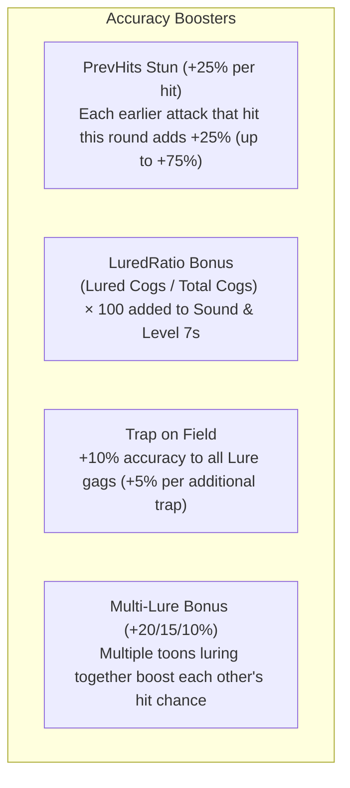
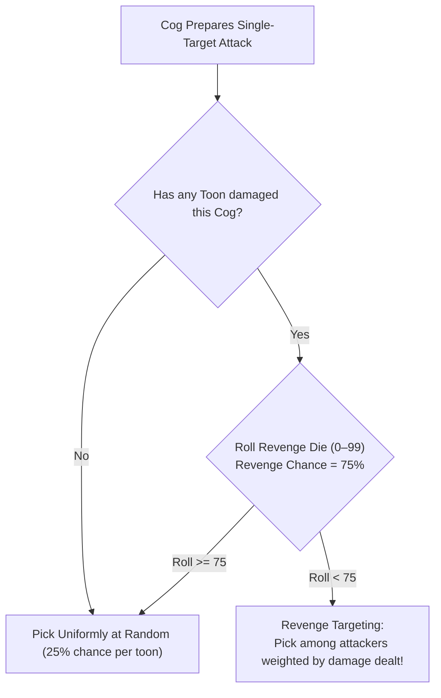
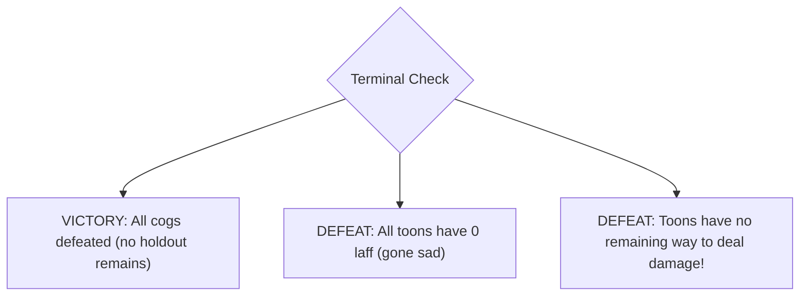

# Toontown Rewritten Battle Mechanics (As Implemented)

A comprehensive, rule-by-rule reference of the combat mechanics simulated in **TTRSolver**. 

This document explains how gag tracks resolve, how accuracy rolls are calculated, how damage combos and knockback work, how cogs pick their attacks and targets, and what conditions trigger the end of a battle.

> [!NOTE]
> **Provenance & Source Tags:**  
> Every rule in TTRSolver is tagged by its data source:
> - `[CONFIRMED]`: Verified directly from the official [Toontown Rewritten Wiki](https://toontownrewritten.wiki).
> - `[OWNER]`: Judgement from the maintainer's experience as a veteran player (not a cited wiki fact).
> - `[OPEN TOONTOWN SOURCE]`: Sourced from the historical Open Toontown codebase (a reference lead, not authoritative for modern TTR).
> - `[ASSUMED]`: Explicitly labeled best-guess assumption where documentation is ambiguous.
> - `[TODO]`: Unknown value; the code raises an error rather than substituting a guess.

---

## Table of Contents

- [Quick Battle Glossary](#quick-battle-glossary)
- [Where the Rules Live in Code](#where-the-rules-live-in-code)
- [The Round Resolution Order](#the-round-resolution-order)
- [Accuracy Mechanics](#accuracy-mechanics)
  - [The Accuracy Formula](#the-accuracy-formula)
  - [Guaranteed (Forced) Outcomes](#guaranteed-forced-outcomes)
  - [Bonus Terms (Stun, LuredRatio, Multi-Lure)](#bonus-terms-stun-luredratio-multi-lure)
  - [One Roll Per Track Per Target](#one-roll-per-track-per-target)
- [Damage & Combos](#damage--combos)
  - [Same-Track Combo Bonus (+20%)](#same-track-combo-bonus-20)
  - [Lured Knockback Bonus (+50%)](#lured-knockback-bonus-50)
  - [Healing & Toon-Up](#healing--toon-up)
  - [Version 2.0 Cogs & Carryover Damage](#version-20-cogs--carryover-damage)
- [Lure Mechanics](#lure-mechanics)
- [Trap Mechanics](#trap-mechanics)
- [The Cog Counter-Attack Phase](#the-cog-counter-attack-phase)
  - [Cog Attack Selection](#cog-attack-selection)
  - [Cog Target Selection](#cog-target-selection)
  - [Single vs. Group Cog Attacks](#single-vs-group-cog-attacks)
- [The Gag Pouch & Inventory Limits](#the-gag-pouch--inventory-limits)
- [Battle End Conditions](#battle-end-conditions)
  - [The "No Way to Damage" Rule](#the-no-way-to-damage-rule)
  - [The Pass Move](#the-pass-move)
- [Key Deviations from Open Toontown & Guide](#key-deviations-from-open-toontown--guide)
- [Known Limitations & Gaps](#known-limitations--gaps)

---

## Quick Battle Glossary

| Term | In-Game Meaning |
|---|---|
| **Toon & Cog** | Up to 4 player characters facing up to 4 enemy suits on the field. |
| **Laff** | Toon HP. At 0 laff, a toon goes "sad" and is eliminated from the battle. |
| **Gag Track** | One of 7 attack categories (*Toon-Up, Trap, Lure, Sound, Throw, Squirt, Drop*), levels 1–7. |
| **Lure** | Puts cogs to sleep so they skip attacks and take $+50\%$ damage knockback. |
| **Trap** | Placed in front of a cog; triggers explosive damage the instant that cog is lured. |
| **Stun Bonus** | $+25\%$ accuracy granted to later attacks for each preceding attack that hit this round. |
| **Organic Gag** | Bonus from growing trees at your estate ($+10\%$ damage, or $+10\%$ accuracy for Lure). |
| **Version 2.0 Cog** | A cog with an outer business suit and a Skelecog underneath (two separate HP bars). |

---

## Where the Rules Live in Code

| Module | Core Responsibility |
|---|---|
| **`solver/data/`** | Ground-truth stat tables for all cogs, attacks, and gag attributes. |
| **`solver/mechanics.py`** | Accuracy rolls, stun stacking, damage formulas, and cog target AI. |
| **`solver/state.py`** | Data structures for `BattleState`, `ToonState`, `CogState`, and `Action`. |
| **`solver/simulator.py`** | Executes single sampled rounds (`step` for solo, `apply_party_round` for teams). |
| **`solver/outcomes.py`** | Exhaustive probability distributions of all possible round outcomes (for Expectimax search). |
| **`solver/party.py`** | Complete multi-toon party simulator including cooperative actions and cog attacks. |

---

## The Round Resolution Order

Every round of combat in Toontown resolves in a strict, unchangeable sequence. Toons select their moves independently, and then gags fire in order of their track:

```mermaid
flowchart LR
    direction TB
    G1["1. Toon-Up<br/>(Heals teammates)"] --> G2["2. Trap<br/>(Sets trap under cog)"]
    G2 --> G3["3. Lure<br/>(Puts cogs to sleep & springs Traps)"]
    G3 --> G4["4. Sound<br/>(Hits all cogs & wakes lured cogs)"]
    G4 --> G5["5. Throw<br/>(Heavy pie attack, +50% on lured)"]
    G5 --> G6["6. Squirt<br/>(Fast water attack, +50% on lured)"]
    G6 --> G7["7. Drop<br/>(Heavy weight; 100% misses lured!)"]
    G7 --> C1["8. Cog Phase<br/>(Surviving awake cogs strike back)"]
```

### Strategic Implications of the Resolution Order
- **Trap resolves before Lure:** You can place a Trap and throw a Lure in the *exact same turn*. The Trap sets up first, and then the Lure pulls the cog into it immediately!
- **Lure resolves before Throw/Squirt:** A Lure landing in the same turn guarantees a 100% hit and $+50\%$ knockback damage for teammate pies and water!
- **Sound wakes lured cogs before Drop lands:** If a toon uses Sound and another uses Drop on a lured cog, the Sound wakes the cog *before* the Drop arrives, allowing the Drop to hit!

---

## Accuracy Mechanics

### The Accuracy Formula
Every gag attack calculates its hit probability using:

$$\text{atkAcc} = \text{propAcc} + \text{trackExp} + \text{tgtDef} + \text{bonus} \qquad [\text{clamped between } 5\% \text{ and } 95\%]$$

The game generates a random roll from $0$ to $99$. The attack hits if the roll is strictly less than $\text{atkAcc}$.

| Term | What it is | How it is computed | Source |
|---|---|---|---|
| **`propAcc`** | Base gag accuracy | Flat across most tracks: Throw ($75\%$), Squirt ($95\%$), Sound ($95\%$), Drop ($50\%$). Lure varies by level ($60, 55, 70, 65, 80, 75, 90$). Organic Lure adds $+10\%$. | `[CONFIRMED]` |
| **`trackExp`** | Track experience | $(\text{highest unlocked level in track} - 1) \times 10$, giving $0$ to $60\%$. Halved for Toon-Up ($0$ to $30\%$). | `[CONFIRMED]` |
| **`tgtDef`** | Target cog defense | Penalty from $-2\%$ (Level 1 cog) down to $-55\%$ (Level 12 cog). Group gags take the penalty of the highest-level cog. | `[CONFIRMED]` |
| **`bonus`** | Stacking bonuses | Sum of stun bonuses, lured ratio bonuses, and multi-lure boosts. | `[CONFIRMED]` |

#### Worked Example
> A maxed toon (Track Exp $= 60\%$) throws a Birthday Cake (Base Acc $= 75\%$) at an un-lured Level 12 Cog (Defense $= -55\%$):
> $$\text{atkAcc} = 75 + 60 - 55 = 80\% \text{ hit chance}$$

---

### Guaranteed (Forced) Outcomes

Certain conditions bypass the accuracy roll entirely:

| Case | Guaranteed Outcome | Rule Notes |
|---|---|---|
| **Any Trap gag** | **100% Always Hits** | Traps never miss. |
| **Throw / Squirt on Lured Cog** | **100% Always Hits** | Pies and water cannot miss a sleeping cog. |
| **Drop on Lured Cog** | **0% Always Misses** | Drop always cancels/misses if the cog is lured! |
| **Pink Slip (Fire)** | **100% Guarantees Elimination** | Instantly destroys the cog. |
| **SOS Cards** | **100% Guaranteed Success** | Restocks, heals, and SOS attacks never roll accuracy. |

---

### Bonus Terms (Stun, LuredRatio, Multi-Lure)

1. **PrevHits (The Stun Bonus):**  
   Each attack from an earlier track that landed this round adds **$+25\%$ accuracy** to subsequent attacks (capped at $+75\%$).  
   *Example: A toon uses Squirt on a cog. That hit adds $+25\%$ to a teammate's Drop attack in the same round, raising Drop's accuracy from $50\%$ to $75\%$!*
2. **LuredRatio Bonus:**  
   $$\text{Bonus} = \left(\frac{\text{Lured Cogs}}{\text{All Live Cogs}}\right) \times 100$$  
   Added to the accuracy of all Sound gags, as well as Wedding Cake (Level 7 Throw) and Geyser (Level 7 Squirt).
3. **Trap's Bonus to Lure:**  
   Having a Trap placed in front of any live cog grants all Lure gags a flat **$+10\%$ accuracy bonus** ($+5\%$ for each additional trap).

---

### One Roll Per Track Per Target

> [!IMPORTANT]
> In Toontown Rewritten, accuracy is rolled **once per track per target cog**, not per gag!
>
> If three toons throw Pies at the same cog:
> - They do **not** roll three separate times.
> - The game rolls **one single die**. Either all three pies hit, or all three pies miss!
> - The highest accuracy among the toons sets the threshold for the entire group.

---

## Damage & Combos

### Same-Track Combo Bonus (+20%)

When two or more toons attack the **same cog** with gags of the **same track** in the same round, the damage is pooled and receives an extra **$+20\%$ bonus** (rounded up):

$$\text{Total Damage} = \Big(\sum \text{Gag Damage}\Big) \times 1.20$$

*(Excludes Toon-Up, Trap, and Lure).*

#### Worked Combo Examples
- **Two Elephant Trunks (Sound Lv 5 = 21 dmg each) on 4 cogs:**  
  $(21 + 21) = 42 \to 42 \times 1.2 = 50.4 \implies \mathbf{51} \text{ damage to every cog!}$
- **Two Birthday Cakes (Throw Lv 6 = 100 dmg each) on one Level 12 Cog:**  
  $(100 + 100) = 200 \to 200 \times 1.2 = \mathbf{240} \text{ damage!}$

---

### Lured Knockback Bonus (+50%)

When a Throw or Squirt attack hits a lured cog, it deals **$+50\%$ knockback damage**:

$$\text{Knockback Damage} = \lfloor \text{Damage} \times 1.50 \rfloor$$

If combined with a same-track combo, the $20\%$ combo bonus is added first, and the $50\%$ knockback is applied to the combined total:
> **Combo + Knockback:**  
> Two Birthday Cakes ($100$ dmg each) on a Lured Cog:  
> $(100 + 100) \times 1.2 = 240 \text{ base combo} \to \lfloor 240 \times 1.5 \rfloor = \mathbf{360} \text{ damage!}$

---

### Healing & Toon-Up

- **Cannot Heal Yourself:** Toon-Up heals other toons only. In solo play, Toon-Up is disabled.
- **Missed Heals Still Heal:** A Toon-Up that "misses" still restores **$20\%$ of its healing value** (rounded up).
- **Group Healing Splits:** A group Toon-Up splits its heal evenly across surviving teammates. In a 4-toon team, the thrower heals the other 3 toons (split into 3 equal shares).

---

### Version 2.0 Cogs & Carryover Damage

A Version 2.0 Cog has an outer suit and an inner Skelecog, each with a full health bar:
- **No Damage Carryover:** TTR removed damage spillover in update 3.0.0. If you deal $180$ damage to an outer suit with only $10$ HP remaining, the excess $170$ damage is completely lost!
- **Pink Slips Destroy Both Layers:** A Pink Slip instantly destroys both the suit and the Skelecog in one shot.

---

## Lure Mechanics

- **Duration by Level:**
  | Gag | Level | Sleep Duration |
  |---|---|---|
  | $1 Bill / Small Magnet | Lv 1–2 | 2 rounds |
  | $5 Bill / Big Magnet | Lv 3–4 | 3 rounds |
  | $10 Bill / Hypno-Goggles | Lv 5–6 | 4 rounds |
  | Presentation | Lv 7 | 8 rounds |
- **Damage Wakes Sleeping Cogs:** Any attack that deals damage (Sound, Throw, Squirt) immediately wakes the cog. The cog receives its $+50\%$ knockback, wakes up, and will attack that round if it survives!
- **No Lure Stacking:** Re-luring a cog that is already asleep does nothing.

---

## Trap Mechanics

- **How Trap Works:** A trap sits armed in front of a cog until a Lure lands on that cog. When lured, the cog walks onto the trap, takes massive damage, and is **not left asleep** (the trap consumes the lure).
- **One Trap Per Cog:** You cannot place two single-target traps under the same cog. If two toons trap the same cog in the same turn, both traps cancel and are wasted!
- **Railroad (Level 7 Trap):** Sets a trap under all cogs. Overrides existing traps on the board.

---

## The Cog Counter-Attack Phase

At the end of each round, all surviving, awake cogs attack the toon party.

### Cog Attack Selection
Every cog has a roster of attacks with predefined hit rates and damage numbers:
- `mechanics.pick_cog_attack` samples an attack according to its frequency distribution.
- If the attack hits, damage is subtracted from the targeted toon.

---

### Cog Target Selection

When a cog uses a single-target attack, how does it choose which toon to hit? TTRSolver simulates the authentic target AI:

1. **The 75% Revenge Rule:** If toons have damaged the cog, there is a **$75\%$ chance** the cog retaliates against those attackers, with odds weighted directly by who dealt the most damage!
2. **Persistent Memory:** TTRSolver models cogs as remembering who hurt them across the entire battle.

---

### Single vs. Group Cog Attacks

- **Single-Target Attacks (54 attacks):** Targets one specific toon chosen via the Revenge AI.
- **Group Cog Attacks (14 attacks):** Attacks like *Power Trip, Tremor, and Filibuster* roll accuracy once and hit **every toon in the battle**!

---

## The Gag Pouch & Inventory Limits

- **Pouch Capacity:** Upgraded from 20 to 80 gags throughout toon progression.
- **Level 7 Exemption:** Level 7 gags (Wedding Cake, TNT, Opera, Geyser, etc.) **do not count toward your pouch total**. You carry at most 1 of each.
- **Zero In-Combat Restock:** Gags spent are gone for the rest of the battle, unless restored with a Gag-Up Unite or SOS card.

---

## Battle End Conditions

A battle state is marked terminal (`BattleState.is_terminal`) when any of the following occur:

### The "No Way to Damage" Rule
A battle is considered lost if the party runs out of all viable means of damaging cogs:
- Holding only Lure gags $\implies$ **Defeat** (cannot damage cogs).
- Holding only Toon-Up and Trap $\implies$ **Defeat** (traps can never be sprung without Lure).
- Holding a Pink Slip or damage SOS $\implies$ **Safe** (can still defeat cogs).

---

### The Pass Move
A toon can choose to pass (`Action(track=None)`). In exact Expectimax search, passing is capped at 3 free passes to prevent infinite evaluation loops while ensuring toons can wait out active lures strategically.

---

## Key Deviations from Open Toontown & Guide

| Mechanic | Open Toontown / Strategy Guide | TTRSolver Implementation | Rationale |
|---|---|---|---|
| **Cog Target Memory** | Erased every round (`CLEAR_SUIT_ATTACKERS`) | Persists for entire fight | Observed TTR behavior (`[OWNER]`). Cogs don't forget who attacked them. |
| **Combo Damage Target** | Applied combo to all cogs touched by group gag | Applied per individual cog | Observed modern TTR rule (`[OWNER]`). |
| **Stun Bonus Size** | $+20\%$ per hit (max $+60\%$) | **$+25\%$ per hit (max $+75\%$)** | Verified modern TTR values (`[CONFIRMED]`). |
| **LuredRatio Scope** | Applied to almost all tracks | Sound and Lv 7 Throw/Squirt only | Verified modern TTR values (`[CONFIRMED]`). |
| **Multi-Lure Bonus** | Not present in Toontown Online | **$+20\%, +15\%, +10\%$** | Modern TTR 4.0.0 addition (`[CONFIRMED]`). |

---

## Known Limitations & Gaps

- **Cog Attack Frequencies:** Modern TTR does not publish internal cog attack frequencies; historical values are used where unpublished.
- **Damage Assumptions:** The solver calculates damage assuming full gag track training (`DAMAGE_TRAINED_FRACTION = 1.0`).
- **Soft Accuracy Cap:** TTR 4.3.3 introduced a soft accuracy cap where bonuses slightly exceed $95\%$; TTRSolver treats $95\%$ as a hard ceiling.

---

*Related Documentation:*
- [Architecture Review](architecture-review.md)
- [Playout Engine Guide](playout.md)
- [Data Confidence & Provenance](data-confidence.md)
