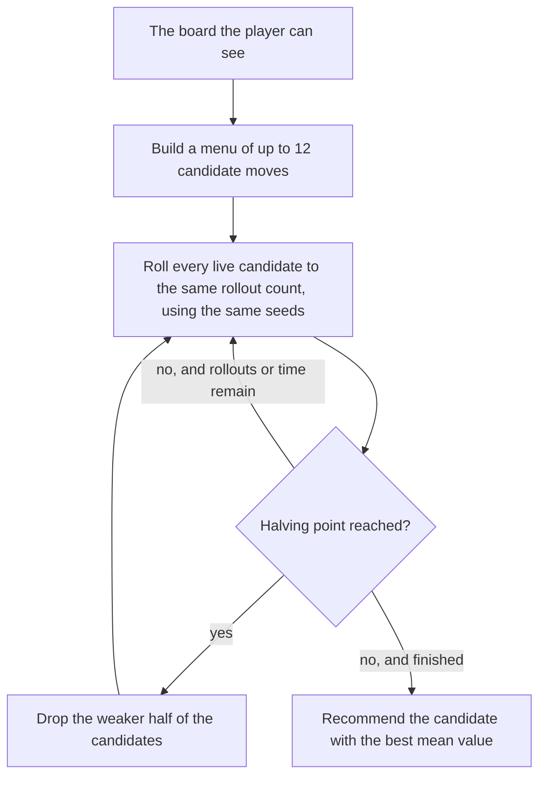

# The Playout engine

The Playout engine chooses a move by trying it. It takes a short menu of
candidate moves for the current round, plays each one forward to the end of
the fight many times in the simulator, and recommends the move whose fights
ended best. It is the third of the three engines the live panel shows (beside
PPO and Search, described in [architecture-review.md](architecture-review.md)),
and since 2026-10-11 it is the row the panel displays by default.

The code is [`solver/search/playout.py`](../solver/search/playout.py). Every
constant in that file carries a comment with the measurement behind it; this
document collects those measurements in one place.

**Every result on this page comes from simulated fights**, played by
`tools/sweep.py` against the project's own model of the game. None is a
measurement of the real game. Where the model is known to disagree with the
maintainer's experience of real play, this page says so (see
[Known gaps](#known-gaps)).

## Terms

| Term | Meaning |
|---|---|
| Toon, cog | The player's character and the enemy. A battle is up to four toons against up to four cogs on the field. |
| Gag, track, level | A gag is one attack or support item. Gags come in seven tracks (Toon-Up, Trap, Lure, Sound, Throw, Squirt, Drop), each with levels 1 to 7. |
| Laff | A toon's hit points. A toon at zero laff is "sad" and leaves the battle. |
| Pouch | The gags a toon carries. Nothing restocks it during a fight except a unite or a restock SOS card. |
| Lure, trap | A lured cog skips its attacks for some rounds. A trap is laid in front of a cog and goes off when the cog is lured. |
| VP, CEO, CFO, CJ | The four boss fights. A VP (Vice President) has a round of cogs and then a round of skelecogs. |
| Building, floor | A cog building is several battles ("floors") in a row with one pouch and one laff bar. |
| SOS card | A consumable that calls a helper: a heal, a restock, a lure, damage to every cog, and so on. |
| Unite | A consumable that heals the party (Toon-Up unite) or restocks gags (Gag-Up unite). It is used alongside a gag and does not cost the round. |
| Pink slip | A consumable that removes one cog outright. The code calls it a "fire". |
| Holdout | Cogs that belong to the current round of a boss fight but have not walked onto the field yet. |
| climb | `hybrid.climb`, the PPO row's engine: a trained policy network proposes a plan and coordinate ascent improves it against a one-round scorer. |
| One-round scorer | `party_search._quick_score`, the hand-weighted function `climb` uses to rank plans by what happens in a single round. |
| Rollout, playout | One simulated continuation of the fight from the current board. The two words are used interchangeably. |

The tags `[CONFIRMED]`, `[OWNER]`, `[ASSUMED]`, `[TODO]` and
`[OPEN TOONTOWN SOURCE]` are explained in
[data-confidence.md](data-confidence.md). `[OWNER]` marks the maintainer's
judgement as an experienced player. It is not a sourced fact.

## The idea



Four ideas hold it together.

1. **A diverse menu.** About ten moves, chosen so that every kind of move is
   represented, not only the ones a one-round scorer likes. See
   [The menu](#the-menu).
2. **Playouts to the end of the fight.** Each candidate is played as the
   opening move, and a fast policy plays every later round until the fight is
   won, lost, or (since 2026-10-09) eight further rounds have passed and a
   value network estimates the rest.
3. **Common random numbers.** Rollout number `k` uses the same seed for every
   candidate (`seed * 1000003 + k * 7919`), so all candidates face the same
   unseen cogs and the same dice in rollout `k`. They differ only by the
   opening move, which makes the comparison paired and much less noisy than
   independent sampling.
4. **Successive halving.** Rollouts are spent where they matter. With the
   shipped stages `HALVING = (16, 32, 64)`, every candidate gets 16 rollouts,
   the better half continues to 32, and the better half of those continues to
   64. At least two candidates are always kept (`HALVING_KEEP_AT_LEAST`). For
   a ten-move menu that is 10 x 16 + 5 x 16 + 3 x 32 = 336 playouts.

The winner is the surviving candidate with the highest mean value. A tie goes
to the first candidate on the menu, which is `climb`'s own pick.

`playout.pick_wide` is this procedure as one function call. It is what the
measurement harness runs. The live panel runs the same procedure in chunks so
that it can show an answer early; see [In the live panel](#in-the-live-panel).

### Why playouts, and not a better formula

The engine exists because of two measurements on solo VPs, the hardest fight
the project models.

First, on a benchmark of solo-VP positions where each candidate was labelled
by playing it out many times, the one-round scorer was a weak guide to how
fights end. The module records its regret as 0.65 cogs against 0.73 for
picking at random among `climb`'s own top four. A larger version of that
benchmark is described under [The menu](#the-menu).

Second, the obvious fix failed. A formula was fitted to those playout labels,
twice, and used as the judge in play. The solo-VP win rate went from about 7%
to 3.6% and to 0.4%. The reason given in the code: a label for one decision is
only valid while the old player plays the rest of the fight, and a fitted
judge used every round is a different player. The project's notes say not to
attempt a third fit without a new idea about why it would work.

So the playouts themselves are the judge.

## The menu

`wide_candidates(state, reject)` builds the menu. It runs `climb` once on a
copy of the board with a spy on `climb`'s scorer, so it collects every plan
`climb` scored along with its score. For a lone toon the menu is then filled
in this order, skipping duplicates, until it holds `WIDE_CAP` = 12 entries
(ten, plus room for two unite variants):

1. `climb`'s pick, carrying its unite if it chose one.
2. If `climb`'s pick used a unite, the same gags without the unite, so the
   unite has to earn its use.
3. Up to two unite variants: `climb`'s gags opened with the largest Toon-Up
   unite worth its heal, and with the all-tracks Gag-Up, when the toon holds a
   unite and is off cooldown.
4. The one-round scorer's top two plans (`WIDE_SCORER_TOP`).
5. The PPO policy network's two highest-ranked legal moves
   (`WIDE_POLICY_TOP`).
6. The best-scored plan of every *kind* `climb` considered. A kind is a track
   together with whether the gag is single-target or hits every cog, each
   type of SOS card, a pink slip, or a pass.
7. A pass, when nothing else on the board is productive (see
   [The pass](#the-pass)).

Every entry must pass `playable`: the plan is checked against the real board,
with its unite applied first, counting each gag, card and slip it needs.
`climb` scores plans on boards a unite has already changed, so without this
check the menu held plans that threw gags only a Gag-Up would have restocked.

Moves the player has turned down in the panel (`reject`) are passed to `climb`
and to the policy ranking, so they stay off the menu.

### Why the one-round scorer does not choose the menu

The first version of the engine (`playout.pick`, still available as the `top3`
arm of the sweep) played out only the scorer's top three plans. A benchmark of
797 solo-VP positions with nine candidates each (`tools/ground_truth.py`)
showed what that filter costs. Each figure is the gain in cogs
defeated over the average candidate, with the best candidate chosen on half of
the rollouts and scored on the other half:

| Judge | Gain over the average candidate |
|---|---|
| `climb`'s pick (the scorer's first choice) | +0.37 cogs |
| Best of the scorer's top four | +0.70 |
| Best of four *random* entries from `climb`'s menu | +0.92 |
| Best of all nine candidates | +1.36 |

Four random menu entries beat the scorer's own top four, and the best move lay
outside the scorer's top four in 49% of positions. The menu is therefore built
for diversity, and the rollouts do the narrowing. On 200 fresh paired solo VPs
the wide menu with halving at 2/4/8 rollouts won 79 (39.5%) against 38 (19.0%)
for the top three played out eight times (+57/-16 on discordant fights,
p < 0.001).

## One playout

`rollout(state, plan, horizon, seed)` returns the value of one playout that
opens with `plan`.

1. **Build the fight** (`build_env`). The board is cloned into a
   `rl.env.BattleEnv`. If a horizon is known, the unseen cogs are drawn from
   it using the rollout's seed (see [Information realism](#information-realism)).
2. **Play the opening move** (`step_round`). If the plan carries a unite, the
   unite is applied first, provided the toon holds one and is off cooldown.
3. **Play the rest.** A rollout player chooses each later round until the
   fight ends, `ROUND_CAP` = 400 rounds pass, or the playout is shortened.
4. **Score it** with `value`, and subtract `spend_charge`.

### Who plays the rest of the fight

`ROLLOUT_PLAYER = "net"` selects `fastplayer`, a small network that picks a
move in one forward pass. It is used because 91% of a playout's time was
`climb` choosing each later round. Measured on 200 paired solo VPs with the
wide menu, when the network was first introduced as a copy of `climb`:

| Rollout player | Rollouts (halving stages) | Wins of 200 | Time per move |
|---|---|---|---|
| `climb` | 2 / 4 / 8 | 71 | 3.37 s |
| network | 2 / 4 / 8 | 63 (p = 0.42 against `climb`) | 0.78 s |
| network | 8 / 16 / 32 | 111 | 3.06 s |

At about equal time the network won +60/-20 on discordant fights (p < 0.001),
2.83 more cogs a fight (standard error 0.63). It was slightly worse per rollout
and afforded four times as many.

The network has since been retrained by expert iteration, with the Playout
engine itself labelling the moves. Playouts using the retrained network won 65
against 44 of 100 simulated solo VPs (p 0.001) and 68 against 37 on 100 fresh
seeds (p < 0.001), were level in solo buildings (121 against 128 of 1,000,
p 0.32), and take about 15% longer per decision. Played on its own, without
playouts, the network hoards gags in buildings (108 against 155 of 2,000), so
it is a rollout player and not a standalone engine. The training method,
inputs and data are described in [rollout-network.md](rollout-network.md).

Three details of the rollout player matter for reading the engine:

- If the network's weights or numpy are missing, `climb` plays the rollouts at
  `ROLLOUT_BUDGET` = 8 scorer calls. Budget 8 tied budget 24 on 200 paired
  solo VPs (72 against 78 wins, p = 0.58) at half the cost.
- The network knows one seat. A board with more than one toon is played on by
  `climb`, which plans every seat together.
- The continuation sees what the live panel sees (`_view`): the cogs waiting
  to walk in are stripped from its board, and it is given only their count.

### Shortened playouts and the value net

Since 2026-10-09 a solo playout does not have to run to the end. With
`ROLLOUT_DEPTH = 8`, once the opening move and eight further rounds have been
played, the playout stops and returns

```
cogs defeated so far + value net's estimate of the rest - spend_charge
```

The value net (`solver/rl/playout_value.json`, loaded through
`valuenet.load`) was trained on 68,030 boards. Each label is the playout's own
unit: cogs defeated from that board to the end of the fight, plus `LAFF_WEIGHT`
times the laff left, with the rollout network playing the fight out. Its
held-out mean absolute error is 1.34 cogs. Because each playout is cheaper, the
halving stages were doubled to (16, 32, 64) at the same time.

| Comparison | Fights (simulated) | Result |
|---|---|---|
| Shortened at 8 rounds with doubled stages, against full playouts | 260 solo VPs | 175 against 163 wins (+56/-44, p 0.27), 28% less time per decision |
| Same | 100 duo-VP sides | 57 against 52 wins, but slower (1.72 s against 1.37 s): short fights save less than the extra playouts cost |
| Same idea, value net **not** told how many cogs are still to come, cut at 4 rounds | 60 solo VPs | 19 against 37 wins (+1/-19) |

The gain in wins is not statistically established. The change shipped for the
time saved. The third row is the instructive failure: the panel's board does
not include the holdout, so a net reading only that board could not tell 16
cogs still to arrive from none. The shipped net takes the holdout count and the
later-round count as two extra inputs.

Shortening applies only when the fast network is playing, so only to solo
playouts. If numpy or the weights file is absent (`ROLLOUT_VALUE = "auto"`),
playouts run in full.

## What a playout is worth

`value` scores the end of a playout in units of cogs:

```
value =   cogs defeated
        + laff weight   x  (party laff left / party max laff)
        + pouch weight  x  (pouch worth at the end / pouch worth at the decision)    buildings only
        - (turn charge + ROUND_TIEBREAK)  x  rounds played
```

and `rollout` subtracts `spend_charge` from it.

**Cogs defeated** is the count at the start minus the count at the end, where
both include cogs on the field, cogs waiting to walk in, and cogs in later
rounds.

**The laff tiebreak** (`LAFF_WEIGHT = 0.5`). Without it, a playout that ends
with the battle on screen scores every sensible move the same, because all the
cogs die either way, and `climb`'s pick wins by default. On a party VP every
candidate read 4.0. The term is worth at most half a cog, so a cog always
outweighs laff. Adding it did no measurable harm: 123 against 119 of 200 solo
VPs and 66 against 69 of 600 solo buildings.

**The round tiebreak** (`ROUND_TIEBREAK = 0.001`). On a board every playout
wins, a move that wasted the round tied with the move that ended the fight. A
thousandth of a cog per round separates only moves that tie on both cogs and
laff.

**The pouch term** (`POUCH_WEIGHT = {"facility": 2.0}`). In a building the next
floor's cogs are unknown to the player, so a playout ends with the floor on
screen, and without this term the gags left over were worth nothing. The case
that prompted it: against a lone 32 hp cog the engine preferred a Foghorn (a
gag that hits every cog) to a Whole Cream Pie, spending one of two Foghorns on
a floor that was already won. The term applies only when there is no horizon
and the fight is a building.

`pouch_value` prices the remaining gags by the damage they could still deal:
damage per cog (the middle of the gag's range in the wiki-sourced tables,
organic where the toon has it) times the cogs it can expect to hit, which is 1
for a single-target gag and `GROUP_REACH = 2.5` for a gag that hits every cog.
The 2.5 is `[OWNER]` and has not been measured. The k-th last copy of a gag
counts `1 + LAST_COPY / k` times, so spending one of two Foghorns costs more
than one of three pies. Gags that deal no damage (Toon-Up, Lure) are priced as
the Search row prices a throw and converted at the rate the same toon's damage
gags give.

The weight was swept on 600 paired buildings with a fixed mid-game toon:

| `POUCH_WEIGHT` | 0 | 1 | 1.5 | 2 | 3 | 6 |
|---|---|---|---|---|---|---|
| Buildings cleared of 600 | 413 | 412 | 414 | 411 | 407 | 378 |

Weights 1 to 3 are within noise of 0 (p > 0.5). Weight 6 hoards and loses
(p < 0.001). The shipped 2 is just past the roughly 1.7 that turns the Foghorn
into the pie. It changes no measurable outcome, because simulated buildings
are decided by laff. What it buys is advice that spends the gag an experienced
player would.

### `spend_charge`

`spend_charge(start, end, plan)` is subtracted from every playout. It has
three parts.

**Wasted reach.** `simulator.wasted_reach` gives the share of the live cogs
that a hit-all gag or SOS card cannot reach (Drop on lured cogs, Lure on cogs
already lured, Trap on cogs already trapped) or whose lure it would undo (a
group Trap waking lured cogs). The opening move is charged that share times
`SOS_REACH_PRICE = 0.5` cogs for a card or `GAG_REACH_PRICE = 0.1` for a gag.
This is a stated preference (`[OWNER]`), and all three engines charge it. It
cost no wins: 43 and 43 of 100 simulated Realms VPs with and without it
(+2/-2).

**The gag economy** (`ECONOMY = True`, `ECONOMY_WEIGHT = 2.0`, `[OWNER]`).
Outside buildings the playouts originally charged nothing for what they spent,
so a Storm Cloud on a level 5 cog tied a cheaper Safe and won by noise, where
PPO and Search both price every gag. Now every gag spent in the playout, by
the opening move and by the rollout after it, is charged:

```
charge = ECONOMY_WEIGHT x (preset's price of the gags spent) x LAFF_WEIGHT / (Balanced's laff weight x your max laff)
```

The price is the panel preset's own `gag_price`. Under Balanced, at weight 1, a
Storm Cloud costs about two points of laff and a Safe about one; the shipped
weight doubles both.

| Change | Fights (simulated) | Result |
|---|---|---|
| Economy on, weight 1, against off | 100 Realms VPs | 42 against 41 wins (+4/-3) |
| Same | 200 solo buildings | 22 against 21 wins (+1/-0) |
| Weight 2 against weight 1 | 100 solo VPs | 73 against 75 wins (+5/-7, p 0.77) |
| Same | 1,000 solo buildings | 104 against 104 wins |

The weight was doubled because of one real board, not a sweep. With a toon
that has no Lure facing a level 5 cog at full health, the Safe led the Storm
Cloud by only 0.0026 +/- 0.0021 cogs at weight 1, which is a coin flip, and the
panel showed the Storm Cloud. At weight 2 the lead is 0.0085 +/- 0.0025.

**The SOS call price** (`SOS_CALL_PRICE = 0.0`). Zero, and measured. A per-call
price was tried to stop the engine calling an SOS card on nearly every board
of a Realms VP. The real cause was elsewhere (see
[SOS cards are one pool](#sos-cards-are-one-pool)). Pricing calls on top of
that fix only delayed them, since every arm still spent about 4.3 of 5 calls,
and it lost: 43, 38 and 30 wins of 100 Realms VPs at prices of 0, 0.5 and 1 cog
(1 against 0: p = 0.035).

### How the panel's preset scales these

The panel has five presets (Balanced, Speedrun, Conserve, Survive, Glass
Cannon), defined as `Objective` values in `solver/search/objective.py`. A
preset reaches the playouts as `playout.STYLE`. Each effect is defined
relative to Balanced, so Balanced is exactly the measured engine and the other
presets move by their own numbers:

| Effect | What changes | Presets that move it |
|---|---|---|
| Caution | `LAFF_WEIGHT` x (preset's laff weight / Balanced's) | Glass Cannon x0.25, Survive x3 |
| Thrift | The pouch weight x (preset's price for this pouch / Balanced's price for it) | Glass Cannon 0, Conserve above 1 |
| Speed | A per-round charge of (preset's turn cost - Balanced's) / win bonus, as a fraction of the whole fight | Speedrun only |
| Economy | The price of each gag spent | Glass Cannon charges nothing, Conserve more |

Measured before the economy charge existed, paired:

| Regime | Balanced | Conserve | Survive | Speedrun | Glass Cannon |
|---|---|---|---|---|---|
| Fixed mid-game toon, 200 buildings (wins) | 149 | 147 | 142 | 141 | 140 |
| Solo VP with five unites, 60 fights (wins) | 57 | 57 | 55 | 53 | 56 |

No preset beats Balanced on wins (p 0.08 at worst in the building row), which
is expected: Balanced is the measured setting and the others trade wins for
what they ask for. Speedrun does what it says, with 38.4 rounds per VP against
Balanced's 46.5. The PPO row ignores the preset.

The preset and the group mode are module-level settings. `chunk_in_child` sets
both on every call, because the worker processes are reused between boards.

## Information realism

The engine may use only what a player can see. A playout starts from the board
on screen. It is never shown which cogs are coming.

What a player does know, in a boss fight, is the fight's published structure
and how many cogs have been defeated. `solver/live/boss.py` turns that into a
`Horizon`: how many cogs are still to walk into this round, the level band
they come from, and the count and level band of each later round. Each playout
fills those slots with a fresh draw from the band, using the rollout's seed, so
every candidate's k-th rollout meets the same drawn cogs and different
rollouts meet different ones.

- The VP's two level bands (1 to 12 for cogs, 8 to 12 for skelecogs) are
  `[CONFIRMED]` from the wiki. The round sizes are `[OWNER]`: 20 cogs a round
  in all, so 20 + 20 for a solo toon and 10 + 10 per side with company.
- The CEO's first round is `[OWNER]` (20 per side, so 40 solo, the solo figure
  being the maintainer's "I think"). Its second round is unknown, so the
  horizon stops after round one.
- The CFO and CJ are `[TODO]`. No horizon is built for them.
- A building has no horizon by design. The next floor is unknown to the player,
  so it is unknown to the engine, and the playout ends with the floor on
  screen. This is what the pouch term compensates for.

Knowing the structure matters. Before the boss tracker existed, the same solo
VP played without it cleared 5 of 100 against 13 of 100 with it (+12/-4,
p = 0.077), because without a horizon a level 7 gag costs the least it ever
can and the pouch was spent on the easy round.

## Unites, SOS cards and the pass

### A unite rides on the plan

A unite is not an action. It is applied in the planning phase, before the gag
is chosen, so `climb` reports it beside its plan and applies it to the board
it was handed. Every playout hands `climb` a copy of the board. Until
2026-10-06 that meant the unite landed on the copy and the round was played
with the gag alone: no simulated fight ever spent a unite, and the Playout row
could not advise one.

`playout.Plan` is a list of actions that also carries a unite.
`climb_with_unite` returns one, `step_round` applies the unite to the real
fight before the gags, and the menu offers `climb`'s move both with and
without it. The fix changed the picture of the VP completely. Paired, with a
realistic VP pouch:

| Regime | No unites | Five unites |
|---|---|---|
| Solo VP, 100 fights | 57 wins | 94 wins (+38/-1) |
| One side of a two-player VP, 60 fights | 33 wins | 55 wins (+22/-0) |

Every solo-VP figure measured before that date had unites unusable.

`climb` proposes a unite only when it clears a deliberately high price
(`unites.UNITE_PRICE`), so short of near death it never does. The playouts
charge no price for a unite and judge it by how the fight ends, which is why
the menu adds its own unite variants.

Inside a rollout, the shipped fast network has a unite head and can open a
round with a unite. That network was shipped on the maintainer's judgement
about realism, since otherwise the playouts value every unite held past this
round at nothing. The measured cost was within noise: 94 to 93 of 100 solo VPs
(p 1.00), and 167 against 163 of 200 duo-VP sides on a re-check (p 0.64), at
about 55% more time per decision in that comparison.

### SOS cards are one pool

`ToonState.sos_calls` is the number of calls a toon may still make, across all
cards. Before it existed, a budget of five calls reached the solver as five of
every card, and the Playout row called an SOS on 13 of 28 boards of a logged
Realms VP. The call price of zero above was measured after this fix.

### The pass

A pass (`Action(track=None)`) is legal whenever a cog is lured, and otherwise
while the state's small allowance of free passes lasts. On a lured board a
pass costs no laff and no gag this round, and what it gives up is small next
to playout noise. When the menu offered a pass on every board it sometimes won
by luck, and the advice read "pass and let the lure lapse", which is never the
right move for a lone toon with something to throw.

`PASS_ON_MENU = "needed"` keeps a lone toon's pass off the menu unless no
other legal action is productive, for example a toon holding only Trap and
Lure against cogs that are all lured. A party's joint plans keep the pass,
because that is how one toon conserves gags while a teammate covers
(`[OWNER]`).

This took two attempts. The first gated only the explicit pass entry at the
end of the menu, and measured neutral: 41 against 43 of 100 Realms VPs,
differing on 2 fights (p = 0.5). It differed so rarely because the pass was
still arriving another way: `climb` scores a pass whenever one is legal, a
pass counts as a kind of move, and so it came in through `climb`'s own pick
and the best-of-each-kind slots. On sampled boards with every cog lured and
something to throw, the menu still held a pass on 10 to 20% of them. The
second attempt refuses a bare pass in every slot. Against the first, on
simulated fights: 96 against 97 of 1,000 solo buildings (+2 / -3) and 68
against 71 of 100 solo VPs (+8 / -11, p = 0.65), with VP fights nine rounds
shorter on average (44.9 against 54.2). The first behaviour is kept as
`PASS_ON_MENU = "kinds"` for comparison.

## Groups

A board with more than one toon on it is handled according to
`playout.GROUP_MODE`.

**Coordinated** (the default). The candidates are joint plans, one action per
toon, taken from `climb`'s menu and kept diverse by what each seat does. The
rollouts play every seat together with `climb`. The panel shows your seat's
part of the best joint plan. It assumes the teammates play theirs; the next
board is read as it really is, so a teammate who does something else simply
means the plan is redone.

**Pickup.** The candidates are your moves alone, built on a board with the
teammates reduced to a count, so the menu stays about ten moves whatever the
party size. In each rollout the fast network plays you and a teammate model
plays everyone else. The default model is `party.SensiblePrior`. **It is a
guess about how people play, not a rule of the game**, and nothing in the wiki
or the source can confirm it. Every pickup-mode number rests on it.
`TEAMMATE_MODEL` swaps in another model, such as `party.NetTeammate`, which is
also a guess.

In both modes a teammate who is recorded as holding a unite opens the round
with one (`TEAMMATE_UNITES`), chosen from their own seat by the fast network's
unite head. In pickup mode that is again a model of what a stranger does. The
live readers record no unites for anyone but the player.

Which mode a live panel reaches depends on what it can read. Realms reports
the teammates, so its Playout row plans coordinated. TTR shows the client one
toon, so its board carries the teammates as a count and the playouts are solo
playouts in which the cogs' single-target attacks are thinned.

### What was measured

All simulated. The boss-fight rows depend on how many cogs a side faces, which
changed on 2026-10-05 when a party VP side was corrected from 20 + 20 to
10 + 10.

| Question | Fights | Result |
|---|---|---|
| Pickup playouts against `climb` | 600 party-building sides | 288 against 268 wins (+34/-14, p = 0.006), 0.25 s a decision |
| Pickup playouts on a party VP at 20 + 20 a side | 300 sides | 1 against 0 wins: uninformative |
| Planning the party together against each toon alone, at 20 + 20 a side | 40 party VPs | Together 23 wins (26 with joint-plan playouts), alone 0, with either teammate model |
| Two-toon VP side at the corrected 10 + 10 | 40 sides | `climb` 40, playouts 40: the fight is easy for either engine |
| Coordinated playouts against `climb` on a two-toon CEO side, no unites | 200 sides | 48 against 43 wins (+16/-11, p = 0.44): neutral, for want of a horizon past round one |
| Same CEO side with five unites per toon | 40 sides | 37 wins whether or not the engine models the teammates' unites (+3/-3) |
| Modelling teammates' unites, pickup | 100 party buildings | 68 against 64 wins (+5/-1, p 0.22) |
| `NetTeammate` against `SensiblePrior` as the assumed model | 200 party buildings | 93 to 101 wins across the four truth/assumption pairs: no measurable difference from what the engine assumes |

### Guessing TTR's teammates gains nothing

Because TTR shows only a count of teammates, an attempt was made to give the
playouts stand-in toons to plan around. It was measured on 300 simulated party
buildings, with the real teammates playing `SensiblePrior`, and shelved:

| What the Playout row sees of its teammates | Wins of 300 |
|---|---|
| The count alone (shipped) | 120 |
| One fixed set of stand-ins built like you, pickup | 110 to 111 |
| The same stand-ins, coordinated | 106 (p 0.02 against the count) |
| Stand-ins redrawn in every rollout (from the true street / from your laff band) | 120 / 119 |
| The real teammates | 131 (p 0.04) |
| Stand-ins given the real teammates' laff only | 114 |
| Stand-ins given the real pouch and training | 129 |

One fixed guess is a specific wrong teammate that the playouts plan around, and
it loses. Redrawing the guess in every rollout ties the count, which is what
averaging over unseen teammates should do. Knowing the real teammates is worth
about 11 wins of 300, all of it from what they hold and how they are trained.
So the stand-ins stay off in the panel (`Worker.stand_in_teammates`), and the
only lever left is evidence of what these particular teammates hold, which is
not built. [roadmap.md](roadmap.md) records the open problems.

## In the live panel

The panel runs the same procedure as an anytime computation
(`AdviceWorker._start_playout` in `solver/live/worker.py`).

- **Processes.** Playouts run in a pool of `PLAYOUT_WORKERS` = 4 child
  processes, separate from the Search row's process. One cheap call
  (`menu_in_child`) fetches the menu's keys. Each chunk then splits the live
  candidates across the processes (`chunk_in_child`); every process rebuilds
  the same deterministic menu, rolls only its share, and the results are
  merged by key. If two processes disagree about the menu, the chunk is
  discarded.
- **Chunks.** `SCHEDULE` gives the cumulative rollouts per candidate after each
  chunk: 2, 4, 8, then every 4 up to 64. A chunk is at most four rollouts per
  candidate, so a deadline is overshot by one short chunk at worst. A chunk is not started if, judging by how long the last one
  took, it would end past the think-time budget.
- **Halving.** When the cumulative count reaches 16 and 32, the weaker half of
  the live candidates stops being rolled.
- **What is on screen.** A move is posted after the first chunk of two
  rollouts. While playouts are still arriving, a challenger replaces the move
  on screen only if it `leads`: its mean paired difference over the rollouts
  both have is positive and larger than one standard error of that difference.
  Without this rule the displayed move flipped between candidates on noise.
  If the displayed move is eliminated by halving, the best survivor replaces
  it.
- **The finished answer** is the measured rule: the plain best mean among the
  survivors, with ties to `climb`'s pick, whatever was on screen while
  refining.
- **Staleness.** Before each chunk the worker checks that the board the
  playouts were started for is still the current one, and stops if not.

The Playout row is the one the panel displays unless the player has picked an
engine. It first led only in boss fights, on the strength of one measurement:
on 60 one-toon sides of a two-player VP the Search row won 6 and the Playout
row 33 (+28/-1), because only the playouts see the rounds after the one on the
field. Since 2026-10-11 it leads in every fight. That extension is the
maintainer's preference after watching it play a building (`[OWNER]`), not a
measured result: in buildings the two rows were level (146 against 149 of
200). PPO's answer, which arrives in milliseconds, is shown until the playouts
post their first.

## Measured results

All rows are paired comparisons on simulated fights: both arms play the same
seeds, and the p-value is a two-sided sign test on the fights where the arms
differ. Each row was measured at the time of the change it tests, so absolute
win rates are not comparable between rows. The loadout, the seeds, the rollout
network and the rest of the engine all changed in between. In particular, every
solo-VP row before the unite fix had unites unusable.

### What moved the result

| Step | Regime | Result |
|---|---|---|
| `climb` against its top 3 moves played out 8 times | 500 solo VP sides | 36 (7.2%) against 106 (21.2%); +90/-20, p < 0.0001; +1.87 cogs a fight (se 0.35) |
| Same, through the module, horizon from the boss tracker | 200 fresh solo VPs | 10 against 54; +50/-6, p < 0.0001; +3.02 cogs a fight (se 0.56) |
| Top 3 x 8 against the wide menu, halving 2/4/8 | 200 fresh solo VPs | 38 (19.0%) against 79 (39.5%); +57/-16, p < 0.001 |
| `climb` playing on against the fast network at equal time | 200 solo VPs | 71 against 111; +60/-20, p < 0.001 |
| Unites usable (five held) | 100 solo VPs / 60 duo-VP sides | 57 to 94 / 33 to 55 |
| Rollout network retrained by expert iteration | 100 solo VPs, twice | 44 to 65 (p 0.001); 37 to 68 (p < 0.001) |
| Same | solo CEO | 8.9 to 9.8 cogs defeated (a lone toon never wins this fight in the model) |
| Pickup playouts against `climb` | 600 party-building sides | 268 to 288 (p = 0.006) |
| Playout against Search | 60 duo-VP sides | 33 against 6 (+28/-1) |

### What made no measurable difference

| Change | Regime | Result | Why it is in the engine anyway |
|---|---|---|---|
| Shortened playouts with doubled stages | 260 solo VPs | 175 against 163, p 0.27 | 28% less time per decision |
| Laff tiebreak | 200 solo VPs; 600 solo buildings | 119 against 123; 69 against 66 | Separates moves that all win the battle |
| Pouch term at weight 1 to 3 | 600 buildings | 407 to 414 against 413 | Spends the gag an experienced player would |
| Gag economy, and its weight of 2 | see above | No wins lost | Stops a dear gag winning by noise |
| Wasted-reach charge | 100 Realms VPs | 43 against 43 | A stated preference |
| Pass offered only when needed | 100 Realms VPs; then, for the complete fix, 1,000 solo buildings and 100 solo VPs | 41 against 43, p = 0.5; then 96 against 97 and 68 against 71 (p = 0.65) | Stops advice no player should follow |
| `ROLLOUT_BUDGET` 8 against 24 for `climb` in rollouts | 200 solo VPs | 72 against 78, p = 0.58 | Half the cost |
| Unite-aware rollout network | 100 solo VPs; 200 duo-VP sides | 93 against 94; 163 against 167 (p 0.64) | Realism: unites held past this round have a value |
| Rollout network retrained by expert iteration | 1,000 solo buildings | 121 against 128, p 0.32 | Shipped for the VP gain |
| A realistic VP pouch against the generic one | 100 solo VPs; 60 duo-VP sides | 57 against 52 (p 0.51); 33 against 33 | Kept as a sweep option; the loadout is not why the model finds a duo VP hard |

### What did not work

| Idea | Regime | Result |
|---|---|---|
| A formula fitted to playout labels, used as the judge (two attempts) | solo VPs | About 7% of fights won fell to 3.6% and 0.4% |
| More than 32 rollouts per move with full playouts (stages 16/32/64 against 8/16/32) | 200 solo VPs | 146 against 139, +36/-29, p = 0.46, at twice the time |
| A price per SOS call | 100 Realms VPs | 43, 38, 30 wins at 0, 0.5, 1 cog |
| Pouch weight 6 | 600 buildings | 378 against 413, p < 0.001: it hoards |
| Shortened playouts without the cogs-to-come inputs | 60 solo VPs | 19 against 37 |
| Open-loop Monte Carlo tree search over several of your decisions (`search/mcts.py`), equal budget | 100 duo-VP sides; 100 solo VPs | 38 to 49 against flat playouts' 52; 51 to 56 against 61 |
| The same tree search at 2x and 4x budget | 100 duo-VP sides | 51 and 49, while flat playouts went 52, 63, 60 |
| An earlier expert-iteration round with fewer playout labels | 300 solo VPs | 190 against 175, p = 0.22: not shipped |
| One fixed set of guessed teammates | 300 party buildings | 110 against 120 for the count alone |
| The rollout network as a standalone engine | 2,000 solo buildings | 108 against 155 |

Two of these rows pull in different directions and both are reported as
measured: doubling the rollouts did not pay on solo VPs with full playouts, yet
on 100 duo-VP sides flat playouts won 52, 63 and 60 at 1x, 2x and 4x the
budget. The tree search stays in the repository as a module and a sweep arm
and is not wired into the panel.

## Reproducing the measurements

`tools/sweep.py` is the harness behind every figure above. Every arm plays the
same seeds, so the fights and dice match and only the engine differs. Each
board is shown to the engine as the live panel would see it: no holdout, and
in a boss fight the horizon the boss tracker would give.

```
python tools/sweep.py --regime solo-vp --n 200 --arms climb playout
python tools/sweep.py --regime my-building --arms playout playout:pouch=0
python tools/sweep.py --regime solo-vp --arms playout:stages=16/32/64 playout
```

Options: `--regime` (default `solo-vp`), `--n` paired seeds (default 200),
`--base` first seed (default 100000), `--arms` (default `climb playout`),
`--workers` processes (default 10). The first arm is the baseline for the sign
test. For each arm the output gives wins, seconds per decision, mean rounds,
mean SOS calls and mean cogs defeated; cogs defeated is the yardstick where
nobody wins.

A sweep is a long job: hundreds of fights, tens of rounds each, at up to a few
seconds per decision.

### Regimes

| Regime | The fight |
|---|---|
| `solo-vp` | A solo VP, 20 + 20 cogs, every track but Toon-Up, 140 laff, three pink slips and a ten-card SOS deck |
| `realms-vp` | A solo VP as the Realms panel sees it: 100 laff, no slips, sixteen SOS cards with five calls in all, five unites |
| `duo-vp` | One side of a two-player VP: one toon, 10 + 10 cogs, four SOS cards, no slips or unites |
| `party-vp` | One side of a four-player VP: two toons planned together, 10 + 10 cogs |
| `ceo` | A two-toon CEO side: 20 cogs, then two leftovers |
| `solo-ceo` | One toon against the CEO's first round at the solo size of 40 (`[OWNER]`) |
| `solo-building` | A solo toon in a cog building, drawn street-first |
| `my-building` | A fixed mid-game toon (54 laff, 40-gag pouch, five tracks) in Daisy Gardens buildings |
| `party-building` | A two-to-four toon building in which you choose and the teammates are modelled |

### Arms

An arm is `name` or `name:key=value,key=value`.

| Arm | What plays |
|---|---|
| `climb` | The PPO row: `hybrid.climb` at budget 24 |
| `playout` | The Playout row: `playout.pick_wide` with the shipped settings |
| `top3` | `playout.pick`, the scorer's top three played out (`rollouts=<n>`) |
| `net` | The fast network alone, one forward pass per decision (solo) |
| `search` | The Search row: `expectimax.best_action_iterative` with the panel's settings (`budget=`, `depth=`, `beam=`, `leaf=`, `eps=`, `loss=`; solo) |
| `mcts` | `mcts.pick`, the tree search (`iters=`, `c=`, `k=`; solo) |

Keys for the `playout` arm:

| Key | Effect |
|---|---|
| `stages=8/16/32` | The halving stages (`HALVING`) |
| `trunc=<rounds>`, `vnet=<weights>` | Shortened playouts: shipped 8; `trunc=0` plays in full |
| `player=net\|climb`, `net=<weights.json>` | Who plays the rollouts, and with which weights |
| `pouch=<weight>` | `POUCH_WEIGHT` for buildings |
| `econ=0`, `econw=<w>` | The gag economy off, or its weight |
| `sosprice=<cogs>`, `sosreach=<cogs>`, `reach=<cogs>` | `SOS_CALL_PRICE`, `SOS_REACH_PRICE`, `GAG_REACH_PRICE` |
| `pass=needed\|kinds\|always` | `PASS_ON_MENU`: only when nothing else is productive; also through `climb`'s pick and the best-of-each-kind slots, as before the complete fix; or always |
| `style=<preset>` | The panel's preset, for example `survive` |
| `kit=owner` | Restock every toon with the realistic VP pouch (`vp.OWNER_VP_POUCH`) |
| `unites=<n>` | Every toon holds n unites |
| `mode=coordinated\|pickup` | `GROUP_MODE` |
| `mates=off` | The engine assumes teammates never use unites (in the fight they always do) |
| `truth=prior\|net`, `assume=prior\|net` | How pickup teammates really play, and what the engine's rollouts expect |
| `see=true\|count\|standins` | What the playouts see of teammates: the real toons, a count, or stand-ins |
| `redraw=0`, `street=0`, `keep=laff+pouch+exp` | With `see=standins`: fixed stand-ins, hide the street, or copy parts of the real teammates |

The sweep's own docstring lists these too.

For example, the SOS call price above corresponds to a command of this shape
(reconstructed from the options, not copied from a recorded run):

```
python tools/sweep.py --regime realms-vp --n 100 --arms playout playout:sosprice=0.5 playout:sosprice=1
```

Older rows will not reproduce exactly with today's defaults, because the
shipped weights and settings have moved on. The arm keys recover the old
configuration in part, for example `trunc=0` for full playouts,
`stages=2/4/8`, `player=climb`, or `net=<earlier weights>`.

Two related tools: `tools/ground_truth.py` builds the playout-labelled
benchmark and scores any judge on it with a split-half estimate, and
`tools/round_parity.py` checks that the three implementations of a round
(exact outcomes, the solo simulator, the party simulator) agree, which the
playouts depend on.

### Reused pool workers

The engine's settings are module-level globals, and process-pool workers are
reused across jobs. A script that sets a global for one arm must set it for
every arm on every job, or one arm's setting leaks into the next arm's fights.
That bug once made two "different" arms play mostly the same fights. The
sweep's `play` function therefore assigns every setting on every job, and
`chunk_in_child` does the same for the preset and the group mode in the live
panel. Any new measurement script has to follow the same rule.

## Known gaps

- **Everything here is simulated.** The cog attack frequencies and accuracies
  in the model predate TTR's rebalancing and no public source gives the current
  ones (see [data-confidence.md](data-confidence.md)).
- **The model disagrees with the maintainer about the duo VP.** One toon on a
  10 + 10 side of a two-player VP, with a light SOS deck and no slips or
  unites, is not easy in the model: `climb` won 6 of 60 and the playouts 33 of
  60, and every traced loss died to the skelecogs with most of the pouch
  unthrown. The maintainer calls that fight trivial. The gap points at cog
  damage or attack rate in the model, not at the search. With five unites the
  same side wins 55 of 60.
- **Agreement with a human is low and largely unmeasured.** On one logged
  34-board solo Realms VP, examined before the fixes that the log prompted, the
  Playout row matched the maintainer's own move on 14% of boards (PPO 29%,
  Search 12%). No such comparison has been repeated since.
- **Groups are played out by `climb`.** The fast network knows one seat, so
  party playouts are slower and are never shortened. A two-toon CEO side took
  about 3.6 s a decision after the last optimisation.
- **Coordinated mode assumes cooperation.** It shows your part of a joint plan
  and assumes the teammates play theirs.
- **Pickup mode rests on a guess about people** (`SensiblePrior`), and with the
  shipped switches neither live panel reaches it. It is exercised by
  `pick_pickup`, the sweeps, and the shelved TTR stand-in path.
- **TTR teammates are a count.** Nothing reads a teammate's laff or gags off
  the TTR screen, and guessing them measured as worth nothing.
- **Horizons exist only for the VP and the CEO's first round.** The CFO, the
  CJ and the CEO's second round are `[TODO]`.
- **The shortened return is simpler than the full one.** A playout cut at
  eight rounds adds neither the pouch term nor the per-round charge, and the
  value net's labels were built with the Balanced laff weight, so past the cut
  a preset's caution is not reflected.
- **The value net predates the current rollout network.** It was trained on
  fights finished by the earlier network and has not been retrained since the
  network was replaced on 2026-10-11. The combination is what the latest
  solo-VP rows measured.
- **The economy charge can be negative.** It is the preset's price of the
  pouch at the start minus at the end, so a restock during the playout counts
  as a credit. This has not been measured separately.
- **`GROUP_REACH` is not measured.** The 2.5 cogs a group gag is expected to
  hit is the maintainer's figure.
- **The first version of the engine (`pick`) is solo only** and returns
  nothing for a party. `pick_wide` is the function to call.

## Constants at a glance

| Constant | Value | What it sets |
|---|---|---|
| `WIDE_CAP`, `WIDE_SCORER_TOP`, `WIDE_POLICY_TOP` | 12, 2, 2 | Menu size and its two fixed sources |
| `HALVING`, `HALVING_KEEP_AT_LEAST` | (16, 32, 64), 2 | Successive-halving stages |
| `SCHEDULE` | 2, 4, 8, 12, ... 64 | Cumulative rollouts after each live chunk |
| `MIN_ROLLOUTS` | 2 | Fewest rollouts before a deadline may stop the playouts |
| `CLIMB_BUDGET`, `ROLLOUT_BUDGET` | 24, 8 | `climb`'s scorer calls for the menu, and inside a rollout |
| `ROLLOUT_PLAYER` | `"net"` | Who plays the rest of a solo fight |
| `ROLLOUT_DEPTH`, `ROLLOUT_VALUE` | 8, `"auto"` | Shortened playouts and their value net |
| `ROUND_CAP` | 400 | Longest playout, in rounds |
| `LAFF_WEIGHT`, `ROUND_TIEBREAK` | 0.5, 0.001 | Tiebreaks, in cogs |
| `POUCH_WEIGHT`, `GROUP_REACH`, `LAST_COPY` | 2.0 in buildings, 2.5, 1.0 | The pouch term |
| `ECONOMY`, `ECONOMY_WEIGHT` | on, 2.0 | The gag economy |
| `SOS_CALL_PRICE`, `SOS_REACH_PRICE`, `GAG_REACH_PRICE` | 0.0, 0.5, 0.1 | Charges in cogs |
| `PASS_ON_MENU` | `"needed"` | When a lone toon's menu adds a pass |
| `GROUP_MODE` | `"coordinated"` | How a board with teammates is played out |
| `TEAMMATE_MODEL`, `TEAMMATE_UNITES`, `REDRAW_ASSUMED` | default model, on, on | Teammates in rollouts |
| `PLAYOUT_WORKERS` (in `solver/live/worker.py`) | 4 | Playout processes in the live panel |
