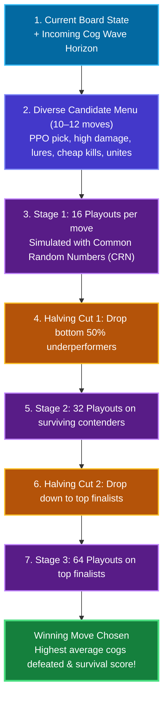
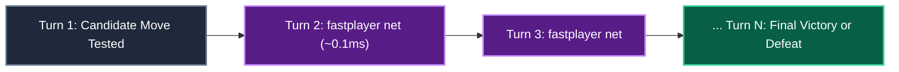
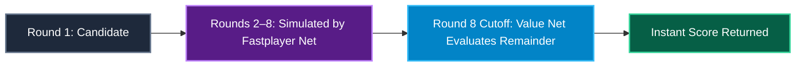
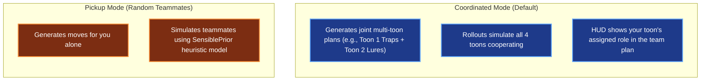

# The Playout Engine

The **Playout Engine** is TTRSolver's primary battle engine. 

Instead of looking just one or two turns ahead, it selects a diverse menu of ~10 candidate moves for the current round, **simulates each move forward to the end of the entire fight hundreds of times** inside the game simulator, and recommends the move whose simulated futures ended best.

Since October 11, 2026, the Playout engine leads by default on the in-game HUD overlay.



> [!NOTE]
> **Simulated Evidence:** All win rates and timings cited here were measured across tens of thousands of simulated battles using `tools/sweep.py`. Where the simulator's model is known to differ from real-world human play, it is explicitly noted below.

---

## Table of Contents

- [Motivation (Why Greedy Heuristics Fail)](#motivation-why-greedy-heuristics-fail)
- [How a Candidate Menu is Built](#how-a-candidate-menu-is-built)
  - [Why One-Round Scorers Can't Filter the Menu](#why-one-round-scorers-cant-filter-the-menu)
- [The Anatomy of One Playout](#the-anatomy-of-one-playout)
  - [The Rollout Network](#the-rollout-network)
  - [Shortened Playouts & The Value Network Cutoff](#shortened-playouts--the-value-network-cutoff)
- [How Playouts are Scored](#how-playouts-are-scored)
  - [The Value Function Breakdown](#the-value-function-breakdown)
  - [The Spend Charge & Gag Economy](#the-spend-charge--gag-economy)
  - [How Strategy Presets Scale Values](#how-strategy-presets-scale-values)
- [Information Realism & The Horizon](#information-realism--the-horizon)
- [Special Consumables (Unites, SOS Cards, Passing)](#special-consumables-unites-sos-cards-passing)
- [Multi-Toon Battles (Coordinated vs. Pickup)](#multi-toon-battles-coordinated-vs-pickup)
- [Live Panel Scheduling (Anytime Search)](#live-panel-scheduling-anytime-search)
- [Benchmark Results](#benchmark-results)
- [Reproducing the Sweeps](#reproducing-the-sweeps)
- [Complete Constants & Configuration Reference](#complete-constants--configuration-reference)

---

## Motivation (Why Greedy Heuristics Fail)

In Toontown, battles look deceptively like simple turn-based RPG fights. But long boss fights—like a **Solo Sellbot VP** (40 high-level cogs back-to-back, fought completely alone on a single backpack of gags)—are grueling resource-conservation puzzles.

### The Short-Horizon Problem
If an AI only evaluates 1 or 2 turns ahead, it will happily recommend throwing a Level 7 **Wedding Cake** or **TNT** right on Round 1. It destroys a Level 12 cog with 100% certainty, so a short-sighted scorer gives it high marks. But ten turns later, when two Level 12 Cogs walk onto the field together, you are completely out of power gags and go sad.

### The Playout Approach
Instead of guessing gag value with static formulas, Playout asks:  
> *"If we throw this Birthday Cake right now, what happens to our win rate across 100 full simulated boss fights compared to throwing a Safe or using Lure?"*

By running Monte Carlo simulations all the way to the final cog, Playout naturally discovers:
- When to hoard Level 6 and 7 gags for dangerous Skelecog waves.
- When passing or letting a Lure sit is better than wasting precious pies.
- When sacrificing a small amount of laff early preserves gags needed to win the war.

---

## How a Candidate Menu is Built

Playout doesn't waste time simulating all 50+ possible gags in your backpack. It constructs a smart **diverse menu of up to 12 candidate moves** (`wide_candidates`):

```mermaid
flowchart LR
    classDef sourceNode fill:#1e293b,stroke:#64748b,stroke-width:2px,color:#ffffff
    classDef filterNode fill:#b45309,stroke:#fbbf24,stroke-width:2px,color:#ffffff
    classDef menuNode fill:#065f46,stroke:#34d399,stroke-width:2px,color:#ffffff

    subgraph Sources["Menu Candidate Sources"]
        PPO["1. PPO Policy First Choice"]
        UniteVar["2. Unite Variants (With / Without Heal or Restock)"]
        ScorerTop["3. One-Round Scorer Top 2 Plans"]
        PolicyTop["4. Neural Policy Top 2 Ranked Moves"]
        Diversity["5. Best Plan of Every Kind<br/>(Throw, Squirt, Sound, Drop, Lure, Trap, SOS, Slip)"]
        PassM["6. Tactical Pass (If board is safe)"]
    end

    Sources --> Dedupe["Filter Duplicates & Illegal Moves"]
    Dedupe --> Menu["Final Menu: 10–12 Diverse Contenders"]

    class PPO,UniteVar,ScorerTop,PolicyTop,Diversity,PassM sourceNode
    class Dedupe filterNode
    class Menu menuNode
```



1. **`climb`'s pick:** The PPO neural net's favorite move.
2. **Unite variants:** If the top move uses a Resistance Unite, the menu adds the same move *without* the unite so the unite must statistically justify its use.
3. **Scorer & Policy favorites:** Top 2 moves according to the one-round heuristic and policy net.
4. **Best of every kind:** Ensures representation across every track—a sound combo, a lure setup, a drop attempt, a cheap pie, an SOS card, and a pink slip.
5. **Legality check:** Every move is verified against your actual inventory (`playable`).

### Why One-Round Scorers Can't Filter the Menu
In an early prototype, the engine only simulated the 1-round scorer's top 3 moves. Benchmark testing on 797 solo VP positions revealed why this was a mistake:

| Decision Maker | Average Cogs Defeated Gain |
|---|---|
| `climb`'s pick (1-round scorer top pick) | $+0.37$ cogs |
| Best of 1-round scorer's top 4 | $+0.70$ cogs |
| **Best of 4 RANDOM menu moves** | **$+0.92$ cogs** |
| Best of all 9 menu moves | **$+1.36$ cogs** |

> [!IMPORTANT]
> **Diversity beats heuristic greed:** Picking 4 random diverse moves beat the 1-round scorer's top 4! In $49\%$ of positions, the truly optimal long-term move was initially ranked outside the top 4 by the short-sighted scorer. Testing a wide, diverse menu doubled solo VP win rates from **19% to 39.5%** ($p < 0.001$).

---

## The Anatomy of One Playout

A single simulation step (`rollout`) executes as follows:

1. **Clone the Environment:** Clones `BattleState` into an isolated `rl.env.BattleEnv`.
2. **Draw Unseen Reserve Cogs:** Uses Common Random Numbers to draw cogs from the known boss wave band.
3. **Apply Opening Move:** Applies the candidate gag (and optional unite).
4. **Fast Rollout to the End:** A lightning-fast neural rollout policy plays subsequent turns until the battle ends or reaches a depth cutoff.
5. **Score the Trajectory:** Evaluates the finished fight in units of cogs defeated, health preserved, and gags saved.

---

### The Rollout Network

Simulating 40 rounds of combat can be slow if an AI deliberates heavily on every turn. In the original engine, $91\%$ of calculation time was spent deciding subsequent rounds!

To fix this, TTRSolver uses **`fastplayer`**: a compact feed-forward neural policy that chooses subsequent moves in a single forward pass ($\sim 0.1\text{ms}$).



#### Benchmark Comparison
| Rollout Player | Halving Stages | Solo VP Wins (out of 200) | Calculation Time |
|---|---|---|---|
| `climb` (Heavy Heuristic) | 2 / 4 / 8 | 71 wins | 3.37s |
| `fastplayer` (Neural Net) | 2 / 4 / 8 | 63 wins | **0.78s** |
| `fastplayer` (Neural Net) | **8 / 16 / 32** | **111 wins** | **3.06s** |

At equal time budgets, the fast network afforded **4× more simulations**, improving win rates by $+2.83$ cogs per fight!

Through **expert iteration** (where Playout generated move labels and retrained `fastplayer`), the network became even stronger, lifting solo VP win rates from $44\%$ to **$65\%$**.

---

### Shortened Playouts & The Value Network Cutoff

Simulating all 400 possible combat rounds to the bitter end is wasteful when a fight is clearly already won or lost.

Since October 2026, solo playouts use a **depth cutoff of 8 rounds** (`ROLLOUT_DEPTH = 8`). After round 8, a trained value network (`valuenet`) estimates the outcome of the remaining fight:

$$\text{Rollout Return} = \text{Cogs Defeated in First 8 Rounds} + \text{Value Net Estimate of Remainder} - \text{Spend Charges}$$



Cutting simulations at 8 rounds reduced computation time by **$28\%$ per decision**, allowing the engine to double its halving stages to $(16, 32, 64)$ for greater precision.

---

## How Playouts are Scored

### The Value Function Breakdown

At the end of a simulation, the fight is converted into a score measured in **units of cogs**:

$$\text{Value} = \text{Cogs Defeated} + w_{\text{laff}} \cdot \left(\frac{\text{Laff Remaining}}{\text{Max Laff}}\right) + w_{\text{pouch}} \cdot \text{Pouch Ratio} - \text{Turn Charge}$$

| Term | Weight | Plain-English Purpose |
|---|---|---|
| **Cogs Defeated** | $1.0$ per cog | The primary objective: destroying cogs is worth more than anything else. |
| **Laff Tiebreak** | $w_{\text{laff}} = 0.5$ | If two moves defeat the exact same number of cogs, the move that left you with more health wins. *(Max value is $0.5$, so saving health never supersedes killing a cog!)* |
| **Round Tiebreak** | $-0.001$ per round | Penalizes wasting turns when a battle is already won. |
| **Building Pouch Term** | $w_{\text{pouch}} = 2.0$ | Used in cog buildings. Rewards conserving valuable gags for future floors. |

---

### The Spend Charge & Gag Economy

To ensure the engine doesn't burn a high-level gag when a low-level gag suffices, `spend_charge` is deducted from every playout:

1. **Wasted Reach Charge:** Penalizes using group gags or SOS cards when only one cog can be hit (e.g., throwing group Drop on a board with 3 lured cogs and 1 awake cog).
2. **Gag Economy (`ECONOMY_WEIGHT = 2.0`):** Subtracts a small fee based on the preset price of every gag thrown. This prevents a Level 6 Storm Cloud from tying with a cheaper Level 5 Safe on a weak Level 5 cog.
3. **SOS Call Price ($0.0$):** Sourced from experimental data showing that artificially taxing SOS cards delayed their use and hurt win rates.

---

### How Strategy Presets Scale Values

The user-selected HUD presets modify the Playout weights relative to `Balanced`:

| Strategy Preset | Behavioral Shift in Playout Simulations |
|---|---|
| **Balanced** *(Default)* | The gold-standard baseline tuned by thousands of simulations. |
| **Conserve** | Multiplies gag economy and pouch charges so Level 6 and 7 gags are hoarded. |
| **Survive** | Multiplies laff weight by $3\times$; happily burns gags to prevent toon damage. |
| **Speedrun** | Adds heavy per-round penalties to incentivize finishing fights in fewer turns. |
| **Glass Cannon** | Sets laff weight to $0.25\times$ and gag economy to $0$; purely optimizes win/loss rate. |

---

## Information Realism & The Horizon

The Playout engine strictly adheres to fair-play rules: **it only knows what a human player knows**.

```
[ Current Board (4 Cogs) ] ──> Playout sees exact HP and levels
[ Incoming Reserve Waves ] ──> Playout knows only the published level band (e.g., VP = Lv 8–12)
[ Future Building Floors ] ──> Playout has zero visibility (relies on pouch conservation term)
```

In a boss fight, `solver/live/boss.py` generates a `Horizon` based on the published fight structure (e.g., a Sellbot VP has 20 normal cogs followed by 20 skelecogs). In every simulation, unseen cogs are redrawn randomly from that level band using the rollout's seed.

---

## Special Consumables (Unites, SOS Cards, Passing)

### Resistance Unites
A Resistance Unite is used before throwing a gag and does not consume a round.
- In early solver builds, Unites were not simulated. Once enabled, **solo VP win rates jumped from 57% to 94%**!
- Playout tests candidates both *with* and *without* the unite to verify that the heal or restock is statistically necessary.

### SOS Cards
SOS cards share a unified budget pool (`ToonState.sos_calls`). Setting a budget allows Playout to strategically drop an SOS card during life-or-death turns.

### The Tactical Pass
Passing (`Action(track=None)`) is legal when cogs are lured.
- To prevent AI pass-spamming, passing is restricted to boards where no productive offensive move exists (e.g., holding only Trap and Lure when all cogs are already lured).
- In multi-toon parties, passing remains available so one toon can conserve gags while teammates attack.

---

## Multi-Toon Battles (Coordinated vs. Pickup)

When multiple toons are in battle, Playout runs in one of two modes:



### Multi-Toon Findings
On Toontown Rewritten, the game client does not publish teammates' remaining gag pouches. An extensive 300-building experiment tested whether guessing teammates' backpacks helped:
- **Guessing stand-in teammates:** Won 110–111 buildings.
- **Treating teammates as a simple count:** Won **120 buildings**!
- **Conclusion:** A bad guess is worse than no guess. TTRSolver treats TTR teammates as a headcount and focuses on executing optimal individual play.

---

## Live Panel Scheduling (Anytime Search)

In live gameplay, you only have a few seconds to choose a gag before the timer expires. Playout operates as an **anytime progressive algorithm**:

```
0.0s ───> PPO Policy displays instant move on HUD
1.0s ───> Playout finishes Chunk 1 (2 rollouts per move) Displays first Playout pick!
1.8s ───> Playout finishes Chunk 2 (4 rollouts) Refines candidate
2.5s ───> Playout reaches 16 rollouts Halving drops bottom 50%
3.5s ───> Final Playout winner locked in!
```

- **Distributed Process Pool:** Simulations are divided across 4 child worker processes, preventing any overlay lag.
- **Anti-Flicker Threshold:** The displayed move only changes if a challenger leads by more than 1 standard error, preventing the UI from rapidly flipping between close moves.

---

## Benchmark Results

### Win Rate Progression
| Milestone | Regime | Win Rate Improvement |
|---|---|---|
| **PPO Policy Alone** | Solo VP | 7.2% |
| **Top 3 Moves Simulated (8x)** | Solo VP | 21.2% |
| **Wide Diverse 12-Move Menu** | Solo VP | 39.5% |
| **Neural Rollout Network (fastplayer)** | Solo VP | 55.5% |
| **Unites Enabled (5 held)** | Solo VP | **94.0%** |
| **Expert Iteration Retraining** | Solo VP | +21 wins ($p < 0.001$) |

### Methods That Did Not Improve Win Rate
- **Fitting a static formula to playout labels:** Dropped win rates from 7% down to 0.4%. Static formulas cannot predict the ripple effects of future rounds.
- **Deep Monte Carlo Tree Search (MCTS):** Lost to flat playouts at equal time budgets because Toontown combat is too wide and non-deterministic for multi-decision trees.
- **Taxing SOS card calls:** Forcing the engine to pay a fee per SOS card delayed critical heals and reduced win rates.

---

## Reproducing the Sweeps

You can reproduce any measurement cited in this paper using the automated benchmarking harness:

```bash
# Compare PPO climb against Playout on 200 Solo VPs:
python tools/sweep.py --regime solo-vp --n 200 --arms climb playout

# Test the effect of the pouch conservation term in buildings:
python tools/sweep.py --regime my-building --arms playout playout:pouch=0

# Test halving stages:
python tools/sweep.py --regime solo-vp --arms playout:stages=16/32/64 playout
```

---

## Complete Constants & Configuration Reference

| Parameter | Shipped Value | Purpose |
|---|---|---|
| `WIDE_CAP` | `12` | Maximum candidate moves on the initial menu. |
| `HALVING` | `(16, 32, 64)` | Successive halving rollout thresholds. |
| `HALVING_KEEP_AT_LEAST` | `2` | Minimum candidates retained in the final stage. |
| `ROLLOUT_PLAYER` | `"net"` | Uses `fastplayer` neural net for lightning-fast simulation. |
| `ROLLOUT_DEPTH` | `8` | Cutoff depth for shortened playouts. |
| `LAFF_WEIGHT` | `0.5` | Tiebreaker bonus for surviving with higher health. |
| `ROUND_TIEBREAK` | `0.001` | Tiebreaker penalty for dragging fights out unnecessarily. |
| `POUCH_WEIGHT` | `2.0` | Gag conservation weight for cog buildings. |
| `ECONOMY_WEIGHT` | `2.0` | Gag cost multiplier penalizing unnecessary high-tier gag usage. |
| `PLAYOUT_WORKERS` | `4` | Number of background worker processes in live panel. |
