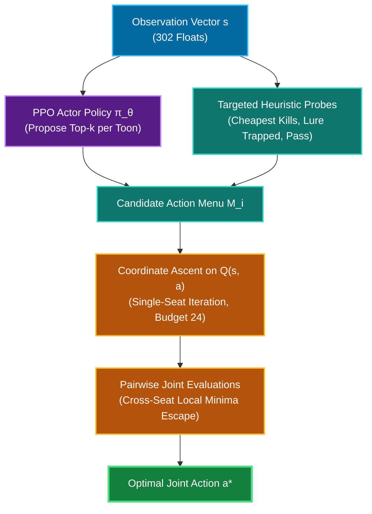

# Mathematical Formulation

Mathematical specification of the solver's reinforcement learning objective, search algorithms, and game MDP.

## 1. Decision Problem

The battle is formulated as an MDP over joint party actions. State $s \in \mathcal{S}$ (`BattleState`) consists of:
- Toon features: Laff, gag pouch inventory, track training levels, organic status.
- Cog features: Level, department, HP, status (lure duration, trap level/damage, Version 2.0 suit).
- Global features: `round_num`, `cogs_remaining`.

The action space $|\mathcal{A}| = 250$ (`env.ACTIONS`) comprises (track, level, target) triples, four pink-slip targets, and pass. Action validity is enforced via masking $m(s) \in \{0,1\}^{250}$:

$$
\pi_\theta(a \mid s) = \operatorname{softmax}\big(z_\theta(s) + \log m(s)\big)_a
$$

Invalid actions receive $-\infty$ logits and zero probability. Unites and SOS cards are excluded from $\mathcal{A}$ to preserve fixed action cardinality and are evaluated as external state transforms (§5).

## 2. Reward Formulation

Per-round reward (`party_search.round_reward`), given team laff lost $\ell$, gags spent $G$, and toons eliminated $k$:

$$
r = -w_\ell \cdot \ell \;-\; \sum_{g \in G} c(g) \;-\; w_k k \;-\; \tau \;+\; W\mathbb{1}[\text{won}] \;-\; L\mathbb{1}[\text{lost}]
$$

where $\tau = \text{turn cost}$ and $W = L = 100$. Gag cost scales with remaining battle horizon:

$$
c(g) = \Big(\text{gag cost} \cdot \text{level}(g) + \frac{\text{scarcity cost}}{\text{carry}(g)}\Big)\big(1 + \eta \cdot \text{cogs remaining}\big)
$$

with $\eta = 0.15$.

## 3. PPO Optimization and Track Marginal Entropy

Trajectories are gathered synchronously across 32 environments (128 steps per update). Advantages use GAE($\lambda$) with $\gamma = 0.99, \lambda = 0.95$:

$$
\delta_t = r_t + \gamma V_\phi(s_{t+1})(1 - d_t) - V_\phi(s_t), \qquad
\hat{A}_t = \sum_{l \ge 0} (\gamma\lambda)^l\,\delta_{t+l}(1 - d_{t+l})
$$

Surrogate loss with probability ratio $\rho_t(\theta) = \exp(\log \pi_\theta(a_t|s_t) - \log \pi_{\theta_{\text{old}}}(a_t|s_t))$:

$$
\mathcal{L}^{\text{PPO}} = -\,\mathbb{E}_t\Big[\min\big(\rho_t \hat{A}_t,\; \operatorname{clip}(\rho_t, 1-\epsilon, 1+\epsilon)\hat{A}_t\big)\Big] + c_v\,\mathbb{E}_t\big[(V_\phi(s_t) - \hat{R}_t)^2\big] - \beta\,\mathbb{E}_t[H(\pi_\theta)] - \beta_{\text{tr}}\,\mathbb{E}_t[H_{\text{track}}(\pi_\theta)]
$$

Hyperparameters: $\epsilon = 0.2$, $c_v = 0.5$, $\beta = 0.01$, gradient norm clip $0.5$.

### Track Marginal Entropy Regularization

Standard entropy over $|\mathcal{A}| = 250$ permits the policy to maximize entropy by spreading probability mass across levels and targets within a single dominant track without exploring alternate tracks (sweeping $\beta \in \{0.01, 0.04, 0.10\}$ yielded static gag entropy $3.79$). To enforce track exploration, an explicit regularizer penalizes low entropy on the marginal track distribution:

$$
p_{\text{track}}(T) = \sum_{a \in T} \pi_\theta(a \mid s), \qquad
H_{\text{track}} = -\sum_T p_{\text{track}}(T) \log p_{\text{track}}(T)
$$

## 4. Policy-Guided Coordinate Ascent (The Climb)

$\pi_\theta$ generates candidates; `hybrid.climb` optimizes the joint action $\mathbf{a} = (a_1, \dots, a_n)$ via coordinate ascent against $Q(s, \mathbf{a}) \equiv$ `_quick_score`:

$$
\mathbf{a}^{(k+1)} = \arg\max_{\mathbf{a} \in \mathcal{N}(\mathbf{a}^{(k)})} Q(s, \mathbf{a}), \qquad
\mathcal{N}(\mathbf{a}) = \bigcup_{i} \big\{ \mathbf{a}[a_i \!\to\! a'] : a' \in \mathcal{M}_i \big\}
$$

Candidate menu $\mathcal{M}_i$ combines top-$k$ policy actions with targeted heuristic probes (cheapest kill per cog, cheapest lure on trapped boards, and pass). Coordinate ascent runs to convergence or budget exhaustion (24 evaluations), followed by pairwise joint evaluations.

## 5. Non-Action Consumables

### Unites (0 Turn Cost)
Unites execute concurrently with gags via SpeedChat. State space is evaluated counterfactually:

$$
V^{+}(s) = \max\Big(\;\max_{u \in U(s)} \big[\,Q\big(s \oplus u,\, \text{climb}(s \oplus u)\big) - P_u\,\big],\;\; Q\big(s, \text{climb}(s)\big)\Big)
$$

A unite is dispatched only if the evaluated gain exceeds price $P_u$.

### SOS Cards (1 Turn Cost)
SOS cards substitute for standard gag actions. The opportunity cost of the turn is accounted for in the simulator by omitting gag actions for that seat; $P_{\text{SOS}} = 250$ reflects scarcity only.

## 6. Exact Expectimax Search

Solo battles are evaluated to terminal states without heuristics:

$$
V(s) = \max_{a \in \mathcal{A}(s)} \sum_{o} \Pr[o \mid s, a]\; \big(r(s, a, o) + V(s')\big)
$$

- **Pruning**: star1 bounds chance node expectations via child bounds $[L, U]$:
$$
V_{\text{chance}} \le \sum_{i \in \text{seen}} p_i v_i + U \Big(1 - \sum_{i \in \text{seen}} p_i\Big)
$$
- **Roll Groups**: Accuracy rolls are evaluated per (track, target) pair. Simultaneous attacks of identical track and target share a single random variable.

## 7. Model Approximations

1. **Party Battles**: Evaluated via sampled Monte Carlo rollouts; expected values are estimates not directly comparable with solo exact values.
2. **Single-Round Horizon in $Q$**: $Q$ evaluates one round ahead, with a one-step lookahead exception for armed traps awaiting lure activation.
3. **Laff Delta vs Laff Level**: `_score_leaf` simulates the toon phase where laff deltas are zero; `survival_rounds` provides the only dependence on absolute laff.
