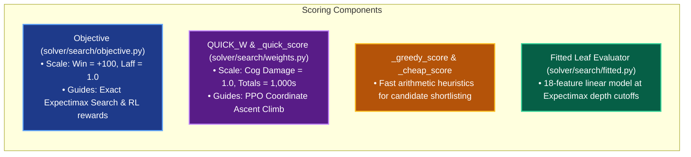
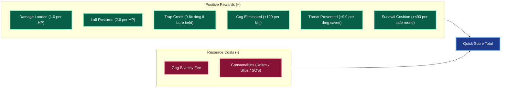

# Battle Scoring: Objectives, One-Round Evaluators & Leaf Weights

An exhaustive inventory of every mathematical formula and weight that determines **what a move is worth** in TTRSolver.

When an AI chooses a move, it must answer questions like:
- *Is saving 15 points of laff worth spending a Level 6 Birthday Cake?*
- *Is finishing off a Level 12 cog now worth taking 20 damage from the other cogs?*
- *When is setting up a Trap better than throwing direct damage?*

Because Toontown doesn't provide a score for individual moves, TTRSolver defines several cooperating evaluation systems. This document details each system, how they price game events, and where their internal scales differ.

> [!NOTE]
> **Who Leads Today:**  
> Since October 2026, the **Playout engine** leads by default on the live overlay. Playout judges moves primarily by full-fight simulation win rates rather than static scores, but it reuses the `Objective` gag prices and presets described below.

---

## Table of Contents

- [The Scoring Systems at a Glance](#the-scoring-systems-at-a-glance)
- [1. Objective (Search Engine)](#1-objective-search-engine)
  - [Gag Pricing Formula](#gag-pricing-formula)
  - [Single-Round Reward Formula](#single-round-reward-formula)
  - [The Five Strategy Presets](#the-five-strategy-presets)
- [2. `_quick_score` (PPO Climb)](#2-_quick_score-ppo-climb)
  - [Expectation Over Accuracy Rolls](#expectation-over-accuracy-rolls)
  - [Quick Score Formula](#quick-score-formula)
  - [Damage Prevented (`prevent = 9.0`)](#damage-prevented-prevent--90)
  - [Survival Rounds (`survive = 400.0`)](#survival-rounds-survive--4000)
  - [Gag Scarcity & Spend Prices](#gag-scarcity--spend-prices)
- [3. `_greedy_score` and `_cheap_score`](#3-_greedy_score-and-_cheap_score)
- [4. Weight Comparison Across Scorers](#4-weight-comparison-across-scorers)
- [5. System Disagreements & Known Divergences](#5-system-disagreements--known-divergences)
- [6. Fitted Leaf Evaluator (Expectimax Cutoffs)](#6-fitted-leaf-evaluator-expectimax-cutoffs)
- [7. Empirical Tuning & Sweep Logs](#7-empirical-tuning--sweep-logs)
- [8. Negative Results](#8-negative-results)

---

## The Scoring Systems at a Glance

| System | Primary Code Location | Read By | Currency & Scale |
|---|---|---|---|
| **`Objective`** | `solver/search/objective.py` | Exact Expectimax search, RL environment, and Playout preset scaling | Win is $+100$, 1 point of laff is $1.0$ |
| **`_quick_score`** | `solver/search/party_search.py` | `hybrid.climb` (judges the PPO row) | 1 point of cog damage is $1.0$; totals run in the hundreds |
| **`_greedy_score`** | `solver/search/party_search.py` | `greedy_plan` rollout policies | 1 point of cog damage is $1.0$ |
| **`_cheap_score`** | `solver/search/weights.py` | Pre-filters moves for `_greedy_score` | Pure arithmetic heuristic |
| **Fitted Leaf** | `solver/search/fitted.py` | `expectimax.heuristic_value` | Same units as `Objective` ($-100$ to $+100$) |

---

## 1. Objective (Search Engine)

The game never tells you how many points of laff a Birthday Cake is worth; `Objective` defines those trade-offs.

| Field | Default (`balanced`) | Meaning |
|---|---|---|
| `gag_cost` | $0.1$ | Base cost per tier level of a gag |
| `scarcity_cost` | $4.0$ | Cost divided by your carry limit (makes rare gags expensive) |
| `horizon_cost` | $0.15$ | Increases gag costs by $15\%$ per incoming reserve cog in boss fights |
| `turn_cost` | $1.0$ | Flat penalty for every round elapsed |
| `laff_weight` | $1.0$ | Multiplier on toon laff lost |
| `sos_cost` | $10.0$ | Charge for calling an SOS helper card |
| `win_bonus` / `loss_penalty` | $+100$ / $-100$ | Awarded / deducted upon battle completion |
| `waste_weight` | $20.0$ | Penalty for overkill damage (scaled by scarcity) |
| `rare_gag_premium` | $6.0$ | Additional penalty for using Level 7 gags |

---

### Gag Pricing Formula

For a gag of Level $\ell$, where your toon can hold at most $c$ copies, with $n$ unseen cogs still waiting in future waves:

$$\text{Price} = \left(\text{gag\_cost} \cdot \ell + \frac{\text{scarcity\_cost}}{c}\right) \cdot \Big(1 + \text{horizon\_cost} \cdot n\Big)$$

- A Level 1 Feather costs very little ($c = 30$).
- A Level 7 Wedding Cake costs significantly more ($c = 1$).
- When $n = 30$ reserve cogs are coming in a boss fight, the price is multiplied by $(1 + 0.15 \times 30) = 5.5\times$ to prevent premature waste!

---

### Single-Round Reward Formula

For exact Expectimax search (`Objective.step_reward`):

$$r = - w_{\text{laff}} \cdot (\text{Laff Lost}) - \text{Gag Price} - \text{Turn Cost} + 100\,[\text{Won}] - 100\,[\text{Lost}]$$

Additionally, `outcomes._accumulate` adds:
- **Wasted Reach Fee:** Hit-all gags (like Sound or group Drop) pay an extra charge proportional to how many cogs they could not affect (e.g., dropping on lured cogs).

---

### The Five Strategy Presets

The overlay HUD allows players to switch presets on the fly:

| Preset | `gag_cost` | `scarcity_cost` | `turn_cost` | `laff_weight` | `waste_weight` | `rare_gag_premium` |
|---|---|---|---|---|---|---|
| **`balanced`** *(Default)* | $0.1$ | $4.0$ | $1.0$ | $1.0$ | $20.0$ | $6.0$ |
| **`speedrun`** | $0.02$ | $0.0$ | $2.0$ | $1.0$ | $0.0$ | $0.0$ |
| **`conserve`** | $0.1$ | $12.0$ | $1.0$ | $1.0$ | $0.0$ | $0.0$ |
| **`survive`** | $0.02$ | $0.0$ | $1.0$ | $3.0$ | $0.0$ | $0.0$ |
| **`glass cannon`** | $0.0$ | $0.0$ | $1.0$ | $0.25$ | $0.0$ | $0.0$ |

#### Resulting Throw Gag Prices Across Presets (Fully Maxed Toon)
| Preset | Level 1 (Cupcake) | Level 4 (Whole Fruit Pie) | Level 6 (Birthday Cake) | Level 7 (Wedding Cake) |
|---|---|---|---|---|
| `balanced` | $0.23$ | $0.67$ | $1.93$ | $4.70$ |
| `speedrun` | $0.02$ | $0.08$ | $0.12$ | $0.14$ |
| `conserve` | $0.50$ | $1.20$ | $4.60$ | **$12.70$** |
| `survive` | $0.02$ | $0.08$ | $0.12$ | $0.14$ |
| `glass cannon` | $0.00$ | $0.00$ | $0.00$ | $0.00$ |

---

## 2. `_quick_score` (PPO Climb)

`_quick_score` evaluates a joint move across all toons by simulating the toons' attack phase. It does not run full cog counter-attacks; instead, incoming cog danger is handled via statistical threat models.

### Expectation Over Accuracy Rolls
Because accuracy is rolled once per track per target, at most 16 distinct hit/miss branches can occur for a 4-toon team. `_expected_over_rolls` enumerates all branches, weights them by their true game accuracy, and computes the mathematical expectation.

---

### Quick Score Formula

$$\begin{aligned}
\text{Quick Score} ={}& \text{Damage Landed} + 2.0 \cdot \text{Laff Restored} + 1.0 \cdot \text{Trap Credit} + 120.0 \cdot \text{Kills} \\
&+ 9.0 \cdot \text{Damage Prevented} + 400.0 \cdot \text{Survival Rounds} - 1.0 \cdot \text{Gag Price} - 1.0 \cdot \text{Spend Price}
\end{aligned}$$

---

### Damage Prevented (`prevent = 9.0`)

`party_search.prevented` calculates how much enemy cog damage our move prevents:
- **Killing a Cog:** Removes $100\%$ of its attack threat permanently.
- **Luring a Cog:** Multiplies the cog's round threat by the number of rounds it will remain asleep.
- **Waking a Lured Cog:** Deducts the sleep rounds that were prematurely canceled (`WAKE_COSTS_PREVENTED = True`).

> [!TIP]
> In empirical benchmarks, setting `prevent = 9.0` captured **$96\%$ of the gap** between random play and perfect Monte Carlo playouts!

---

### Survival Rounds (`survive = 400.0`)

$$\text{Survival Rounds} = \min\left(4,\ \frac{\text{Lowest Toon Laff}}{\text{Expected Incoming Damage}}\right)$$

This is the only term that evaluates toon health as a defensive threshold rather than an increment:
- If a toon is 1 hit away from dying, a Resistance Unite or Toon-Up that pushes them past the death threshold scores a massive $+400$ points!
- Once a toon has enough health to survive 4+ rounds of attacks, the score caps out to prevent unnecessary overhealing.

---

### Gag Scarcity & Spend Prices

- **Gag Scarcity:**  
  $$\text{Units} = \text{Level} + \frac{20}{m} + 40\,[m \le 1] \qquad (m = \text{gags held})$$  
  Holding only 1 copy of a gag triggers a heavy $+40$ last-copy penalty!
- **Pink Slip (Fire):** $\text{Price} = 20n + 120$ ($n$ = cogs remaining).
- **SOS Cards:** Base price of $250$ plus wasted-reach fees.
- **Resistance Unites:** Must improve the plan's score by at least $+200$ points (`UNITE_PRICE`) to be recommended.

---

## 3. `_greedy_score` and `_cheap_score`

Used during offline party search rollouts:
- **`_cheap_score`:** Lightning-fast arithmetic lookup that shortlists the top 2 candidate gags plus track probes.
- **`_greedy_score`:** Slightly heavier 1-round scorer that values kills at $+60$ and prevented damage at $+2.0$.

---

## 4. Weight Comparison Across Scorers

| Concept | `Objective` (Search) | `_quick_score` (PPO) | `_greedy_score` | `_cheap_score` |
|---|---|---|---|---|
| **Destroying a Cog** | Implicit in $+100$ win | **$+120$ per cog** | $+60$ per cog | $+60$ (gag) / $+120$ (slip) |
| **Laff Restored** | Evaluated via surviving laff | $+2.0$ (discounted by incoming) | $+2.0$ | $+2.0$ |
| **Survival Cushion** | Handled by pruning/tree bounds | **$+400 \times \text{survival rounds}$** | None | None |
| **Damage Prevented** | Modeled in search tree branches | **$+9.0 \times \text{threat prevented}$** | $+2.0 \times \text{prevented}$ | $+25$ per lured cog |
| **Gag Expended** | $\text{cost} \cdot \ell + \frac{\text{scarcity}}{c}$ | $\ell + \frac{20}{m} + 40\,[m \le 1]$ | Objective Price $\times 10$ | $\ell + \frac{20}{m} + 40\,[m \le 1]$ |
| **Pink Slip (Fire)** | $4.8$ | $20n + 120$ | $200n$ | $20n$ |
| **SOS Card** | $10.0$ | $250.0$ | $0$ (free) | $0$ (free) |
| **Resistance Unite** | $200.0$ | $200.0$ | N/A | N/A |

---

## 5. System Disagreements & Known Divergences

These intentional differences exist between systems and are preserved for benchmark continuity:

1. **Kill Pricing:** `_quick_score` awards $+120$, `_greedy_score` awards $+60$, and `Objective` treats kills implicitly through win probability.
2. **Prevention Multiplier:** Valued at $9.0$ in `_quick_score` vs. $2.0$ in `_greedy_score`.
3. **Consumable Scales:** An SOS card costs $10.0$ in Expectimax, $250.0$ in `_quick_score`, and $0.0$ in greedy rollouts.
4. **Preset Application:** Search follows presets directly; Playout scales presets relative to `balanced`; PPO evaluates under standard weights.

---

## 6. Fitted Leaf Evaluator (Expectimax Cutoffs)

When Expectimax hits its depth limit (e.g., depth 3), it cannot search further. It calls `expectimax.heuristic_value`, which evaluates an **18-feature linear model**:

$$\text{Leaf Value} = \text{Bias} + \sum_{i=1}^{18} w_i \cdot f_i \qquad [\text{clamped between } -100 - \text{max\_laff} \text{ and } +100]$$

| Feature | Description | Fitted Weight |
|---|---|---|
| `laff_ratio` | Current toon laff / max laff | **$+160.15$** |
| `incoming_ratio` | Worst-case round damage / max laff | **$-206.74$** |
| `laff_after_worst_ratio` | Laff remaining after worst-case round | **$-158.69$** |
| `damage_budget_ratio` | Remaining pouch damage / total cog HP | **$+51.02$** |
| `cannot_finish` | Flagged if pouch damage < remaining cog HP | **$-99.95$** |
| `lured_ratio` | Fraction of cogs currently asleep | **$+14.33$** |
| `cogs_alive` | Count of live cogs | **$-10.77$** |

---

## 7. Empirical Tuning & Sweep Logs

- **Prevent Weight Sweep:** Sweeping `prevent` from $4 \to 30$ showed a peak correlation at **$9.0$** (matching Monte Carlo ground truth in $96\%$ of boards).
- **Survival Cushion Sweep:** At `survive = 400`, solo VP win rates jumped from **$35\%$ to $95\%$** because the AI correctly learned when to pop heals before lethal rounds.
- **Fire Floor Sweep:** Testing `FIRE_FLOOR = 120` stopped the advisor from wasting pink slips on weak street cogs while saving them for final boss rounds.

---

## 8. Negative Results

- **Overkill Penalty in `_quick_score`:** Swept from 0 to 400 and rejected. Penalizing overkill forced the AI to pick gags that left cogs with 2 HP, causing more damage to toons.
- **Risk & Kill Threat Terms:** Looked promising on training sets, but showed $0\%$ improvement across 1,600 held-out validation fights.
- **Two-Round Greedy Judge (`deep=True`):** Ran 3× slower ($1.82\text{ms}$ vs $0.61\text{ms}$) and won fewer buildings ($63.9\%$ vs $66.7\%$).

---

*Related Documentation:*
- [The Playout Engine](playout.md)
- [Exact Search Depth](search-depth.md)
- [Scorer Audit Record](scorer-audit.md)
