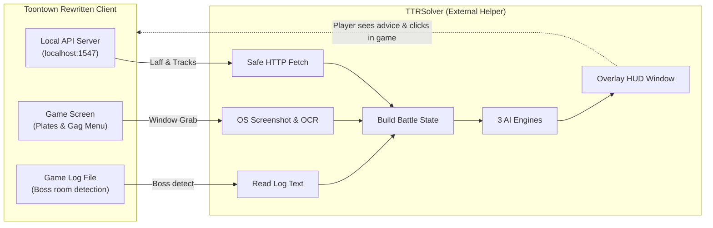
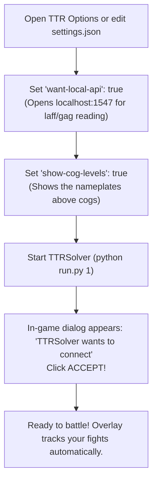
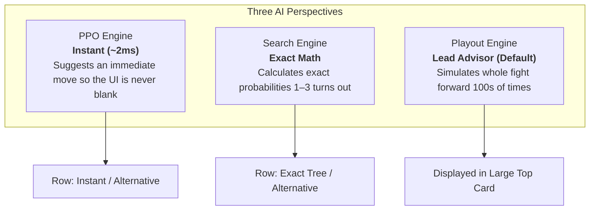
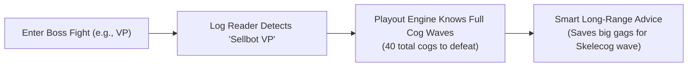
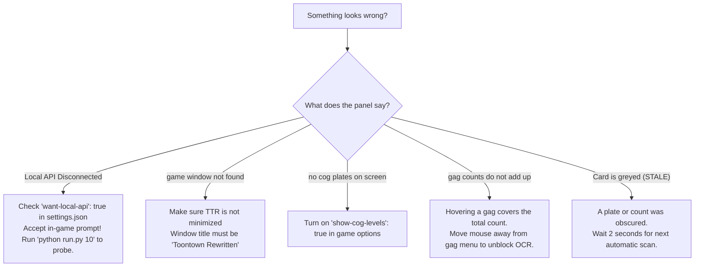

# TTRSolver User Guide

Welcome to TTRSolver! This guide walks you through setting up and using the real-time battle advisor panel during cog fights in **Toontown Rewritten (TTR)** and **Toontown Realms**.

> [!NOTE]
> **Advisory only:** TTRSolver gives advice—you still choose and throw every gag yourself! It never touches game memory, never clicks buttons, and never sends keystrokes.

---

## Table of Contents

- [Quick Terminology](#quick-terminology)
- [How TTRSolver Interacts With Your Game](#how-ttrsolver-interacts-with-your-game)
- [1. Prerequisites & Installation](#1-prerequisites--installation)
- [2. Setting Up Toontown Rewritten](#2-setting-up-toontown-rewritten)
- [3. Starting TTRSolver](#3-starting-ttrsolver)
- [4. Tour of the Live Overlay Panel](#4-tour-of-the-live-overlay-panel)
  - [Panel Anatomy at a Glance](#panel-anatomy-at-a-glance)
  - [Header & Detection Status](#header--detection-status)
  - [The Three Engines (PPO, Search, Playout)](#the-three-engines-ppo-search-playout)
  - [Cog Rows & The Head Library](#cog-rows--the-head-library)
  - [Solver Presets & Party Configuration](#solver-presets--party-configuration)
  - [Boss Fights & Special Items (Unites, Pink Slips)](#boss-fights--special-items-unites-pink-slips)
  - [Manual Overrides & Discord Building Floors](#manual-overrides--discord-building-floors)
- [5. The Toontown Realms Panel](#5-the-toontown-realms-panel)
- [6. Troubleshooting & Common Questions](#6-troubleshooting--common-questions)
- [7. Platform & OS Support](#7-platform--os-support)
- [8. Known Limitations](#8-known-limitations)

---

## Quick Terminology

If you are new or just need a quick refresher on terms:
- **Gag & Track:** Your attacks. Gags belong to 7 tracks (*Toon-Up, Trap, Lure, Sound, Throw, Squirt, Drop*), tiered from Level 1 to 7.
- **Laff:** Your toon's health points. Reach 0 laff and you go "sad" back to the playground.
- **Pouch:** The gags you are currently carrying in your backpack.
- **Lure & Trap:** Lured cogs fall asleep and cannot attack. A Trap is placed under a cog and triggers the moment someone lures it.
- **Organic Gag:** Gags grown in your estate garden. They get $+10\%$ bonus damage (or extra accuracy for Lure).
- **Plate:** The floating nameplate above a cog's head showing its department emblem, level, and health bar.

---

## How TTRSolver Interacts With Your Game

TTRSolver operates completely outside the game client. It never hooks into game memory or sends automated inputs:



| Source | What it reads | How it works |
|---|---|---|
| **TTR Local API** | Laff, unlocked tracks, organic tracks, playground location, invasions, pink slips | An official, opt-in HTTP server the game runs on `localhost:1547`. The game prompts you in-game to grant permission. |
| **Game Window** | Cog levels, departments, health bars, lured status, gag pouch counts | Takes standard OS screenshots of the game window—just like the Windows Snipping Tool. |
| **Client Log** | Boss fight detection (VP, CFO, CJ, CEO) | Reads the game's diagnostic text file on your drive. |
| **Discord RPC** | Building floor numbers (*e.g., Floor 3 of 5*) | Reads the local pipe published by the game to Discord. |

---

## 1. Prerequisites & Installation

### Requirements
- **Python 3.10+** (Python 3.10 or newer is required for modern dataclasses).
- **Windows** (standard platform for window capture and live overlay).

### Core vs. Optional Extras
The core simulator and expectimax search run on the **Python standard library alone**—no `pip` packages required to run unit tests or simulations!

To use the live overlay and AI engines, install what you need:

```bash
# 1. For Screen Reading & AI engines (numpy, pillow, mss)
pip install -r requirements-vision.txt

# 2. For the floating overlay GUI window
pip install pywebview

# 3. (Optional) For Toontown Realms support
pip install -r requirements-realms.txt

# 4. (Optional) For retraining PyTorch networks (pre-trained weights ship in repo!)
pip install -r requirements-training.txt
```

> [!TIP]
> You do **not** need Node.js installed to run TTRSolver. The overlay's React web app is already pre-compiled and bundled inside `overlay_ui/dist/`!

---

## 2. Setting Up Toontown Rewritten

Before launching the overlay, turn on two settings inside Toontown Rewritten:



### The Two Settings
1. **`"want-local-api": true`**  
   Enables TTR's local API. You can toggle this inside the in-game Options menu under Gameplay, or edit `settings.json` in your TTR installation folder. *(If editing by hand, do so with the game closed!)*
2. **`"show-cog-levels": true`**  
   Displays the overhead nameplate above every cog showing its level, department emblem, and health. The screen reader relies on this plate to see the cogs!

### In-Game Consent Prompt
The very first time the panel connects to the game, TTR displays an in-game modal:  
> *"TTRSolver (Toontown battle advisor) is requesting access to your game state."*

Click **Accept**. The panel maintains that connection, so you typically only see this once per gaming session.

---

## 3. Starting TTRSolver

Launch the master launcher by typing:

```bash
python run.py
```

This opens an interactive menu:

```
[1]  TTR overlay (pywebview)        - The main floating HUD beside your game
[2]  TTR overlay (Tk)              - Lightweight fallback GUI for systems without webview
[3]  TTR advice in the terminal    - Prints round advice to your terminal
[4]  Realms panel                  - Real-time panel for Toontown Realms
[5]  Narrated solo fight           - Interactive simulated battle demo (no game needed!)
[6]  Random-policy demo            - Baseline comparison fight
[7]  Browser visualizer            - Explore search trees in your browser (localhost:8000)
[8]  Read one screenshot           - Diagnostic: inspects plates in a screenshot
[9]  Watch the screen              - Diagnostic: streams what the OCR reader sees
[10] Probe TTR Local API           - Diagnostic: prints current raw Local API response
```

### Direct Shortcuts
You can bypass the menu by passing the option number directly:
```bash
# Launch the main TTR live overlay
python run.py 1

# Launch with custom options:
python run.py 1 --objective survive --budget 10 --no-level-7
```

| CLI Option | Description |
|---|---|
| `--objective NAME` | Sets default strategy preset (`balanced`, `conserve`, `glass cannon`, `speedrun`, `survive`). |
| `--budget SECONDS` | Sets calculation think-time budget (default: 15 seconds). |
| `--no-level-7` | Tells the engines to save all Level 7 gags (Wedding, TNT, Opera, etc.). |
| `--feedback PATH` | Appends a round-by-round log of recommended vs. actual played moves to a file. |
| `--ignore-checksum` | Ignores pouch checksum mismatches *(debug only—unsafe for real play)*. |

---

## 4. Tour of the Live Overlay Panel

### Panel Anatomy at a Glance

The overlay window sits alongside your game window, stays on top, and automatically follows battle rounds:

```
┌────────────────────────────────────────────────────────┐
│  STATUS: IN BATTLE          [ PPO ]  [SEARCH] [PLAYOUT]│  <-- Header & Mode
│  Evidence: see 2 cog plates, gag menu     turn: 3      │
├────────────────────────────────────────────────────────┤
│  ┌──────────────────────────────────────────────────┐  │
│  │  BIRTHDAY CAKE (Throw Lv 6)  [95% acc]       │  │  <-- Big Card
│  │  Playout: Kills Lv 11 Glad Hander cleanly        │  │      (Lead move)
│  └──────────────────────────────────────────────────┘  │
│  PPO agrees  |  Search: Storm Cloud (Squirt Lv 6) [Use]│  <-- Alternative rows
├────────────────────────────────────────────────────────┤
│  [Bossbot]  Lv 11  Glad Hander    [LURED]  HP: 104/156 │  <-- Cog Row 1
│  [Lawbot]   Lv 9   Spin Doctor    [AWAKE]  HP: 110/110 │  <-- Cog Row 2
├────────────────────────────────────────────────────────┤
│  Preset: [Balanced ▾]    Toons: [4 ▾]    7s: [ON / OFF]│  <-- Controls
│  Boss: [VP (Detected) ▾]  Slips: [0]     Unites: [0]   │
├────────────────────────────────────────────────────────┤
│  Location: Donald's Dreamland - Lullaby Lane           │  <-- Footer
└────────────────────────────────────────────────────────┘
```

---

### Header & Detection Status

- **Status Badge:**
  - `WAITING FOR BATTLE`: You are roaming the playground or streets.
  - `IN BATTLE`: You are in an active cog battle.
  - `IN BATTLE (CONFIRMED)`: You manually asserted the battle using the *Force Fight State* button.
- **Evidence Line:** Tells you what the computer vision system can see right now:
  - `see: 2 cog plates, gag menu` Battle detected and perfectly readable!
  - `nothing on screen that looks like a battle` Normal outside of combat.
  - `game window not found` Toontown is minimized or behind other windows.

> [!NOTE]
> A battle is only triggered when **both** cog plates **and** the gag menu are visible. This prevents false positives from street scenery that shares the same color palette as cog plates!

---

### The Three Engines (PPO, Search, Playout)

When a round begins, three independent algorithms assess the board simultaneously:



1. **Playout (Leads by default):**  
   The gold standard for multi-round boss fights and cog buildings. It tests moves by playing the battle out to the very end. The large card shows its pick. As it refines, you'll see a label like `refining · 32 playouts`.
2. **Search:**  
   Computes exact expectimax mathematical trees. Shows its recommendation below the card with a **[Use]** button to swap it in.
3. **PPO:**  
   A trained neural net that outputs an answer in 2 milliseconds. It populates the card instantly while the other two engines calculate.

---

### Cog Rows & The Head Library

Each cog in battle gets its own interactive row:

- **Department & Head Portrait:** Matches the icon on the plate.
- **Level & Cog Name:**  
  If the reader is unsure about a cog's level, a **`?` picker** appears. Click it to set the level.  
  If the cog's name says *"Sellbot ?"*, click it to open a searchable menu and name it.
- **The Self-Learning Head Library:**  
  There are 48 combinations of cog levels and departments. When you name an unfamiliar cog, TTRSolver **saves its head portrait to a local library** (`solver/live/_cog_heads/`). From that point onward, it recognizes that cog automatically!
- **LURED / AWAKE Button:**  
  The reader automatically detects whether a cog is lured. If a lure status was missed, click **AWAKE** to toggle it to **LURED**.
  > [!IMPORTANT]
  > Lured status dramatically alters battle advice: lured cogs take $+50\%$ damage, can never be targeted by Drop gags, and cannot attack you.

---

### Solver Presets & Party Configuration

You can tune the advisor's strategy mid-battle using the dropdowns:

| Preset | Strategy & Playstyle |
|---|---|
| **Balanced** *(Default)* | Sensible all-round play. Conserves high-level gags when cheap gags suffice. |
| **Conserve** | Ultra-frugal. Hoards Level 6 and Level 7 gags unless facing imminent defeat. |
| **Survive** | Prioritizes keeping toon laff as high as possible; happily burns gags to prevent cog attacks. |
| **Speedrun** | Spends powerful gags aggressively to finish fights in the fewest possible turns. |
| **Glass Cannon** | Pure win-rate optimizer. Treats 1 laff the same as 100 laff as long as the fight is won. |

- **Toon Party (1 to 4):**  
  Select how many toons are on your battle side. *(On TTR, the game client does not publish teammates' pouch contents, so the advisor uses this count to distribute expected incoming cog damage).*
- **7s ON / 7s OFF:**  
  Toggle whether the advisor is allowed to suggest Level 7 gags (*Wedding Cake, TNT, Geyser, etc.*). Turn it **OFF** if you want to hoard them for the final boss!
- **Think Time:**  
  Sets how many seconds the Search and Playout engines are allowed to deliberate before locking in their advice (default: 15s).

---

### Boss Fights & Special Items (Unites, Pink Slips)



- **Boss Fight Selector:**  
  The **VP** is detected automatically via game logs. For **CFO, CJ, and CEO**, select them from the dropdown manually so Playout knows how many cogs remain in reserve.
- **Pink Slips (Fires):**  
  Works automatically on TTR! The counter syncs with your toon via the Local API and safely decrements when used.
- **Resistance Unites:**  
  Set a budget of unites the panel may suggest. If a unite is recommended, a prominent green banner appears: **`USE UNITE FIRST`**. *(Unites do not consume a turn, so you use the unite and throw your gag in the same round!)*

---

### Manual Overrides & Discord Building Floors

- **Reconsider ("Not this Gag" / "Not this Track"):**  
  Don't want to throw the suggested gag? Click *Reconsider* to reject that gag or the entire track. The engines immediately suggest their runner-up option!
- **Fight is Over:**  
  Clears stale battle state if the battle ended but scenery fooled the reader.
- **Force Fight State:**  
  Forces the advisor into battle mode if it hasn't detected the start of a fight yet.
- **Show Building Floors (Discord Relay):**  
  TTR broadcasts your building floor (*e.g., Floor 3 of 5*) to Discord. The panel can relay this information so you always know your floor progression.

---

## 5. The Toontown Realms Panel

If you play on **Toontown Realms**, launch with:

```bash
python run.py 4
```

Instead of computer vision and screen reading, Realms connects directly to the local server developer stream!

### Differences in Realms Mode
- **100% Exact State:** Cog names, exact HP, lured status, and teammate actions are read directly over the network stream—no OCR needed!
- **Teammates Visible:** Teammates' real toons and gag options are fully visible to the AI engines.
- **Instant Think Time:** Defaults to a snappy 4-second calculation time.
- **Inventory Tracking:** SOS cards, unites, and pink slips are read directly from your inventory.

---

## 6. Troubleshooting & Common Questions

Here is a quick diagnosis guide if the panel doesn't advise as expected:



### Full Issue Reference Table

| Symptom | Cause | Solution |
|---|---|---|
| **"Local API Disconnected"** | Local API is disabled or consent prompt was missed. | Ensure `"want-local-api": true` is set, accept the in-game consent modal, and test with `python run.py 10`. |
| **"game window not found"** | Window is minimized or covered. | Bring Toontown Rewritten to the foreground. |
| **"no cog plates on screen"** | The floating nameplates are turned off. | In game options, enable `"show-cog-levels"`. |
| **"no gag menu on screen"** | Round hasn't started yet. | Wait for the gag selection timer to start; menu slides in at turn start. |
| **"cog N: level unreadable"** | Low resolution blurred the level number. | Click the `?` icon on the cog row and pick its level. |
| **"cog N: unidentified"** | Cog head is not in your local head library yet. | Click the cog name, search for the cog (*e.g., Short Change*), and select it. It will be remembered forever! |
| **"gag counts do not add up"** | Mouse cursor is hovering over a gag icon. | Move your mouse cursor off the gag dock so the OCR can read the total count. |
| **Card is greyed and marked STALE** | Current frame had an unreadable element. | Do not throw a stale move. The panel rescans automatically every 2 seconds. |
| **Cog is Lured but panel thinks AWAKE** | Visual lure indicator was obscured. | Click the **AWAKE** button on that cog's row to toggle it to **LURED**. |

---

## 7. Platform & OS Support

- **Windows (Fully Supported & Tested):** All screen capture, window tracking, and pywebview overlay features were developed and tested on Windows 10/11 using Edge WebView2.
- **macOS / Linux:**
  - Automated game window tracking targets Windows. On Linux/macOS, set `TTR_DIR` and `TTR_LOG_DIR` manually if using live features.
  - The core solver, expectimax search, simulator demos (`python run.py 5`), and the browser visualizer (`python run.py 7`) run seamlessly on any OS with Python!

---

## 8. Known Limitations

- **Teammate Hands on TTR:** TTR's client does not broadcast what gags your teammates hold. The advisor calculates optimal solo lines and assumes teammates act reasonably.
- **Trap State OCR:** Trap status is currently set via manual controls rather than auto-OCR.
- **Boss Fight Sizes:** VP waves are detected automatically. CFO, CJ, and CEO room sizes are selected manually from the dropdown.
- **Head Library Cold Start:** A fresh install starts with an empty head library; expect to name unfamiliar cogs occasionally during your first few battles.

---

*Ready to dive deeper into the mathematics and system architecture? Check out [Architecture Review](architecture-review.md) or the [Playout Engine Guide](playout.md).*
