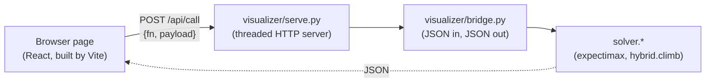

# The visualizer: design and API

How `visualizer/` is built, the API its page calls, and what is still
missing. For how to run and use it, see
[visualizer/README.md](../visualizer/README.md).

This file used to be a plan for rebuilding the visualizer. That rebuild
has been done: the page is now a React app built with Vite, and the solver
runs in the server process instead of in the browser. What follows
describes the result. The last two sections record which items of the
original plan landed and which did not.

## Purpose

The visualizer answers "why that move?" for a position built by hand. It
is a debugging and teaching tool. It does not read a live game.

Its one design constraint: **the page holds no copy of the battle rules.**
An earlier version carried its own JavaScript port of the rules and data,
and it drifted from the solver (it kept a single-target Small Magnet and
lures that never expired long after the solver had corrected both). Every
answer the page shows now comes from the `solver` package.

## Architecture



| Part | Role |
|---|---|
| `visualizer/serve.py` | A standard-library HTTP server bound to `127.0.0.1`. Serves the built page and answers `POST /api/call`. |
| `visualizer/bridge.py` | The only translation layer. Turns JSON into `BattleState` and `Action` objects, calls the solver, and labels the results. It holds serialisation and display names and no game rules. |
| `visualizer/src/` | The page. `App.jsx` holds the tree and the engines' answers; `api.js` wraps the server calls. |
| `visualizer/dist/` | The built page, committed so that running the tool needs no Node.js. |

**The solver runs in the server.** `serve.py` is ordinary CPython in the
repository, so `bridge` imports `solver` directly, numpy is available if
installed, and the exported policy weights under `solver/rl/` are on disk.
A long search occupies one server thread (`ThreadingTCPServer`) while the
page awaits a `fetch`.

An earlier version loaded the Python package into the browser with
Pyodide and ran it in a Web Worker. That kept the no-second-copy property
but could not run the PPO engine: numpy was never loaded in the browser
and the policy weights never reached it. Moving the solver into the
server removed both problems. Two leftovers of that version remain and
the current page uses neither:

- `visualizer/worker.js`, the old Web Worker.
- `GET /api/manifest` in `serve.py`, which lists the Python sources the
  worker used to download. `serve.py` still prints how many files that is
  at start-up.

Some comments in `bridge.py` still describe the Pyodide arrangement.

### Serving

`serve.py` roots a `SimpleHTTPRequestHandler` at the repository and
rewrites a few paths:

| Request | Served from |
|---|---|
| `/`, `/visualizer`, `/visualizer/`, `/visualizer/index.html` | `visualizer/dist/index.html` |
| `/visualizer/<path>` | `visualizer/dist/<path>` if it exists, else `visualizer/<path>` |
| `/assets/<path>` | `visualizer/dist/assets/<path>` if it exists, else `visualizer/assets/<path>` |
| anything else | the repository, by path |

If `visualizer/dist/index.html` is missing, none of this applies and the
server hands out `visualizer/index.html`, the unbuilt Vite entry point,
which a browser cannot run. Build the page first in that case.

Every response carries `Cache-Control: no-store`.

## The API

One endpoint:

```
POST /api/call
{"fn": "api_root", "payload": { ... }}
```

The server calls `bridge.<fn>` and returns its JSON. Only names beginning
`api_` are callable. One endpoint rather than a route per function means a
new bridge function needs no server change.

Errors come back as `{"error": "..."}` with HTTP status 200, because the
useful failures are ordinary ones: a loadout over the pouch limit, a cog
whose attack table has an unconfirmed cell. `api.js` turns an `error` key
into a thrown exception.

| `fn` | Payload | Returns |
|---|---|---|
| `api_catalogue` | none | Everything for the pickers. See below. |
| `api_root` | a scenario config | `{kind, label, state, cogs, cog_icons}` |
| `api_expand_decision` | `{state, depth, objective}` | `{children}`: every legal move with its expected value, best first |
| `api_expand_action` | `{state, action, objective}` | `{children}`: the outcomes of one move, with probabilities |
| `api_cog_forecast` | `{state}` | `{cogs}`: what each living cog may do next |
| `api_best_line` | `{state, depth, objective}` | `{line}`: the search's plan from here |
| `api_climb` | `{state, budget, width}` | the PPO engine's plan, or `{available: false, reason}` |
| `api_generate_scenario` | `{kind, seed}` | a generated position, in the shape `api_root` returns |
| `api_random_toon` | `{seed}` | `{toon}` |

`objective` is a preset name such as `"balanced"`, or an object
`{preset, gag_cost, scarcity_cost, turn_cost, laff_weight}` whose extra
keys override the preset's weights. Omitted, it is the default preset.

### `api_catalogue`

| Key | Contents |
|---|---|
| `departments` | Per department, each cog's `type`, `label`, `levels` and `icon` |
| `gags` | Each gag's `track`, `level`, `name`, `icon`, `max_carry` and `group` (whether it hits every cog, taken from `simulator.is_group_action`) |
| `tracks` | The seven track slugs |
| `emblems` | Department to emblem file name |
| `presets` | Each objective preset with its `name`, `description` and weights. Also sent as `objectives`, the older key. |
| `sos_cards` | Each SOS card's `name`, `kind`, `stars`, `amount`, `track` |
| `unites` | The Toon-Up unite values and the Gag-Up unite kinds |
| `scenarios` | The ids and labels `api_generate_scenario` accepts |
| `limits` | `max_tracks` and `max_pouch`, the same limits `build_state` enforces |

### The scenario config

`api_root` passes its payload to `bridge.build_state`. A config holds
either one toon's fields at the top level or a `toons` list.

| Toon field | Notes |
|---|---|
| `laff`, `max_laff` | Default 50, and `max_laff` defaults to `laff`. |
| `gags` | `{track: {level: count}}` or a list of `[track, level, count]`. |
| `track_exp` | `{track: level}`. Default: 7 in every track the toon carries a gag from. |
| `organic` | A track slug or a list of them. |
| `fires` | Pink slips. |
| `unites_held` | A count, or a list whose length is the count. |
| `sos_cards` | A list of card names (one each) or `{name: count}`. An unknown name is rejected; a card's `kind` is not its name. |
| `pouch_capacity` | Default 80. |

| Cog field | Notes |
|---|---|
| `level` | Required. |
| `type` or `name` | The cog's key or display name. If absent or unmatched, the bridge picks the first cog of the department that can appear at that level. |
| `department` or `dept` | Default `sellbot`. Overridden by the named cog's own department. |
| `hp`, `max_hp` | Default to the level's maximum. |
| `lured`, `lure_rounds`, `lure_level`, `lure_acc` | `lure_rounds` defaults to 2 when lured. |
| `trapped`, `trap_level` | A trapped cog must name its trap's level, 1 to 7. The trap's damage depends on it, so the bridge refuses a trapped cog without one. |
| `suited` | A Version 2.0 cog. |

Top-level `round`, `kind` (default `"street"`) and `street` are passed to
`BattleState`.

`build_state` validates each toon's loadout with `data.validate_loadout`:
at most six gag tracks, at most a full pouch, and no gag above its carry
limit. It returns `{error}` rather than plan for a toon who could not
exist.

### State on the wire

`state` in every payload is `bridge.state_to_dict` output and is passed
back unchanged. It carries `toons` (and `toon`, the first of them, for
older readers), `cogs`, `round`, `kind` and `street`. Tests check that a
state survives the round trip with organic tracks, consumables, a party
and cog status intact.

### `api_climb`

Runs `hybrid.climb`, the engine shown as PPO in the live panel. It needs
numpy and the exported policy. When either is missing it returns
`{available: false, reason}` rather than raising.

It uses a fixed random seed, so the same position always gives the same
answer. `budget` (default 24) is the number of plan evaluations it may
spend and `width` (default 16) is how many of the policy's top
alternatives it offers each toon. The result holds `plan` (one action per toon),
`labels`, `first` (the first toon's move, with its icon) and `unite` (a
Resistance Unite to use first, or `null`).

### Tree expansion

The tree is lazy, one layer per call. `api_expand_decision` returns the
moves from a position, scored by `expectimax.rank_actions` and each
carrying `gap`, its lead over the next best. `api_expand_action` returns
the outcomes of one move from `outcomes.action_outcomes`, the eight
likeliest individually and the rest merged into one bucket whose
probability is their sum.

`api_cog_forecast` returns per-cog marginals from
`outcomes.cog_phase_summary`: for each cog, `cog`, `level`, `lured`,
`p_acts`, `expected_damage` and a list of `attacks` with `attack`,
`prob`, `hit_prob`, `damage` and `group`. It is per cog because the joint
over all cogs is combinatorial and a truncated joint would misrepresent
the round.

`api_best_line` follows the search's own recommendation and then the
single most likely outcome, repeatedly, until the battle ends. The number
of steps is capped by the number of gags the toon carries. Each step
takes the modal outcome, so the whole line is much less likely than any
one step in it.

## The page

Built with Vite 8, React 19, Tailwind 4 and daisyUI 5, the same stack as
the overlay panel. `visualizer/src/index.css` is a copy of the overlay's
theme and track colours, not a shared file.

What the page does with the API:

| Page element | Call | Notes |
|---|---|---|
| Start-up | `api_catalogue`, `api_root`, `api_expand_decision` | Only `presets` is read from the catalogue. |
| Banner: PPO move | `api_climb` | The "Think" slider is sent as `budget`. It is an evaluation count, not seconds. |
| Banner: Search move, inspector's best line | `api_best_line` | Uses the Depth selector. No time limit is applied. |
| Tree nodes | `api_expand_decision`, `api_expand_action` | Always requested at depth 1. |
| Inspector forecast | `api_cog_forecast` | |
| Scenario presets | `api_generate_scenario` | |
| Randomize Toon | `api_random_toon` | |

The Playout engine is not exposed through the bridge and the page does not
show it.

## Tests

| File | Covers |
|---|---|
| `tests/test_bridge.py` | Round trips, tree expansion against the solver's own numbers, the forecast, icon naming, the best line, loadout validation, the catalogue |
| `tests/test_visualizer_bridge.py` | Consumables and cog status surviving a round trip, SOS card names, unnamed cogs, `api_climb`, the `/api/call` endpoint |
| `tests/test_visualizer_e2e.py` | That `dist/` exists with its assets, path translation in `serve.py`, and a full scenario through the bridge |

No test drives the page in a browser.

## What the rebuild plan asked for, and where it stands

| Planned | Status |
|---|---|
| Move the solver out of the browser | Done. |
| Expose the PPO engine (`api_climb`) | Done. |
| Rebuild the page on the overlay's stack, with `dist/` committed | Done. |
| A party of up to four toons | Partly. The builder and `build_state` accept them. The tree and best line are the solo search for the first toon. |
| Cog status in the builder: lured with rounds, trapped with trap level, Version 2.0 | Done. |
| Consumables in the builder | Partly. Pink slips can be set. Unites and SOS cards are carried by the bridge but have no editing control. |
| The two engines side by side | Done for the first move. The tree marks each engine's first move only. |
| Comparing objectives | Not done. One preset at a time. |
| Sharing components with `overlay_ui/` | Not done. The two apps hold separate copies. |

## Known gaps in the page

Each of these is a mismatch between the page and the bridge, found by
reading the source. The bridge's output is correct in each case.

- **Forecast fields.** `Inspector.jsx` reads `name`, `target`,
  `threat_mean`, `threat_max` and `kills_toon` on each forecast entry and
  `name` on each attack. The bridge sends `cog`, `expected_damage` and
  `attack` and has no target or kill field. The card therefore shows a
  placeholder name, a constant target and zero totals.
- **Cog names in the inspector.** It reads `name` on each cog; the state
  carries `type`. Cogs are listed as "Cog 1", "Cog 2".
- **Consumable counts.** The inspector and the builder take the length of
  `unites_held` and `sos_cards`. In a state from the bridge the first is a
  number and the second an object, so the counts come out empty, and a
  toon loaded from a preset loses its unites.
- **Node ids.** `api_root` returns no `id`, so the root's is undefined.
  The Fit button and the focus-on-load step look a node up by id and so do
  nothing for the root. `fitToScreen` in `TreeCanvas.jsx` is never called.
- **Duplicated tables.** `ScenarioBuilder.jsx` hardcodes per-gag carry
  limits and the cog hit-point formula instead of reading `max_carry` and
  `limits` from the catalogue. The six-track limit is not checked in the
  grid; the server rejects it on apply.
- **Scenario list.** The builder hardcodes five preset buttons; the
  catalogue lists six (`street` is the one without a button).

## Rules for changing it

**Never write a game rule in JavaScript.** Anything the page needs to know
about damage, accuracy, lure or trap goes through `bridge`. The duplicated
tables above are the exception to remove, not a precedent.

**Keep `bridge.py` free of rules too.** It translates and labels. If it
needs a number, it asks `solver.mechanics`, `solver.outcomes` or
`solver.search`.

**A trap needs a level.** The in-game marker is the same for every trap,
but the damage is not. Any trap control must ask which trap.

**Searches take seconds.** Show that a call is running and never block the
page on one.

**Commit `dist/` after a build.** `serve.py` serves the built page, and
`tests/test_visualizer_e2e.py` expects it.
