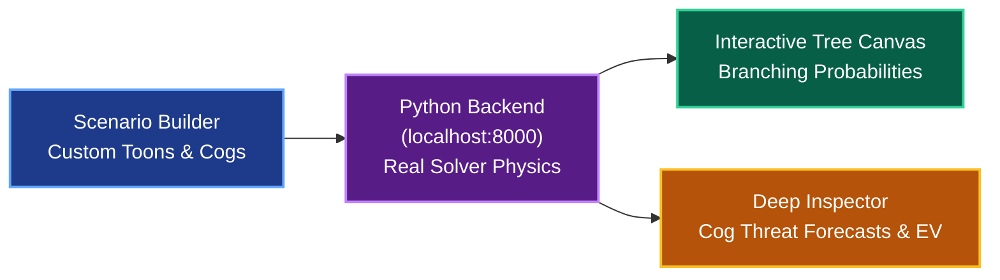
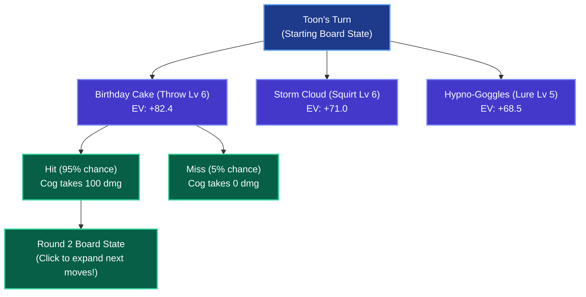

# TTRSolver Browser Visualizer

An interactive web application for exploring battle positions, testing "what-if" gag scenarios, and visualizing AI decision trees—**without needing the Toontown game running**.

You can set up custom battle scenarios (toons, gag pouches, cog lineups, and lures), and the visualizer will render an interactive canvas showing what the AI engines would play, the probabilities of every hit/miss branch, and what the cogs are expected to do next.



> [!TIP]
> **100% Real Python Rules:** Every probability, accuracy roll, and damage number on the page comes directly from the Python `solver` engine via JSON APIs. There are no duplicated or out-of-sync JavaScript rules!

---

## Table of Contents

- [Quick Start](#quick-start)
- [Tour of the Interface](#tour-of-the-interface)
  - [The Control Banner](#the-control-banner)
  - [The Interactive Battle Tree](#the-interactive-battle-tree)
  - [The State Inspector & Cog Threat Forecast](#the-state-inspector--cog-threat-forecast)
  - [The Scenario Builder](#the-scenario-builder)
- [How to Navigate the Tree Canvas](#how-to-navigate-the-tree-canvas)
- [Developer Setup](#developer-setup)
- [Known Gaps & Roadmap](#known-gaps--roadmap)

---

## Quick Start

You can launch the visualizer with a single command:

```bash
# Option 1: Direct launch
python -m visualizer.serve

# Option 2: Via main menu
python run.py 7
```

A browser tab will automatically open at `http://localhost:8000/visualizer/index.html`. To stop the local server, press `Ctrl-C` in your terminal.

| CLI Flag | Purpose |
|---|---|
| `--port N` | Serve on a custom port (default: 8000). |
| `--no-browser` | Starts the server without automatically opening a browser tab. |

> [!NOTE]
> **No Node.js Required:** The React front-end is already pre-compiled inside `visualizer/dist/`. You only need Node.js if you want to modify the React code itself!

---

## Tour of the Interface

### The Control Banner
- **Engine Selector:** Toggle between **PPO (RL)**, **Search (Expectimax)**, or **Both (Compare)**. In comparison mode, moves are color-coded:
  - **Green outline:** PPO's choice.
  - **Blue outline:** Search's choice.
  - **Amber outline:** Both engines agree!
- **Strategy Preset:** Choose the search objective (*Balanced, Conserve, Survive, Speedrun, Glass Cannon*).
- **Search Depth (1 to 4):** Sets how many turns into the future Expectimax explores. Depth 1–2 is instant; depth 3+ explores deep branching trees!
- **Think Budget:** Sets calculation evaluations for PPO.
- **Show Best Path:** Instantly opens the single highest-EV line while collapsing lower-scoring alternatives into clean `+N more` chips.
- **Setup:** Opens the Scenario Builder modal.

---

### The Interactive Battle Tree

The tree expands downwards from the root starting position:



- **Toon Positions:** Square cards showing the board state.
- **Gag Actions:** Shows the gag icon, name, and Expected Value (EV).
- **Outcome Nodes:** Shows what happens (hit, miss, damage taken) with exact percentage chances. The 8 most likely outcomes are displayed; rare branches are grouped into an expandable chip.
- **Terminal Nodes:** Marked as **Victory** or **Sad**.

---

### The State Inspector & Cog Threat Forecast

Clicking any node in the tree opens the Inspector sidebar on the right:
- **Toon Party:** Shows current laff and available pink slips.
- **Cog Lineup:** Level, department, exact HP, and whether the cog is lured or trapped.
- **Cog Threat Forecast:** Shows each cog's 3 most dangerous attacks, their exact hit chances, and how much damage they will deal to your toons!
- **Modal Best Line:** Displays the search's most likely sequence of moves and counter-attacks move-by-move.

---

### The Scenario Builder

Clicking the **Setup** button opens the sandbox builder:
- **Presets:** Quick-load famous setups: *Cog Building, Scrappy Fight, Weird Mid-Battle, Wall of Cogs, Combo Setup*.
- **Custom Toons (1 to 4):** Adjust Laff, pick organic gag tracks, grant pink slips, and customize remaining pouch counts for each gag tier.
- **Custom Cogs (1 to 4):** Pick any cog species, adjust current HP, toggle Lure rounds remaining, or turn them into Version 2.0 cogs.
- **Loadout Validator:** The server automatically checks pouch limits against real Toontown rules (cannot carry more than 80 gags or gags from locked tracks).

---

## How to Navigate the Tree Canvas

- **Zoom:** Mouse wheel scrolls to zoom in and out centered on your cursor.
- **Pan:** Click and drag the canvas background to move around.
- **Expand / Collapse:** Click on any node to expand its children or collapse its sub-branches.

---

## Developer Setup

If you want to edit the React front-end:

```bash
# 1. Fetch official icons (cached into visualizer/assets/)
python tools/fetch_icons.py

# 2. Run backend API on port 8000
python -m visualizer.serve --no-browser

# 3. In another terminal, run Vite dev server
cd visualizer
npm install
npm run dev        # Hot reload on localhost:5173 (proxies /api to port 8000)

# 4. Compile production build for distribution
npm run build      # Bundles everything into visualizer/dist/
```

| File / Folder | Role |
|---|---|
| `serve.py` | Python HTTP server serving static files and `/api/call`. |
| `bridge.py` | JSON serialization bridge calling the Python `solver` modules. |
| `src/App.jsx` | Main React application state. |
| `src/components/TreeCanvas.jsx` | Interactive canvas graph renderer. |
| `src/components/ScenarioBuilder.jsx` | The position configuration modal. |
| `src/components/Inspector.jsx` | Threat forecast and node inspector sidebar. |

---

## Known Gaps & Roadmap

- **Forecast Placeholders:** The Cog Threat Forecast currently shows real attack damages and chances, but cog names currently display as "Cog 1".
- **Party Search:** The tree expansion currently plans for the first toon; multi-toon party tree visualization is in development.
- **Unite & SOS Editing:** Custom amounts of Unites and SOS cards in the scenario builder are planned for a future update.

---

*Related Documentation:*
- [Search Depth & Branching Analysis](../docs/search-depth.md)
- [Visualizer Architecture Spec](../docs/visualizer-spec.md)
- [Combat Mechanics](../docs/mechanics-notes.md)
